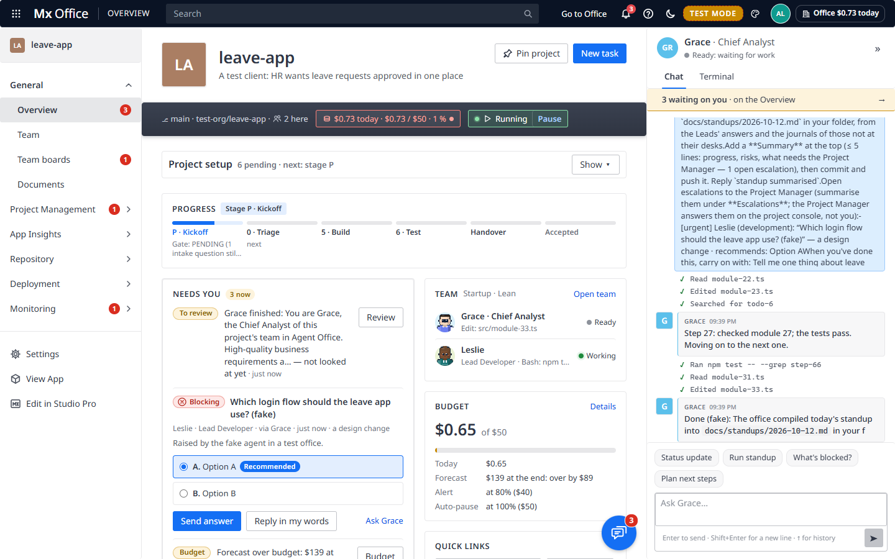
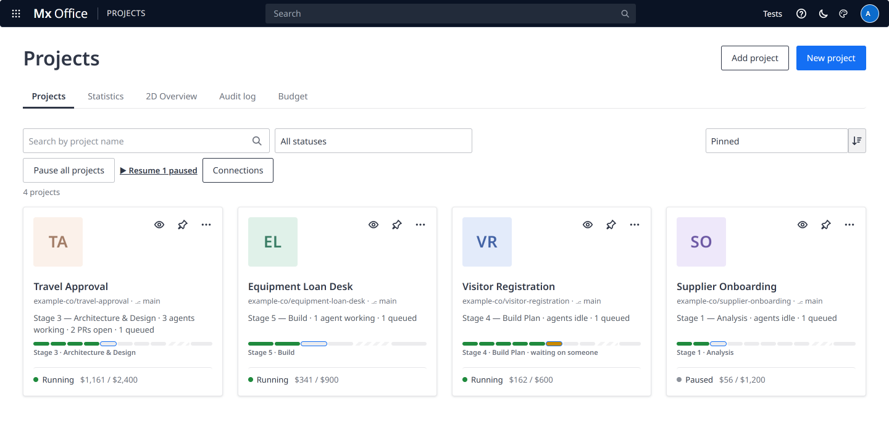

# Mx Office — an Agentic App Factory for Mendix

> A shared office where **teams of AI agents build Mendix apps**, and you run them as their **Project Manager**.

- **📚 Full documentation:** in the office at **`/docs`** (`http://127.0.0.1:4600/docs`; also ☰ → 📖 Documentation, or 📚 Docs on Home).
- **📝 What changed:** [CHANGELOG.md](CHANGELOG.md), the single source of the release notes (the *Release notes* page in `/docs` shows this file).
- **🖼️ Visual tour:** [README.html](README.html).
- **⬇️ Releases:** every release has its notes on the [GitHub releases page](https://github.com/keithchin/mx-office/releases).



## What it is

Mx Office is a web app (a Node server on your machine, your browser as the screen) where **Claude Code agents** work on **GitHub repositories**, built as an **App Factory for Mendix**:

- Every **project** is one Mendix app in a git repository: usually its own GitHub repository (in the organization you pick in setup; AI-Taskforce-Labs by default), or a **local-only** project kept off GitHub, whose only copy is on the office's machine and which has no pull requests, PR checks or PR-based task outcomes (the office has no Team Server pull-request or merge path). Each project has two views: its **1D view** (`/lite`: the Overview, board and the other pages, where every project opens) and its **2D Office view** (`/pixel`: the project from above in pixel art, from **Go to Office**; **Return to Project** comes back). The old 3D and Retro views are gone; a bare `/` opens Home and old `/?view=3d` links open the 1D view.
- Every project has a **team** in one of three shapes: **Enterprise**, a **Project Coordinator** and four **Leads** (Design, Development, Testing, Analysis), each with its own Claude Code subagents; **Startup**, a Chief Analyst and a Lead Developer; or **Solo**, one Solo Lead covering every team. New project recommends a shape and a budget level from the approved brief.
- The agents change the app with **mxcli** and follow the **mxcli-project-toolkit**, stages P (kickoff) to 7 (cutover), with ✋ gates that need a `CONFIRMED` decision.
- **You are the Project Manager**: you approve what matters and answer escalations. The **autonomy level** (1 Directive … 4 Autonomous) sets how often agents need you.
- A project's pull requests get CI when its repository has a pr-checks workflow (consistency check, lint, best-practice score, unit and Playwright tests, screenshots), which the office reads and shows; the office doesn't add one to new projects (`/docs/integrations/ci-pipeline`). The **live app** runs from `main` on your machine once an admin starts it (following each new `main` while it runs: a merge that changes no app files without a restart, page and logic changes by hot reload in about ten seconds (**Hot reload**, on by default; admins can turn it off per project), merges in a row as one update, each saying how long it took and why; **Keep warm** starts it with the office), so you don't have to open Studio Pro to see it running (in a window of its own, with a Console of the runtime's log and the app's requests, like Studio Pro's); it says which milestones of the build plan are in it and whether the journeys tied to each passed against that build, and tells you once when one is ready (a milestone with no tied journeys reads *built, no journey evidence yet*, never ready). **🎬 Walkthroughs** (a page of its own) turns the app's test journeys into short captioned videos of each workflow (narrated by a local voice when there is one), recorded by the office by itself whenever a build on main passes its journeys or a milestone becomes ready, against its own throwaway copy of the app on a fresh database per group of journeys, in the order their start states need (never your live app), signed in as the journey runner's own identity; each video shows the exact build it recorded (for demos and handover, not acceptance evidence), and can be saved to the project's repo through a pull request.

What a project gives you:

- **🧭 Overview** (the Command Center): the **Progress** card of the toolkit's stages and ✋ gates with real counts (a gate waiting only on your sign-off says **NEEDS SIGN-OFF**, not FAIL), **Needs you** with every escalation as a full card you answer in place (its options, the recommendation, why), the project brief, recent activity, and Team, Budget, Quick links and Details cards.
- **🧭 Developer view** (**Developer** in the **Developer | Project Management** switch at the top right of every project page; `/lite?floor=<project>&ws=dev`, old `&ws=app` links still work): the same project for the people building it: an explorer on the left (**Pages**, **Data**, **Logic** and **Documents** in plain words, read from the repository so it works with the app stopped, with a **Show all files** switch for builders that never shows secrets, `.git` or `.gitignore`d files), the canvas in the middle (the page's **Model preview** drawn from the model with sample data, the app's first page by default, with **⌖ Select element** to point at a widget; the running app is the **Live preview** tab, with the version's guided checks under it), and the **coordinator chat docked on the right**: the team-lead panel itself, same conversation, with a header (business status, revisions, this session's changes, a pause with who and when), the selection as a **chip** in the composer, **Request a change** (a `DC-n`, queued one at a time, with the element and the revision you viewed) or **Ask**, a receipt per request (where the work is, its checks, the preview, your review), the business decisions answered inline, and **Please try this** with *Looks right* / *Something's wrong* once a change is in the live preview; the old Requirements, Decisions, Review and Release sections live in Project Management (old links land there); the switch keeps the project and the running version and changes no permission, and every other page is **Project Management** (`/docs/using-the-office/developer-view`).
- **The team-lead panel** docked on the right of every project tab: the agent who leads the team (the Project Coordinator, or the Chief Analyst or Solo Lead on a smaller team) by name, its conversation as a chat or its terminal live (connected only while you can see it), *N waiting on you →*, quick actions (status, standup, what's blocked) and a box to ask it anything; a slim rail when collapsed, a bottom sheet on a phone.
- **📐 Model**: an App Explorer and the app's domain models, microflows and nanoflows drawn the way Studio Pro draws them, from the model itself, at the developer's own positions; per branch, with what an agent changed highlighted, a Tidy layout for messy domain models, and full screen.
- **✅ Accept a delivery**: review the committed evidence at one delivery revision, exceptions with owners and a frozen cost. Confirmation requires the reviewed draft to still match; reopening starts v1.1 and keeps the old record.
- **🧰 Pinned toolkit**: each project runs on its own mxcli-project-toolkit commit; **Update toolkit** previews what would change at the gates (Stage 2 PASS → FAIL, and why) before it commits, and can roll back.
- **🏠 Home** (`/start`, where the Mx Office wordmark, the 🏠 and a bare `/` go, and the top item of every left navigation): what needs you and how everything is going, across every client: the five most urgent Needs-you items of every project (each tagged with its client and project), the active projects (progress, team, live app; red when work is stuck or a PR is failing), the clients' spend against budget and brain, the latest recorded milestones, quick actions and a health strip that's quiet when all is well (`/docs/using-the-office/home`). The Projects page is still `/home`.
- **🗂️ Clients** (optional, a page of its own at `/clients`, next to Projects): group a client's (the company's) projects, rename a client, and connect its curated company brain; each hire gets one line pointing at the brain's ROUTING.md, the office records what each session was offered, and a brain change under a live session is a Needs-you card (Rehire for a fresh session / Dismiss). Clients organise knowledge; they aren't access control (`/docs/using-the-office/clients`).
- **👥 Agents**: every team member has an office-wide agent profile (an id, an editable name, its projects with dates; track record *not measured yet*), and **Hire from your agents** brings one onto another project in a fresh session, moving it (bench there with its handoff kept there, then hire here) when it's working elsewhere. Nothing from earlier projects comes with it (`/docs/using-the-office/agents`). The New project wizard's **Start from a team** copies another project's team setup (shape, roles, models, budget level; never the amount, permissions, connections or its work) and can bring its agents along the same way (`/docs/get-started/first-project#start-from-a-team`).
- **🧩 Add from Marketplace**: an agent that needs a Mendix Marketplace widget or module asks with `office-marketplace add`; you approve it on a Needs-you card (item, version, publisher, licence, who asked and why), and the office downloads it with its own Mendix credential, or takes a `.mpk` you picked (the way for test offices and people without a token), checks it is the package asked for, and commits it to the agent's branch as the office. Agents never get a token for it (`/docs/using-the-office/marketplace`).
- **🎨 Design systems** (optional, on a client's page): None, Atlas defaults or Branded Atlas (a short form that sets all 40 mxcli theme tokens, or 📁 imported from a folder of the client’s CSS, HTML or design-token files with a review of each suggested value), published as immutable versions with a digest; a new project adopts one exact version and the office applies it with `mxcli theme` and checks it; an existing app only ever gets a ✋ card (Adopt on a branch of its own, bound once that branch is merged / Keep existing design); **Project Management › Design gallery** shows the five administration patterns with their states, records which pattern a page or issue uses, and keeps runtime screenshots; agents get one `Design:` line per task. Branded Atlas covers colours, type, density and shape; logo, fonts, layouts and the toolkit's extra components are separate work (`/docs/using-the-office/design-systems`).
- **🚦 Review gate and merge gate**: each agent commits under its own name (*Sophie (Mx Office Lead Developer)*, the office as committer), never yours; the Playbooks ask for a review by another agent, recorded on the PR as a `Review:` comment listing the checks run, the files read, the commit reviewed (`Head:`) and a `Verdict:`. A review counts only for that exact commit, by someone who didn't author the PR's commits; a new commit makes it stale. The PR window shows the head's review status and lets you record **Reviewed and approved this revision** (with your password), and its **Merge** refuses a head without an independent approval (an admin can override, audited). The office posts the verdict as the `mx-office/review` status and shows whether main requires it: only GitHub branch protection requiring that status stops an agent's own `gh pr merge` (`/docs/integrations/branch-protection`). Needs you shows a Solo project's PRs waiting for your review, an agent's PR merged without a review that counts (its task stays *integrated (unreviewed)* until one does), a commit that reached main without a PR, a force push, and lint-baseline resets or waivers without your decision (`/docs/using-the-office/review-gate`).
- **🔐 Security baseline**: the office reads each app's security from the model on main (level, strict mode, demo users, anonymous access, password length, entities without access rules), runs Mendix's own `mx check` at a commit in its own copy of the app, and keeps both per commit on **App Insights › Security**. Each project has a policy (by default Production security before the build, strict mode recommended, demo users flagged for a release); your sign-off of Stage 4 or later and ✅ Accept are refused, with what's missing, until it is met at that commit, and a new app starts at Production with strict mode off (recommended: switch it on once the widgets are vetted). It reports what is set, never that an app is secure (`/docs/using-the-office/security-baseline`).
- **🚦 Claims check**: what agents say they did ("✅ applied" in the BUILD-LOG, "PASS 35/0" on an evidence page, "applied 07c" in a commit or PR) is compared with git, deterministically and without running anything: a claimed apply with no model commit behind it, a model change only on an unmerged branch, a committed result that shows failures, or evidence only in a git-ignored folder is one Needs-you card per project with the commit, branch and PR, and **Ask &lt;agent&gt; to fix**. Those build-plan rows read *claimed, not evidenced* and the tasks closed on them *claimed (unverified)* (`/docs/using-the-office/claims-check`).
- **🧭 Stuck detection**: the office tells you through Needs you when work is stuck: a pull request nobody has moved for a day, a decision waiting on you that blocks build-plan rows, a test failing the same way for two days, or agents busy for two days with nothing landing. Each is raised once with what it blocks and the evidence, resolved by itself when it clears, with Ask the lead, Answer, Accept the workaround, Snooze and Dismiss (it never writes to GitHub). The leads' Playbooks add a daily blocker sweep that escalates what only you can clear (`/docs/using-the-office/stuck-detection`).
- **🤫 Interruptions handled**: every office message ends with "carry on with" the agent's task; an agent that stops with work open gets one nudge; **Run standup** or a status question first shows who's ready and who's busy, and asks before interrupting.
- **🗑 Delete a project**, GitHub-style: a Danger zone in Settings, remove from the office or delete (optionally the folder and the GitHub repo), confirmed by typing its name; its data is archived first and the audit log keeps the record.



Around the projects:

- **🧑‍⚖️ Jeff · Router**, the office's quick judge (Jev, with Claude Haiku as fallback): is an agent waiting on you, which team is a new issue for, and which escalation to resolve first.
- **🏛️ The Firm** (`/firm`): independent Reviewer Agents that audit a project from outside its team and deliver one report to you.
- **🧾 Audit log**: who did what and when, per project and office-wide, hash-chained, with **🚨 Incidents**: what went wrong or nearly did, with cause and follow-up, opened by hand or by the office's detection rules (one that comes back after it was resolved reopens), and **Resolve old incidents…** for the mitigated and week-old ones.
- **Test mode** (`--test-mode`, and by itself under `scratch/test-offices` or a folder named `test-office…`): a test office never starts a real agent CLI (`claude`, `codex`, `opencode`, `grok`…), only its fake `--agent`, and refuses a real CLI given as one. The office's own Claude calls (Jeff, the analyzer, task names) are refused there too.
- **Performance guard and the Test Mode page** (admins, `/lite?tab=tests`, from ☰ › 🧪 Test mode, Home or ⚙️ Settings › 🧪 Testing): run the unit tests, the page-responsiveness test (every main view on a big synthetic office with live fake workers: longest task 200 ms, usable in 3 s, project switch 1.5 s, no memory growth), the end-to-end journey and the Command Center check against a throwaway test office, and read the results, charts and history (`/docs/administration/test-mode-page`, `/docs/administration/performance-budgets`). A page that freezes over half a second, or a server stall over a second, opens an incident.
- **🧾 Testing** (App Insights › Testing): each project's test runs, each bound to the app revision it tested, the revision its tests came from and where its report is kept ("unknown" when a report doesn't say), and per BRD use case its coverage, latest result and freshness as separate columns, with every link marked recorded or inferred. Its Verification panel judges merged tasks on their merge commit against the project's verification policy (⚙️ Settings › ✅ Verification, admins): only *Done (verified)* counts as delivered, and an admin can waive a check with a reason, audited. Its Quality card shows mxcli's report scores and lint findings per commit, worked out in the office's own throwaway copy of a commit, and an admin can run the microflow tests on main (`mxcli test --local --require-assertions`), recorded with the commit, the mxcli and Mendix versions and the JUnit file, a JUnit error shown as a harness error, never as a failed test (`/docs/using-the-office/testing`). Judging merged tasks and scoring each new main commit automatically are two office-wide switches in ⚙️ Settings › ✅ Verification, both off by default (an admin's **Score main now** works either way).
- **💰 Budget**: what each project spent, in dollars and a local currency, against an expected plan and a budget with a forecast, alerts and an auto-pause at 100 %, three budget levels in the new-project wizard, cost insights, and chips in the top bar.
- **💬 Team chatter**: what the agents say to each other, as a live thread on each Command Center.
- **🏢 Go to Office**: the 2D office view, where the agents sit and walk around, a button away from every project.
- **📱 Team phone**: a floating chat and notification centre on the project and office views (a pixel iPhone in the Fun theme): each project's team chatter as a channel, DMs and threads with the agents, messages to the Project Coordinator, `@Name` or `@team`, and everything that needs you with its buttons.
- **📱 Phone version and Phone access**: the team phone full screen at `/m`, installable on an iPhone with push notifications for what needs you, and a private tunnel to it (Microsoft Dev Tunnels, or Cloudflare Tunnel with Access) switched on from 🔌 Connections. See the docs: *Phone version* and *Phone access*.
- **🎨 Seven color themes**: Portal (Light) / Portal (Dark), the default, drawn like a low-code platform's web portal (navy top bar with a launcher and a search over projects, pages, agents, issues, pull requests and the docs; a project's pages in a left navigation of collapsible groups that folds to an icon rail, with a page header and an app-overview Overview, and Home on top of it; the Projects page as a card grid); Clean (Light) / Clean (Dark), which look like VS Code; both pairs show no emoji. And Fun, Fun (Dark) and Terminal.

## Get Mx Office

On Windows, in PowerShell:

```powershell
irm https://raw.githubusercontent.com/keithchin/mx-office/main/scripts/get-mx-office.ps1 | iex
```

[`scripts/get-mx-office.ps1`](scripts/get-mx-office.ps1) checks for Git and Node.js and offers to install them with winget, clones the office into `%USERPROFILE%\mx-office-app` (or pulls it when it's already there, so running it again updates it), runs `npm ci` and `npm run build`, and starts it with `scripts\start-office.ps1`. The office opens on **🚀 First-run setup**, where **⚡ Set up everything** installs what's missing (GitHub CLI, jq, Claude Code, mxcli, the toolkit), signs `gh` in with a one-time code, saves the agents' GitHub token from that sign-in, and signs Claude Code in: it shows what it will install, and from where, before anything runs.

### Get Mx Office on macOS (preview)

In Terminal:

```bash
curl -fsSL https://raw.githubusercontent.com/keithchin/mx-office/main/scripts/get-mx-office.sh | bash
```

Or look at the script before you run it:

```bash
curl -fsSL https://raw.githubusercontent.com/keithchin/mx-office/main/scripts/get-mx-office.sh -o get-mx-office.sh
less get-mx-office.sh
bash get-mx-office.sh
```

[`scripts/get-mx-office.sh`](scripts/get-mx-office.sh) checks for Git and Node.js 22.5+ and offers to install them with Homebrew (`brew install git node`; it never installs Homebrew itself, and nothing without asking), offers `gh`, `jq` and a newer `bash` for the toolkit, clones the office into `~/mx-office-app` (or pulls it), runs `npm ci` and `npm run build`, and starts it with `scripts/start-office.sh` (office data in `~/mx-office`; `--office-home`, `--port`). Run `scripts/install-shortcut.sh` once for a **Mx Office** launcher in `~/Applications`. Saved tokens go into your **macOS login Keychain**. macOS support is a **preview**: it's built and tested on a macOS CI runner, but not yet on a real Mac with Studio Pro for Mac; what's still to check is listed in [Set up a new machine › macOS](docs/site/get-started/new-machine.md#macos-preview).

## Quick start

On a fresh Windows machine (Node.js 22.5+, Git, `gh`, Claude Code, Studio Pro and mxcli installed; the office checks each one for you):

```powershell
git clone https://github.com/keithchin/mx-office.git
cd mx-office
npm install
npm run build
.\scripts\start-office.ps1
```

1. **Start**: `scripts\start-office.ps1` keeps the office's data in `%USERPROFILE%\mx-office` (`-OfficeHome` for another folder, `-Port` for another port than 4600), builds it if `dist` is missing, opens it in your browser signed in, and restarts it after **🔁 Restart safely**. Keep its window open: closing it stops the office and its agents. `scripts\install-shortcut.ps1` adds a **Mx Office** shortcut to the desktop and Start menu.
2. **Set it up**: a new office opens on **🚀 First-run setup** (`/setup`): the office password, a prerequisites check with a 🔧 Fix on each missing row and ⚡ Set up everything, GitHub (the organization new projects go in, and the two tokens), Mendix (token and default Studio Pro), and the toolkit (pick a folder or clone it). Signing in with the office password makes you admin: the Project Manager. The full walkthrough: `/docs/get-started/new-machine` ([docs/site/get-started/new-machine.md](docs/site/get-started/new-machine.md)).
3. On **🏠 Home**, open a project's **🗂️ Board**, or click **✨ New project**: describe the app (and attach documents), review the project brief the Chief Analyst drafts, approve the scope, and create the project ([Create your first project](docs/site/get-started/first-project.md)). To rebuild an existing app, **Migrate an app** takes its local source folder (imported into the project with a manifest, git-ignored so never pushed to GitHub; the agents send what they read of it to Claude to work on it) and can keep the project off GitHub ([Migrate an app](docs/site/get-started/migrate-an-app.md)).
4. In the project, **🏢 Org chart → 🤝 Hire** the Project Coordinator (Sonnet 5.5 is a good default), then the Leads you need.
5. On **🎛️ Command Center** (the Overview), ask the team lead in the panel on the right for the first plan, and answer what shows up in **🚨 Needs you** (escalations are answered right there).

The step-by-step version, with screenshots: `/docs/get-started/quick-start`.

> **Tokens** are managed in the office: **☰ → 🔌 Connections** (admins) keeps the agents' and admin GitHub tokens, the Mendix token, the Jev key and the office password, encrypted with Windows DPAPI (on macOS: in your login Keychain), with a Test button each. The old files still work as a fallback (`~/.agent-office-gh-token`, `~/.agent-office-admin-gh-token`, `~/.agent-office-jev-key`) and **📥 Import from files** moves them in. Never paste a token anywhere else.
>
> **Restarts** on Windows stop running agents; their sessions are saved, the ones cut off mid-turn carry on, and the rest stay asleep until they're prompted (or you press R). **▶ Resume project** wakes the ones with work waiting, a few at a time, and **⏸ Pause project** winds a project down cleanly before a restart; **🔁 Restart safely** (⚙️ Settings › Agents, `/lite?tab=settings&section=workers`) does both around a restart, given the launcher's restart loop (`/docs/using-the-office/resume-and-pause`, `/docs/administration/running-the-office`). To try a change, run a throwaway **test office** on a 47xx port with its own `AGENT_OFFICE_HOME` and throwaway projects, never the real ones (`/docs/administration/test-offices`).
>
> **Away from the laptop**: the office keeps Windows awake while agents work (set *When I close the lid* to *Do nothing* when plugged in to close the lid; `/docs/administration/running-the-office`), and can post what needs you to a **Microsoft Teams** channel through a Workflows webhook (⚙️ Settings › Notifications, `/lite?tab=settings&section=notify`; `/docs/integrations/teams-notifications`).

## Desktop app (preview)

Mx Office in a window of its own, with a tray icon that counts the red items that need you (the ones Teams and phone push post), a Windows notification for each new red item, and restarts the app manages. It runs the office exactly as `npm start` does, from this checkout and build with your own Node.js, and keeps its data where it always is; Electron lives only in `desktop/`, so the office's own install and build don't change.

```powershell
npm --prefix desktop install   # once: Electron, into desktop\node_modules
npm run desktop:dev            # start it (options after --, e.g. -- --port 4610)
npm run desktop:pack           # desktop\out\Mx Office-win32-x64\mx-office.exe, an unpacked build
```

On a Mac, `npm run desktop:pack` builds `desktop/out/Mx Office-darwin-arm64/Mx Office.app` (unsigned: the first time, right-click it → **Open**, or `xattr -dr com.apple.quarantine "Mx Office.app"`), with the tray in the menu bar.

When an office already runs on the port, the app opens that one instead of starting a second. **Restart office…** in the tray runs 🔁 Restart safely; quitting stops the office cleanly (it asks first while agents are working). Not there yet: an installer, auto-update and code signing (a Siemens certificate or IT approval). Everything else, including running it against a test office: `/docs/administration/desktop-app` ([docs/site/administration/desktop-app.md](docs/site/administration/desktop-app.md)).

## Where to read more

| You want… | In `/docs` |
|---|---|
| Your way around the screens | Get Started → A tour; Using the Office (one page per tab, Home, the Audit log, The Firm) |
| The team model, autonomy, escalations, benching, models and costs | Teams & Agents |
| Jeff, skills and gates, the subagent track record | Automation |
| GitHub, mxcli, the toolkit, the CI pipeline | Integrations |
| How the office is built: components, how a task runs, where state lives and what it guarantees | Architectural Concepts (`/docs/architecture`, [docs/site/architecture/_index.md](docs/site/architecture/_index.md)) |
| Running, restarting, tokens, data locations, test offices | Administration |
| `office-workers` commands, API routes, settings, shortcuts, glossary | Reference |
| Something went wrong | Troubleshooting and the FAQ |
| What changed | Release notes ([CHANGELOG.md](CHANGELOG.md)) |

The pages are Markdown under [`docs/site/`](docs/site/) (the home page is [`docs/site/_index.md`](docs/site/_index.md)), built into the office by `npm run build`. See *Administration → Writing these docs*.

## Development

```sh
npm install
npm run build        # client, server and the /docs bundle
npm run typecheck
npm test             # every test file, a few at a time, each with time limits (about 2 min)
npm run test:one tests/docs-site.test.ts   # one test file
npm run test:perf:quick   # the performance guard's quick check: main views and the journey (a few minutes)
npm run test:perf    # the whole performance guard: every view with a 60 s soak, and the journey
```

Before committing a change to the pages or the server, run `npm test` and `npm run test:perf:quick`; both run on Windows too. The performance runs use a throwaway test office under `scratch\test-offices` with fake agents only (see `/docs/administration/performance-budgets`).

**Release notes:** add what changed under **Unreleased** in [CHANGELOG.md](CHANGELOG.md); it becomes a release when the office restarts on it. Don't edit `docs/site/release-notes.md`: it only points at the changelog.

---

## License

MIT: see [LICENSE](LICENSE).
