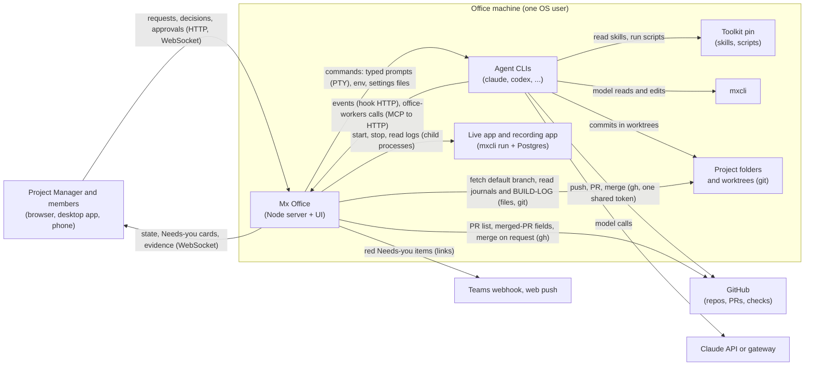

> [!NOTE]
> Describes release 66 (commit `39d0083a`), assessed 2026-10-20.
> **Verification scope:** the statements on these pages were checked by reading the code at that commit and, where noted, by running the office's own tests (about 210 tests across the dispatch, restart, review-gate, readiness, walkthrough, navigation and Needs-you suites, all green). Behaviour that only shows with real agents, real projects or a real Windows desktop session (how often agents follow instructions, how often a milestone reaches Ready, power-loss durability) was **not** verified and is marked where it matters.

This section explains the office for two kinds of reader:

- **Product and R&D**: what each part is responsible for, what it deliberately leaves to others, and the trade-offs behind that.
- **Engineers**: where each mechanism lives. Code references are paths under `src/` (or `desktop/`, `bin/`), so you can go from a sentence to the code. They name files, not line numbers, because line numbers drift.

Current behaviour and proposals are kept apart. Everything proposed is on [Proposed simplifications](proposals.md) and labelled **PROPOSED** wherever else it is mentioned.

## What Mx Office is

Mx Office is a **local orchestrator** for teams of coding-agent CLIs (Claude Code first; adapters exist for Codex, OpenCode, Grok, Cursor, Pi and DeepSeek Harness) that build Mendix apps. One Node process on your machine is the office; your browser (or the optional desktop app, or a phone) is its screen.

It does two different jobs, and it helps to keep them apart:

| Job | What it means | Where it lives in the code |
|---|---|---|
| **Agent management** | Projects, teams and roles, budgets, approvals, decisions and their answers, sign-offs, acceptance, the audit log and incidents: the *records* of who decided what | `src/server/roster/`, `decisions/`, `answers/`, `budget/`, `audit/`, `incidents/`, `acceptance/`, `signoff/`, `profiles/`, `portfolios/` |
| **Orchestration** | Starting agent processes, typing work and answers into them, tracking tasks, watching git and GitHub, running the app, restarting and recovering | `src/server/workers/`, `ptys.ts`, `providers/`, `hooks/`, `roster/deliver.ts`, `dispatch/`, `tasks/`, `queue.ts`, `restart/`, `project-run/`, `liveapp/`, `app-instance/`, `walkthroughs/`, `flow/`, `wizard/` |

## System boundaries

| Party | Owns | Does not own |
|---|---|---|
| **Mx Office** (Node server, browser UI, optional Electron shell) | The project list, team rosters, task identity, decision answers and their hand-off records, Needs-you cards, the budget ledger, the audit log, incidents, the live app and recording app processes, walkthrough records, toolkit pins, agent terminals (PTYs), the hook endpoints agents report to | The model's reasoning; what an agent actually does inside a turn; GitHub branch protection; the content of the Mendix model |
| **Agent runtimes** (`claude`, `codex`, … each in its own terminal) | Their session and transcript files, tool use and their own permission prompts (Claude Code's permission layer), commits in their worktree, `gh` calls (pull requests, merges) | Office records: they reach the office only through hooks and the `office-workers` CLI or MCP tools |
| **mxcli-project-toolkit** (pinned per project) | The stage process P to 7, skills and agent definitions, `gate-check.sh`, `init-project.sh`, `sync-project.sh`, the journey runner, project hooks | Office state. The office *reads* its outputs (gate-check output, the build plan, BUILD-LOG, reports) |
| **mxcli** | Reading and changing the Mendix model, `run --local`, `test`, `lint`, `report`, `theme` | Orchestration |
| **External services** | GitHub (repositories, pull requests, checks, merges, comments), Mendix (token only; there is no Team Server pull-request path), the Claude API or a gateway, Postgres for the local apps, Teams webhooks, web push, Dev Tunnels or Cloudflare | Office state |
| **People** (the Project Manager is the office admin; members) | Decisions, sign-offs, acceptance, merges from the PR window, hands-on work in Studio Pro, settings, credentials | How agents behave at run time |

Three consequences follow from this split:

1. The office **does not run the model**. The agent CLI does, under its own permission layer.
2. The office **does not change the Mendix model**. Agents do that with mxcli. The office runs a handful of mxcli commands of its own (run the app, draw the Model tab, score and test a commit, apply a theme).
3. The office **does not enforce the toolkit's process**. Skills, gates and scripts are instructions and checks the agents run; the office reads their results.

## How the pieces relate

A project is one Mendix app in a git repository (on GitHub, or local-only and kept off GitHub). The office clones it into a **project folder**, gives each agent a **worktree** of its own, and starts the agent CLI in a terminal there. The agent reads its role's **Playbook** and the **toolkit skills** it points to from the project's **toolkit pin**, changes the model with **mxcli**, commits, and opens pull requests with `gh`. The office watches what lands, runs the default branch as the **live app**, and puts what needs a person in **Needs you**.

> [!NOTE]
> The diagrams in this section are [Mermaid](https://mermaid.js.org/) blocks. GitHub draws them when you read these files in the repository; the office's `/docs` page shows their source as a code block (it doesn't draw Mermaid yet).

## The pages

| Page | Read it for |
|---|---|
| [Components and processes](components.md) | Every process, where it runs, how they talk, and where data is kept |
| [Execution lifecycle](execution-lifecycle.md) | One request from intake to acceptance, and what happens on failure, cancellation, restart and unknown outcomes |
| [State and sources of truth](state-and-truth.md) | Which record is authoritative for what, who writes it, and what survives a crash |
| [Trust and authority](trust-and-authority.md) | Credentials, approvals, agent identity, isolation limits, and which controls the office enforces |
| [Reusable skills and knowledge across applications](reusable-skills-and-knowledge.md) | Toolkit skills, company brains, project knowledge, and what the office does and doesn't prove about their use |
| [Design decisions](design-decisions.md) | Why the main mechanisms exist, the failures that led to them, trade-offs and open questions |
| [Proposed simplifications](proposals.md) | **PROPOSED**: navigation, one Inbox, review safeguards, structured agent reports and more |

For the words, see the [Glossary](../reference/glossary.md). For the module map, see `docs/code-layout.md` in the repository.

## Keeping these docs true

These pages describe code, so they go stale when the code moves. When you change one of the areas below, review the pages next to it in the same pull request (the repository rule in `AGENTS.md`: a change that affects how people run or use the office updates its docs).

| When you change… | Review |
|---|---|
| Processes, ports, the desktop supervisor, PTY host, hook server (`desktop/src/`, `src/server/ptys.ts`, `ptyhost.ts`, `hooks/server.ts`, `server.ts`, `cli.ts`) | [Components](components.md), [Desktop app](../administration/desktop-app.md), [Running the office](../administration/running-the-office.md) |
| A store, its location or its write discipline (`durable/`, `flow/critical-write.ts`, `flow/store.ts`, any `*/store.ts`) | [State and sources of truth](state-and-truth.md), [Data locations](../administration/data-locations.md) |
| Delivery, dispatch, answers, tasks, restart (`roster/deliver.ts`, `dispatch/`, `answers/`, `tasks/`, `restart/`, `queue.ts`) | [Execution lifecycle](execution-lifecycle.md), [State and sources of truth](state-and-truth.md), [Escalations](../teams-and-agents/escalations.md), [Interruptions](../teams-and-agents/interruptions.md) |
| Needs-you sources or counts (`shared/needsyou.ts`, `shared/decisions/`, `notify-teams/`, `webpush/`, `mobile/`, desktop tray) | [Needs you](../using-the-office/needs-you.md), [Home](../using-the-office/home.md), [Teams notifications](../integrations/teams-notifications.md), [Desktop app](../administration/desktop-app.md) |
| Sign-in, admin checks, credentials, agent env, isolation (`auth.ts`, `office/`, `http/routes/*` admin lists, `connections/`, `providers/`, `firm/isolation.ts`) | [Trust and authority](trust-and-authority.md), [Security and tokens](../administration/security-and-tokens.md) |
| Review gate, claims check, merge paths (`review-gate/`, `shared/review-gate.ts`, `claims/`, `github.ts`) | [Review gate](../using-the-office/review-gate.md), [Trust and authority](trust-and-authority.md), [Execution lifecycle](execution-lifecycle.md) |
| The security baseline and mx check gate (`security-gate/`, `shared/security.ts`, the sign-off's guard, acceptance) | [Security baseline](../using-the-office/security-baseline.md), [Trust and authority](trust-and-authority.md), [Progress and acceptance](../using-the-office/progress-and-acceptance.md) |
| Live app, readiness, testing, acceptance, business status, walkthroughs (`liveapp/`, `shared/liveapp/`, `testing/`, `acceptance/`, `business-status/`, `shared/business-status.ts`, `walkthroughs/`, `app-instance/`) | [Live app](../using-the-office/live-app.md), [Testing](../using-the-office/testing.md), [Walkthroughs](../using-the-office/walkthroughs.md), [Progress and acceptance](../using-the-office/progress-and-acceptance.md), [State and sources of truth](state-and-truth.md) |
| Toolkit pins, company brains, Playbooks, role skills (`toolkit-pin/`, `portfolios/`, `roster/playbooks.ts`, `shared/roster/skills.ts`, `shared/roster/roles.ts`) | [Reusable skills and knowledge](reusable-skills-and-knowledge.md), [Clients](../using-the-office/clients.md), [Skills and gates](../automation/skills.md), [Toolkit versions](../administration/toolkit-versions.md), [Toolkit](../integrations/toolkit.md) |
| Team shapes, wizard team step, budget levels (`shared/roster/coverage.ts`, `shared/budget/`, `client/ui/wizard/`) | [Team shapes](../teams-and-agents/team-shapes.md), [Create your first project](../get-started/first-project.md) |
| Navigation, tabs, URL parameters (`client/ui/portal/nav-logic.ts`, `client/tabs/`, `shared/settings-sections.ts`) | [Top bar and menu](../using-the-office/top-bar-and-menu.md), [URL parameters](../reference/url-parameters.md), [A tour](../get-started/tour.md) |
| Anything proposed on [Proposed simplifications](proposals.md) gets built | Move it from that page into the current-state pages, and update the header line of every page you touched |

When you re-check a page, update its header line (release, commit, date) and its verification-scope note.
