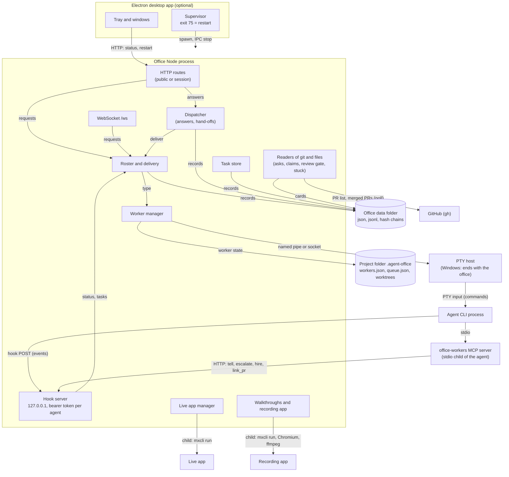

> [!NOTE]
> Describes release 74 (`c4c6a14` on `main`). **Last checked against release 74 on 2026-10-24** for the Git and GitHub section (the merge gate), the app runtime, acceptance, the modules added since release 66 and the mxcli and toolkit lines; the process table, channels and stores were first checked at release 66 (`39d0083a`, 2026-10-20) and not re-read line by line since.
> **Verification scope:** process layout, channels and stores were confirmed by reading the code. Restart, PTY host, store-safety and desktop teardown behaviour is also covered by tests that were run (`safe-restart`, `restart-truth`, `store-safety`, `ptys-host-win`, `desktop-core`, `desktop-teardown`). The desktop quit on a real Windows log-off was not observed, only unit-tested.

## At a glance

## Processes

| Component | Process | Code | Channels |
|---|---|---|---|
| **Desktop app** (preview) | Electron main process. Owns the office as a child, or attaches to one already on the port | `desktop/src/main.ts`, `desktop/src/core/supervisor.ts`, `desktop/src/core/teardown.ts` | Spawns `node … --port N` with an IPC channel; talks HTTP to `127.0.0.1:<port>`. Exit code 75 means restart; more than 5 restarts in 2 minutes is a crash loop; stop sends IPC `stop`, then kills the process tree after 20 s |
| **Launcher** (without the desktop app) | A PowerShell loop | `scripts/start-office.ps1` | Restarts the office on exit code 75 |
| **Office server** | One Node process | `src/server/cli.ts`, `src/server/server.ts` | HTTP(S) on 127.0.0.1 by default, WebSocket `/ws` (same origin plus the session cookie) |
| **Hook server** | A second HTTP server inside the office process | `src/server/hooks/server.ts` | Always **127.0.0.1**. Agents post hook events and `office-workers` calls here with a per-agent bearer token. Started *before* the rest of the office, so agents from the previous office can still report |
| **`office-workers` MCP server** | One stdio child per agent, started by the agent CLI | `bin/office-workers.js`, config from `src/server/office-workers.ts` | Turns MCP tool calls (`list_workers`, `hire_worker`, `send_home`, `tell_worker`, `link_pr`, `escalate`, `subagent`) into HTTP calls to the hook server |
| **Agent processes** | One OS process per agent, in a terminal (PTY), **as the same OS user as the office** | `src/server/workers/manager.ts`, `src/server/ptys.ts`, `src/server/providers/*` | In: text pasted into the terminal. Out: hook HTTP posts (Claude Code gets a settings file with the hooks) and transcripts on disk |
| **PTY host** | Windows: one host process per project, tied to the office; it ends every terminal when the office exits. Unix: detached, outlives the office | `src/server/ptyhost.ts`, `src/server/ptys.ts` | Named pipe or Unix socket |
| **ACP and DSH workers** | A stdio JSON-RPC child, no terminal | `src/server/workers/acp.ts`, `src/server/dsh.ts` | stdio |
| **PreToolUse guards** (Claude agents only) | Short-lived hook processes | `bin/worktree-guard.js` (`src/server/worktree-guard.ts`), `bin/studio-guard.js` (`src/server/studio/`) | Refuse `git worktree add` outside the project's `.agent-office/worktrees`; hold mxcli writes while Studio Pro has the project open |
| **Live app** (one per project) | `mxcli run --local` child plus Postgres | `src/server/liveapp/app.ts`, `checkout.ts` | Ports from a range; a clone of the project folder's default branch under the data folder's `live/<project>/` |
| **Live app Console proxy** | Inside the office process | `src/server/liveapp/console/proxy.ts` | A port of its own, forwarding to the app and stripping office cookies |
| **Recording app** | `mxcli run --local` child on its own database and ports | `src/server/app-instance/` | A warm workspace under `testing/work/<project>/`; a fresh database per run or group of journeys |
| **Walkthrough recorder** | Headless Chromium (Playwright), ffmpeg, optional local voice | `src/server/walkthroughs/recorder.ts`, `media.ts`, `tts.ts` | Locked to the recording app's origin |
| **Keep-awake** | A PowerShell child of the office server | `src/server/keep-awake/` | stdin pipe |
| **Phone access** | `devtunnel` or `cloudflared` children | `src/server/phone-access/` | Forwarded headers are trusted only from loopback |

### What happens on quit and restart

- **🔁 Restart safely** pauses every project, waits until no agent is mid-turn, writes `restart-pending.json` and exits with code 75; the launcher or the desktop supervisor starts the office again (`src/server/restart/`). See [Execution lifecycle](execution-lifecycle.md#office-restart-mid-task).
- The office process exits about **300 ms** after its shutdown starts (`src/server/cli.ts`). Records written with the critical or durable write are on disk by then; background saves get whatever that window allows.
- **On Windows, agent terminals do not survive** a restart or quit: the PTY host ends them (`src/server/ptys.ts`). Interrupted agents are resumed with their saved session id after the office starts. On Unix the terminals survive and are adopted. (Some code comments still say terminals survive a restart; on Windows they don't.)
- **Desktop quit** (release 66, `desktop/src/core/teardown.ts`): once Quit is decided, an ordered teardown runs each step once (polling, saving the app's settings, the Show here view, Live app windows, the tray, stopping the office it started if any, every window), giving each step at most 3 s before going on (so the office is asked to stop, not waited for long); if the process is still there 5 s later it logs what was still open and exits anyway. Page unload prompts are ignored while quitting, a Windows log-off quits without asking, and a second start during quit relaunches instead of handing over to the dying instance.

## Browser UI and client state

The UI is a set of pages built by Vite (`src/client/`):

| Address | Page |
|---|---|
| `/start` | Home |
| `/home` | Projects |
| `/clients`, `/firm` | Clients, The Firm |
| `/lite` | A project's pages (the 1D view): **Project Management**, with the Portal left navigation (`src/client/ui/portal/nav-logic.ts`), and the **Developer view** (`&ws=dev`, reached by the Developer \| Project Management switch at the top right of every project page; see [Developer view](../using-the-office/developer-view.md#addresses)) |
| `/pixel` | The 2D Office view |
| `/docs` | These docs |
| `/m` | The phone version (PWA) |
| `/setup`, `/login`, `/claim`, `/join` | First-run setup and sign-in |

Client state is a store of slices (`src/client/state/slices/`), fed by WebSocket frames from the server and some HTTP polls. The page reconnects and reloads after a restart. Hiding an item in the client is never a permission check; the server checks each route (see [Trust and authority](trust-and-authority.md)).

## Office server and its interfaces

`startServer` (`src/server/server.ts`) builds the office in a fixed order: context, core, **hook server**, services, audit, incidents, Claude sign-in, performance watch, opening the projects, late services, the HTTP handler, the WebSocket, timers, then `listen`.

| Interface | Who calls it | Registry |
|---|---|---|
| HTTP routes | The browser, the desktop tray, the phone, `agent-office` commands | `src/server/http/routes/index.ts`; each route declares `auth: public` or `session`, admin checks are per route |
| WebSocket messages | The browser | `src/server/ws/handlers/index.ts` |
| Hook endpoints (`/hooks/<provider>`, `/office/workers/…`, `/office/queue`, `/office/firm/…`, `/office/studio`) | Agent hooks and the `office-workers` CLI and MCP server | `src/server/hooks/` |
| `office-workers` MCP tools | Agent CLIs | `bin/office-workers.js`; see [MCP tools](../reference/mcp-tools.md) |

`docs/code-layout.md` explains how a feature plugs into these registries.

## Agent processes and provider adapters

Each provider has an adapter in `src/server/providers/` that knows how to start its CLI, where its transcripts are, how to resume a session and how to read usage. Claude Code is the reference: the office writes a hooks settings file for it (hook events posted with `curl`, retried a few times, never blocking the agent), adds the two PreToolUse guards, pre-allows the read-only `office-workers` tools plus `escalate` and `subagent`, and adds `--permission-mode acceptEdits` only for models that Claude Code's auto mode isn't offered for (Haiku). Everything else about tool permissions is Claude Code's own permission layer and the project's settings.

Work and answers go **into** an agent as text pasted into its terminal. Status comes **out** as hook events; anything richer (a hand-off to another agent, an escalation, a linked PR) as an `office-workers` call.

## Project folders and git worktrees

- A **project folder** is a clone of the project's repository. The office keeps its per-project data in `<project>/.agent-office/`: `workers.json` (each agent's session id, hook token, mid-turn flag), `queue.json`, `jail.json` (the 2D view's "sent home" list, **not** isolation), the PTY host's files and `worktrees/`.
- Each agent works in a **worktree** under `<project>/.agent-office/worktrees/`, on a branch `office/<worker>-<id>`, made after a fetch of the base branch (`src/server/worktrees.ts`).
- The repository carries one office file, `agent-office.project.json`: the toolkit pin, `localOnly`, and the design binding (which the office writes but never loads a binding from; see [State and sources of truth](state-and-truth.md)).

See [Workers and worktrees](../concepts/workers-and-worktrees.md).

## Git, GitHub and Team Server

- The office talks to GitHub through `gh`: it polls the pull-request list every 90 s (`src/server/github.ts`), fetches extra fields of recently merged PRs (merger, comments, reviews, commits) for the review gate (`src/server/review-gate/fields.ts`), opens PRs from an agent's desk, infers PRs from an agent's own `gh pr create`, and merges when a person presses Merge in the PR window. **That merge goes through the merge gate** (since release 71, `src/server/merge-gate/`): it refuses a head without an independent approval of that exact commit, unless an admin overrides it (audited). The office also posts the gate's verdict as the `mx-office/review` commit status and reads (never writes) the base branch's protection. The gate stops only the office's own Merge button: an agent's `gh pr merge` or GitHub's UI is stopped only by branch protection that requires the status (see [Review gate](../using-the-office/review-gate.md#the-merge-gate)).
- Agents use `gh` too, with **one shared agents token**, so on GitHub every agent is the same account.
- **Local-only projects** (`src/server/local-only.ts`) never call GitHub; the Playbook tells the Lead to merge locally.
- **Team Server**: there is no pull-request or merge path. The Mendix token reaches agents as environment variables (`src/server/connections/env.ts`) and nothing more.

See [GitHub](../integrations/github.md).

## Persistent stores and operational records

The office's data folder is `<office home>/.agent-office/` (the office home is `AGENT_OFFICE_HOME`, else `~/agent-office`; the launcher script uses `%USERPROFILE%\mx-office`). Stores are JSON or JSON Lines files, some hash-chained. Each store uses one of a few write disciplines, and the guarantee differs:

| Discipline | Code | Guarantee |
|---|---|---|
| Critical write | `src/server/flow/critical-write.ts` | Temporary file, fsync, rename. Survives the office process stopping at any moment. **Power loss is not claimed** |
| Durable write | `src/server/durable/write.ts` | Temporary file, fsync, rename, optional `.bak`. Crash safe |
| fsync'd append | answers, task creation | Crash safe per line |
| Background file | `src/server/offloop/save.ts` | Debounced, off the main loop; best effort |
| `writeJsonAtomic` | `src/server/flow/store.ts` | Atomic replace, **no fsync** |
| Plain append or write | various | No guarantee beyond the operating system's |

Readers (`src/server/durable/read.ts`) treat only a missing file as empty. A locked file blocks writes and raises an incident; a corrupt file is moved aside and the store recovers from its backup.

The full list of stores, with what each holds and its discipline, is on [Data locations](../administration/data-locations.md). What each store is the source of truth for is on [State and sources of truth](state-and-truth.md).

## App runtime

- **Live app** (`src/server/liveapp/`): a clone of the project's default branch, run with `mxcli run --local` on Postgres, in one folder and one database per project, reused by every build. While it runs, a poll (every 60 s) fetches the default branch. What a newer commit does depends on what changed (`src/server/liveapp/classify.ts`, the rule in `src/shared/liveapp/speed.ts`):
  - **No app files changed** (docs, journals, evidence): no restart; the serving build serves on, and the tab names the commit it was built from.
  - **Only pages, microflows, nanoflows or the theme, with hot reload on** (the default since release 73; off when an admin turned it off, when this mxcli has no `--watch`, or when the app started with less than 2.5 GB free): the checkout moves under the running app and mxcli's watch applies it in place (`hot.ts`, `hot-mode.ts`). The served commit moves only once mxcli said it applied the change and the app answers below 400. A hot reload that doesn't confirm falls back to a restart.
  - **Anything else** (domain model, enumerations, security, Java, or hot reload off): a restart. The new commit is fetched first with the old build still serving (a fetch that fails leaves it serving: *update failed, still running …*); then the old build is stopped, because the new one builds in the same folder against the same database, so **from then until the new build answers, nothing serves**, and the state says so. A failed build gets one clean retry, then stays failed; there is **no fallback** to the previous build.

  The office keeps the **served** commit (set only once a build answers, cleared when that runtime stops) apart from the **target** it is building or updating to. It reads *running* after the first HTTP answer below 500; after that there is **no liveness probe**: a crash is noticed when the process exits, a hung app isn't. The served commit is in memory; the last one is also written to `live/<project>.served.json` (`served.ts`), so after an office restart the tab says *Nothing running · last ran abc1234*, and the app stays stopped until someone starts it (or **Keep warm** starts it with the office). There is no backup of the app's database. See [Live app](../using-the-office/live-app.md).
- **Recording app** (`src/server/app-instance/`): the office's own copy of the app at one commit, in a workspace kept warm between batches, on a fresh database per group of journeys. It waits while the live app builds and retries a port or bundle failure once.

## Testing, acceptance and walkthroughs

- **Test-run records** (`src/shared/testing/record.ts`, `src/server/testing/`) each carry the tested revision, the revision the tests came from, and where the evidence is. Sources: PR checks, report files (whose revision is whatever the file says), gate-check, and the office's own `mxcli test`. See [Testing](../using-the-office/testing.md).
- **Verification of merged tasks** on their merge commit runs only when *Judge merged tasks* is on (off by default).
- **Acceptance** (`src/server/acceptance/`) is a human act by an admin, bound to the default branch's head and the deliverables' digest. It is **refused while the project's security baseline isn't met at the delivery commit** (since release 71: the app's security at that commit below the policy, or no clean `mx check` of it; when only the check is missing the office starts one), unless the project's security policy is advisory (`src/server/security-gate/`). It records the testing summary at that commit, but doesn't require passing tests, and it does not consult the live app, readiness or walkthroughs. The Developer view's **Accept this version** uses the same route and checks. See [Progress and acceptance](../using-the-office/progress-and-acceptance.md).
- **Walkthroughs** (`src/server/walkthroughs/`) are captioned videos of journeys recorded on the recording app: presentation, not acceptance evidence. See [Walkthroughs](../using-the-office/walkthroughs.md).

## Toolkit integration and shared knowledge

- A **toolkit pin** is a detached worktree of the shared toolkit clone at `<clone>-pins/<sha12>`, shared by every project on that commit (`src/server/toolkit-pin/pins.ts`). It is recorded in `agent-office.project.json`, the office's `toolkit-pins.json` and `PROJECT.md`. Playbooks point at skills inside the pin.
- The office runs a few toolkit scripts itself (`init-project.sh`, `gate-check.sh`, `sync-project.sh`, `open-questions.sh`, `wire-company-brain.sh`) and parses their output; the rest it only names in prompts.
- mxcli commands the office runs itself: `run --local` (with `--watch` for hot reload), `project-tree` and `describe` (Model tab), `test`, `report`, `lint`, `theme`, `new`, `auth status`, and the MDL that sets a new app's security. **mxcli isn't pinned**, per project or for the office: the office uses whichever mxcli it finds (see [mxcli](../integrations/mxcli.md)), and first-run's Fix downloads mxcli's newest release, not the build the office was tested with.
- A toolkit pin can be reproduced only on a machine whose toolkit clone has that commit: the pin is a commit of the office's own toolkit clone, and the instruction files name its path on this machine (`src/server/toolkit-pin/instructions.ts`).
- A **company brain** is a folder with `README.md` and `ROUTING.md`, connected to a client; each hire gets one line pointing at it, and the office records what each session was offered.

The whole picture is on [Reusable skills and knowledge across applications](reusable-skills-and-knowledge.md).

## Modules added since release 66

Each is a module of its own under `src/server/` (with its rules in `src/shared/`), plugged in through the registries:

| Module | Since | What it does | Its record |
|---|---|---|---|
| `adopt-from/` | 68 | Start a new project from another app of the client (design system version, toolkit pin, role skills, brain) | `<data>/adopt-from/<project>.json` |
| `merge-gate/` | 71 | Reviews bound to the head they reviewed, the Merge button's check, the `mx-office/review` status | `<data>/merge-gate/<project>.jsonl` |
| `security-gate/` | 71 | The security policy, what the office read of the app's security per commit, `mx check` per commit, the refusals at sign-off and acceptance | `<data>/security/<project>.json` |
| `business-status/` | 72 | The one business status, derived (nothing stored) | — |
| `change-requests/` | 72 | **Request a change**: a task for the team lead, with the page and version on screen | `<data>/change-requests/<project>.json` |
| `guided-validation/` | 73 | The Developer view's **Review**: guided checks of the served version and the person's marks | `<data>/guided-validation/<project>.json` |
| `app-explorer/` | 73, 74 | The Developer view's explorer, reading main's newest commit (not the running app) | — (read from git) |
| `dev-changes/` | 74 | Developer changes (`DC-n`): the queue, source revision and candidates | `<data>/dev-changes/<project>.jsonl` ([Revisions and Developer changes](revisions-and-changes.md)) |
