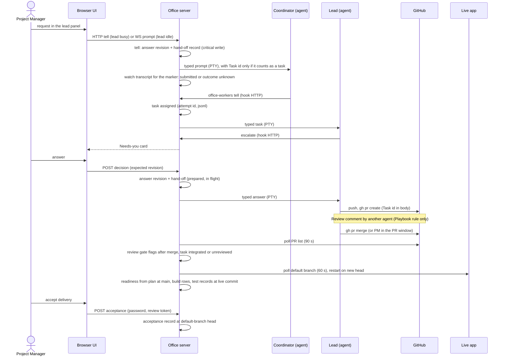

> [!NOTE]
> Describes release 66 (commit `39d0083a`), assessed 2026-10-20.
> **Verification scope:** each step was traced in the code. Durable answers, reconciliation, held answers, task ids, restart and the review gate are covered by tests that were run (`durable-dispatch`, `durable-dispatch-evidence`, `held-answer-truth`, `task-ids`, `task-durability`, `safe-restart`, `restart-truth`, `change-answer-restart`, `review-gate`, `flow`). Statements that something is *absent* (no merge block, no gate check before a merge) rest on code reading and search, not on a test. How agents actually behave in each step depends on the model and its instructions and was not observed.

## The scenario

You, the Project Manager, ask the team lead for a feature: *"Add a Cancel button to the Order form"* in a neutral example app, Acme Logistics. The team is the Enterprise shape: a Project Coordinator and Leads.

## Step by step

| # | Step | What happens | Record written | Crosses the boundary as |
|---|---|---|---|---|
| 1 | **Intake** | You type in the lead panel (`src/client/ui/lead-panel/`). If the lead is mid-turn, the request goes as a *tell* through the dispatcher (`src/server/roster/interrupts.ts` → `src/server/dispatch/service.ts`). If the lead is idle, it goes as a console prompt over the WebSocket (`src/server/ws/handlers/workers.ts`) | Tell: an answer revision and a hand-off record, both on disk before anything is typed. Idle prompt: an audit line | HTTP or WebSocket request |
| 2 | **Clarification** | The lead may ask you back: in chat (the office's router may turn that into a Needs-you card), by `office-workers escalate`, or by an `AWAITING-PM:` line in its journal, which the office reads every few minutes (`src/server/asks/`) | An escalation in the roster | Hook HTTP; files read |
| 3 | **Task identity** | Work gets a task id (`tsk_…`) written to `tasks/<project>.jsonl` and fsync'd **before** the `Task:` line is typed (`src/server/tasks/`, `src/server/roster/task-ids.ts`). Not everything is a task: a plain lead-panel tell isn't, and an idle prompt isn't when it is under 24 characters, a `/command`, or a question under 400 characters (`src/server/roster/resume.ts`) | Task created | — |
| 4 | **Delivery** | `Delivery.send` (`src/server/roster/deliver.ts`) never types into an agent that is showing a prompt or starting, holds office messages until the turn ends, refuses office and agent messages past the spend cap or while the project is paused, wakes sleeping agents, and adds a "carry on with" line. Typing is a paste into the terminal plus Enter. **The idle-lead console prompt bypasses `Delivery.send`** | Held messages in the roster (24 h expiry, idempotency id) | PTY input |
| 5 | **Receipt** | Typed is not received. The office watches the agent's transcript for the marker `[office answer dsp_… rev n]` (`src/server/dispatch/typed-watch.ts`), presses Enter at most once more, and otherwise marks the hand-off **outcome unknown** | Hand-off state: submitted or outcome unknown | Files (transcript read) |
| 6 | **Planning and delegation** | The Coordinator calls `office-workers tell` (CLI or MCP) → hook server (bearer token, at most 5 tells per sender-target pair in 10 minutes, counted in memory) → `Delivery.send` → assigned to the Lead. **Agent-to-agent tells are not durable hand-offs** | Task assigned, with an attempt id (`exe_…`) | Hook HTTP request |
| 7 | **Execution and tool use** | The Lead works in its worktree, commits as `<Name> (Mx Office <role>)` (`src/server/workers/git-identity.ts`), runs mxcli and toolkit scripts. Hook events (tool use, stop) update its status; a stop reads as *done* for the turn, not for the task | Agent status (memory and `workers.json`) | Hook events; git |
| 8 | **Human decisions** | The Lead escalates; you answer on the card. The answer goes through the dispatcher: stale check, answer revision appended (fsync'd), hand-off written *prepared*, then *in flight*, then typed, then settled (`src/server/dispatch/service.ts`). An answer to a **working** agent is typed straight away (Claude Code queues it for its next step); the ready-or-busy question is asked only for standups, quick questions and lead tells (see [Interruptions](../teams-and-agents/interruptions.md)) | Answer revision; hand-off record | HTTP; PTY |
| 9 | **Pull request** | The desk's **Open PR** (body includes `Task: tsk_…`), or the agent's own `gh pr create`, which the office infers from its output (`src/server/workers/pr.ts`) | A GitHub PR | `gh` → GitHub |
| 10 | **Review** | The Playbook asks another Lead to post a `Review:` comment listing checks run and files read, and not to merge within 10 minutes (`src/shared/review-gate.ts`). **This is an instruction, not a control** | A GitHub comment | GitHub |
| 11 | **Integration (merge)** | An agent's `gh pr merge`, a person in the PR window (`src/server/github.ts`), or GitHub's own UI or auto-merge. **The office never merges by itself and never blocks a merge** | A merge commit on GitHub | GitHub |
| 12 | **After-merge judgement** | The review gate (`src/server/review-gate/judge.ts`) flags no review, self-review, too fast, failing or pending checks, or a "(reviewed)" claim, as an info card, and marks the task *integrated (unreviewed)*. A task is *integrated* when a PR carrying its id merged after it was assigned (`src/server/roster/task-outcome.ts`). Verification on the merge commit only when *Judge merged tasks* is on | Task completed; roster task outcome | `gh` poll |
| 13 | **Running app** | The live app's poll fetches the default branch into the project folder and restarts the app on the new head, with a short downtime (`src/server/liveapp/app.ts`) | Live app log; running commit in memory | git (local); child process |
| 14 | **Readiness** | Each build-plan milestone gets a verdict (`src/server/liveapp/readiness.ts`, `src/shared/liveapp/readiness.ts`): plan and journeys read at the default branch's head; build rows evidenced by commit subjects, PR titles and BUILD-LOG; journey results counted when their tested revision matches the **live** commit. A milestone whose rows are all live reads **Ready** when every tied journey passed, **and also when no journeys are tied to it** | `live/<project>.ready.json` (the news once) | — |
| 15 | **Acceptance** | A separate admin act on the Progress page, bound to the default branch's head and the deliverables' digest, with the password asked again; refused (409) if the head moved (`src/server/acceptance/`). It doesn't look at readiness, the running commit, test runs or walkthroughs | `acceptance/<project>.jsonl` | HTTP |

## When things go wrong

Three different answers to "what now?" appear below. Keep them apart:

- **Safe refusal or safe retry**: nothing happened, or doing it again is harmless, so the office refuses or retries.
- **Reconciliation**: the office looks at evidence (a transcript, git, GitHub) to find out what happened.
- **Human confirmation**: the evidence doesn't settle it, so the office asks a person and does **not** guess.

| Situation | What happens | Kind |
|---|---|---|
| The task record can't be written | Nothing is sent; a queued task becomes *failed*, never started | Safe refusal |
| The answer revision can't be appended | Error, nothing typed | Safe refusal |
| Stale answer (the card changed since you opened it) | 409, nothing written | Safe refusal |
| Typed, but no marker in the transcript in time (30 s; up to 30 min when Claude Code shows it queued) | **Outcome unknown**; the escalation stays open; an admin chooses *Send again*, *It went through* or *Abandon* | **Human confirmation** |
| Office restarted with a hand-off *prepared* | Marked *not sent* (or outcome unknown if it may have been typed) (`src/server/dispatch/reconcile.ts`) | Reconciliation |
| Office restarted with a hand-off *in flight* | Transcript evidence → *submitted*, back to watching, or outcome unknown. **Never replayed automatically** | Reconciliation, then human |
| A held message older than 24 h | Expires (`src/server/roster/held.ts`). Whether the hand-off it carried is then settled was not re-checked | Unverified |
| The agent's turn ends on an API error, a cancel or Esc | The queue task reads *stopped before finishing* and can be requeued; a clean end reads *turn ended, not confirmed finished* until the PR merges (`src/server/queue-finish.ts`) | Honest status |
| A setup action on GitHub (create or delete a repository, clone) with an unconfirmed result | Later steps stop; the office looks again (`src/server/wizard/reconcile.ts`); *Cancel and undo* deletes only a create it confirmed | Reconciliation |
| A workflow step was running when the office stopped | The run loads as *interrupted*; carrying on runs the step again, which is safe only because each step checks whether it is already done (`src/server/flow/engine.ts`) | Safe retry (idempotent steps) |
| A queue task was running at restart | *Reconciling after restart*, abandoned after 2 minutes if its agent doesn't come back (`src/server/queue.ts`) | Reconciliation |
| The live app's build fails | One clean retry, then *failed*; no further automatic retry | Human |
| The recording app fails to boot | One retry for a port or bundle failure; otherwise every remaining card is an error | Human (*Re-record*) |
| An automatic walkthrough failed or was interrupted | Counts as done for that commit; **not retried automatically** (`src/server/walkthroughs/index.ts`) | Human |
| A walkthrough batch is cancelled | The current card reads *cancelled*; later journeys get no card | — |

> [!IMPORTANT]
> Nothing in this lifecycle is exactly-once. The office records intent before it acts, reconciles from evidence after a restart, and refuses to replay anything ambiguous. When it can't tell, it says *outcome unknown* and asks you.

## Office restart mid-task

1. **🔁 Restart safely** (`src/server/restart/`) pauses every project, waits until no agent is mid-turn (up to 10 minutes, then *Wait*, *Anyway* or *Cancel*), optionally builds, refuses to start an older build while hand-off records are unsettled, writes `restart-pending.json`, and exits with code 75.
2. On shutdown the worker manager saves scrollback and usage; on Windows it marks mid-turn agents *interrupted* before their terminals end, and saves `workers.json`.
3. **On Windows the agent processes end with the office.** On Unix they survive and are adopted.
4. On start, the office restores its agents. Interrupted ones are resumed with their saved session (`--resume`) and a carry-on prompt listing their open escalations; the rest wait until prompted. If the provider no longer has the session, a fresh conversation starts and the office shows only a toast.
5. Held messages are reloaded from the roster file and delivered at the next turn end. Lost on restart (memory only): the tell-limit counters, the last-message cache, the live app's running commit, the walkthrough queue, and the choice you made in an interrupt prompt.
6. Hand-off reconciliation runs a few seconds after the roster loads.
7. Resuming deletes `restart-pending.json` **first**, so a crash while resuming leaves projects paused: the safe direction.

## See also

- [State and sources of truth](state-and-truth.md): which record wins at each step.
- [Escalations](../teams-and-agents/escalations.md) and [Needs you](../using-the-office/needs-you.md): the decision cards.
- [Review gate](../using-the-office/review-gate.md) and [Trust and authority](trust-and-authority.md): what the review step does and doesn't enforce.
- [Resume and pause](../using-the-office/resume-and-pause.md): restarts from the user's side.
