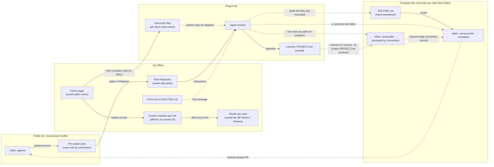
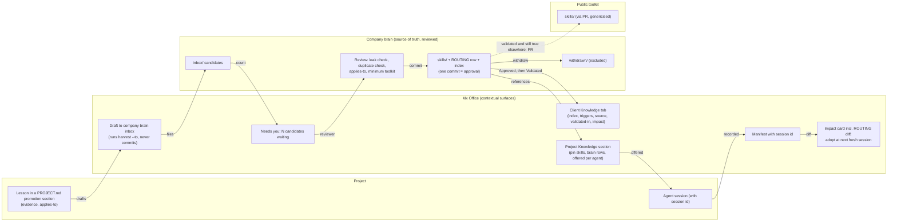

> [!NOTE]
> Describes release 66 (commit `39d0083a`), assessed 2026-10-20, with the toolkit at the office's pinned commit and the public upstream release of 2026-10-19.
> **Verification scope:** the office side (clients, brain wiring, routing, context manifests, change detection, Playbooks, role skills) was read in code. A two-app demonstration on synthetic fixtures exercised the office's own modules and both toolkit versions' scripts (wiring, harvest, promotion, correction, withdrawal, non-isolation). Real agents were **not** run: how often a real session reads ROUTING.md, or applies a skill correctly, was not measured.

## Three scopes

| Scope | What it holds | True for | Owned by | Lives in |
|---|---|---|---|---|
| **Public toolkit** | Reusable, client-free skills and agent definitions | Any client, module and app | The toolkit's maintainers | `skills/` and `agents/` of the mxcli-project-toolkit; a project reads them from its **pin** (`<clone>-pins/<sha12>/`) |
| **Company brain** | Company skills, approved components, examples | One company's apps | That company (one private repository) | A folder with `README.md` and `ROUTING.md`, made by the toolkit's `init-company-brain.sh`; one brain per client in the office |
| **Project** | Decisions, gate answers, lessons, journals, handoffs | One app | The project team | The project repository: `PROJECT.md`, `docs/brain/`, `docs/team/<team>.md`, the project lessons skill file under `.ai-context/skills/` |

## Concepts

| Concept | Definition | Where it lives | Notes |
|---|---|---|---|
| **Public toolkit skill** | A reusable instruction file for one kind of work (title, *Applies to*, purpose, steps, completion criteria), still true with a different client, module and app | `skills/<name>.md` in the toolkit, read from the project's pin | Each role's Playbook lists its toolkit skills (`src/shared/roster/roles.ts`, `src/server/roster/playbooks.ts`) |
| **Company-brain skill** | The same shape, true only for one company's apps. May name the company; never holds personal data. Reached through the brain's `ROUTING.md` | `<brain>/skills/<name>.md` | The office never stores its text, only paths and hashes |
| **Project knowledge** | Facts and decisions true for one app; **lessons** are dated free-form bullets an agent appends (a gotcha, a recipe, a mistake not to repeat) | The project repository | No schema, source, applicability or de-duplication |
| **Role Playbook** | The office-generated instruction file for one role on one project: mission, rights, autonomy, permitted actions and their gates, which toolkit skills to read, journal and lesson rules | `.ai-context/skills/team-<role>/SKILL.md`, mirrored to `.claude/skills/` | Technically a Claude Code skill file; written by the office from its templates |
| **Agent permission and gate** | An action a team member may take (report, propose, escalate, dispatch, manage subagents, nudge a Lead) and its gate: ask, propose, tell or FYI | `src/shared/roster/skills.ts`; the Team tab's **🧰 Skills** window | Enforced by the office only for `office-workers subagent …`; the rest are Playbook instructions. See [Skills and gates](../automation/skills.md) |
| **Reusable component** | An approved Mendix package (widget, module, theme) with a manifest: version, Mendix range, module name, the command that worked, where it was proven | `<brain>/components/` (company-brain convention) | The office has no component catalogue; it sees one only as a routed path |
| **Design system** | A client's versioned look: draft → immutable published version with a digest → approved → default → a project adopts one exact version | The office data folder `design-systems/`, not the brain | The only reusable asset in the office today with versions, approval and exact adoption. See [Design systems](../using-the-office/design-systems.md) |
| **mxcli skill** | Skills mxcli itself ships into each project | `.ai-context/skills/` in the project | Owned and refreshed by mxcli |

> [!NOTE]
> **Terminology.** "Skill" means several things in the office today. In the Team tab's **🧰 Skills** window and on [Skills and gates](../automation/skills.md), a skill is a **permitted action with a gate**, and its *Craft* group lists the toolkit skills the Playbook points to (switching one off only removes the pointer). Elsewhere a skill is **reusable instructions** (toolkit, company or mxcli), and a Playbook is a Claude Code skill file. Renaming the Team tab's skills to *permissions* and moving the Craft list into a *Knowledge* list is a **proposal** only (see [Proposed simplifications](proposals.md#terminology)); the code, the API action `skill` and the audit names would stay.

## How project agents discover skills

1. **Toolkit skills**: the role's Playbook lists them as paths into the project's toolkit pin. The pin block in each instruction file (`CLAUDE.md`, `CLAUDE.local.md`, `AGENTS.md`) names the pinned toolkit (`src/server/toolkit-pin/instructions.ts`).
2. **Company skills**: when a project's client has a brain, **Connect a brain** runs the toolkit's `wire-company-brain.sh`, which writes a short COMPANY-BRAIN block into each instruction file; the office then checks one block per file names a `ROUTING.md` that resolves (`src/server/portfolios/wire.ts`). Each hire's first message also gets one line of at most 300 characters: *"Company brain &lt;name&gt; @&lt;commit&gt;: before answering terminology or convention questions, read …/ROUTING.md. Don't search other company folders."* (`primeLine` in `src/shared/portfolios.ts`).
3. **ROUTING.md** is maintained by hand in the brain. The office parses the backticked paths in its table rows, hashes each routed file, and leaves out `inbox/`, `handoffs/`, `proposals/` and `patches/` by convention (`src/server/portfolios/brain.ts`). The client page lists routed and excluded paths with their sizes, never their text.
4. **Project knowledge**: the Playbook tells agents to read and append to the project's lessons file and journals.

## What the office records, and what it doesn't prove

The office records a **context manifest** at each hire: project, role, agent, time, client, brain path, its commit, whether it had uncommitted changes, and each routed file's path, hash and size (`src/server/portfolios/manifest.ts`, `<data>/context-manifests/<project>.jsonl`). Every five minutes, and at each hire, it compares the routed hashes with each live agent's latest manifest and raises a Needs-you card (*Rehire for a fresh session* / *Dismiss*) when routed files were corrected, withdrawn or added (`src/server/portfolios/service.ts`).

Read these limits literally:

- **A pointer doesn't prove retrieval.** The block and the prime line record nothing about reads. In the office's own probe one session in six read `ROUTING.md` first; in the demonstration an agent found a company skill by searching the folder instead.
- **Retrieval doesn't prove correct application.** The Chat view can show "Read acme-naming.md" from the transcript (basename only), but nothing links a read to what the agent produced. Conforming output is not attribution either: Playbooks may already prescribe the same rule.
- **A context manifest records offered material.** Its own definition says it records what the hire was *offered*, never what it read or obeyed. It is written after the hire, from a brain read cached up to a minute, and today **without a session id**, so it can't be joined to the transcript.
- **A recorded snapshot isn't an immutable execution environment.** The manifest stores the brain's commit and hashes, but agents read the brain's **live working tree** whenever they choose, including uncommitted edits.
- **Withdrawal doesn't erase knowledge from active sessions or undo generated work.** Withdrawing means a file is no longer routed. The card goes to you only; the running agent keeps what it read, the file may still be on disk, and code and documents already written stay as they are. Disconnecting a brain works the same way.
- **Client grouping doesn't enforce filesystem isolation.** Agents on the machine can read any folder by path, including other clients' brains and projects and a brain's unreviewed inbox. *"Don't search other company folders"* is an instruction.
- A change to `ROUTING.md` that keeps the same set of routed files (a reworded trigger, say) raises no card. A routed path that doesn't exist is listed as missing, but isn't a warning unless it was routed before.

## Toolkit pinning vs company-brain snapshots

| | Toolkit pin | Company-brain snapshot |
|---|---|---|
| Granularity | Per project | Per client: one live folder shared by all its projects |
| What agents read | A detached worktree at the pinned commit | The brain's current working tree, committed or not |
| Recorded where | `agent-office.project.json` (committed), the office's `toolkit-pins.json`, `PROJECT.md` | The office's private `context-manifests/`, per hire |
| How it changes | Only by **Update toolkit**, which previews gate changes first and can roll back ([Toolkit versions](../administration/toolkit-versions.md)) | Whenever anyone edits or commits the brain; noticed within five minutes |
| Protection during a stage | Yes: the rules don't change under a stage | No: the change is live for the next read; a card offers Rehire or Dismiss |
| Read-only | By convention and a detached HEAD; the office's edit check sees tracked files only | Writable by design (wiring appends `projects.tsv`; harvest writes the inbox) |
| Rollback | Yes (an earlier commit) | No office rollback; revert in the brain by hand |
| Compatibility | — | No link: a company skill can cite toolkit skills an older pin lacks |

## How a lesson becomes a shared skill today

Mostly **manual or delegated**; the office orchestrates the *down* direction (wire, offer, record, notice change) and has nothing for the *up* direction.

| Step | Status | How |
|---|---|---|
| Agent writes a project lesson | Instruction | Playbook and the bench prompt ask for dated bullets in the lessons file |
| Harvest to the brain's inbox | Delegated (CLI, run by a person) | The toolkit's `harvest-learnings.sh <project> --to <brain>/inbox`. The office runs no harvest. The script scans bug logs and sections of `PROJECT.md` and `CLAUDE.local.md` headed for toolkit promotion, **not** the lessons file the office tells agents to write. Without `--to` it writes into the toolkit it runs from, so always pass `--to`, and run it from the project's own pin |
| Review candidates | Manual | The brain README's weekly checklist; no office surface |
| Promote to a company skill | Manual | Move it into `skills/` with a header recording the decision, and add a ROUTING row the same day; one brain commit |
| Agents pick it up | Native, next fresh session | Running sessions get a card for you; new hires get the new snapshot |
| Validate in a second project | Absent | No record or check |
| Onward to the public toolkit | Manual | A toolkit pull request, genericised, with a pointer stub in the brain's `PROMOTED.md` |

**Versioning, corrections and withdrawals** today: a correction is an edit and a commit in the brain; the office notices changed hashes and lists the projects whose agents predate it. A withdrawal is removing the ROUTING row; the file can stay readable. There is no per-project brain pin, preview or office rollback.

*Current state. Solid lines are what the office or toolkit does; dotted lines are agent behaviour or manual steps.*

## PROPOSED: a promotion lifecycle

> [!IMPORTANT]
> Everything in this part is a **proposal**. None of it is built.

The proposal keeps the toolkit's conventions (harvest into the brain's inbox, weekly triage, promotion as a brain commit with a ROUTING row, `PROMOTED.md` for the onward step) and has the office orchestrate and record, with the brain repository staying the source of truth and the place of review:

*Lesson (project) → Candidate (brain inbox) → In review → Approved company skill (one brain commit) → Available (next fresh session) → Validated (proven in a second project) → optionally Onward to the public toolkit. Corrected or Withdrawn at any point after Approved.*

| Concern | Proposed rule |
|---|---|
| Evidence and applicability | A candidate states its field evidence; the reviewer adds *Applies to*, *Source* and *Approved* (who, when) |
| Duplicates and conflicts | A toolkit-side routing check (rows resolve, triggers unique, nothing routed twice, no shadowed toolkit skill), its result shown by the office |
| Approval | A commit in the brain by its owner; the office records an audit event pointing at that commit, never an office-only state |
| Compatibility | The skill names the minimum toolkit it relies on; projects on older pins see "needs toolkit ≥ X"; no automatic pin move |
| Correction | Edit and commit; the office marks affected projects (as today) and adds the ROUTING diff |
| Withdrawal | Remove the ROUTING row **and** move the file to an excluded folder, so it doesn't linger as searchable guidance |
| Affected sessions | From manifests, once they carry the session id |
| Mid-stage adoption | Default: next fresh session. A correction marked as a defect recommends Rehire. Optional later: a per-project brain pin mirroring toolkit pins |
| Hard limits | Harvest only into an explicit brain inbox; never into a toolkit pin; never commits, routes, publishes or rehires on its own |

Contextual surfaces instead of new navigation: a *Draft to company brain inbox…* action on a project's client settings, a Needs-you item for waiting candidates, a *Knowledge* tab on the client page, and a project *Knowledge* section listing pin skills per role, routed brain rows and what each agent was offered.

*PROPOSED. Not built.*

## See also

- [Clients](../using-the-office/clients.md): connecting a brain, the client page, the change card.
- [Skills and gates](../automation/skills.md): the Team tab's permissions.
- [Playbooks and journals](../teams-and-agents/playbooks-and-journals.md)
- [Toolkit](../integrations/toolkit.md) and [Toolkit versions](../administration/toolkit-versions.md): pins and updates.
- [Trust and authority](trust-and-authority.md): isolation limits.
