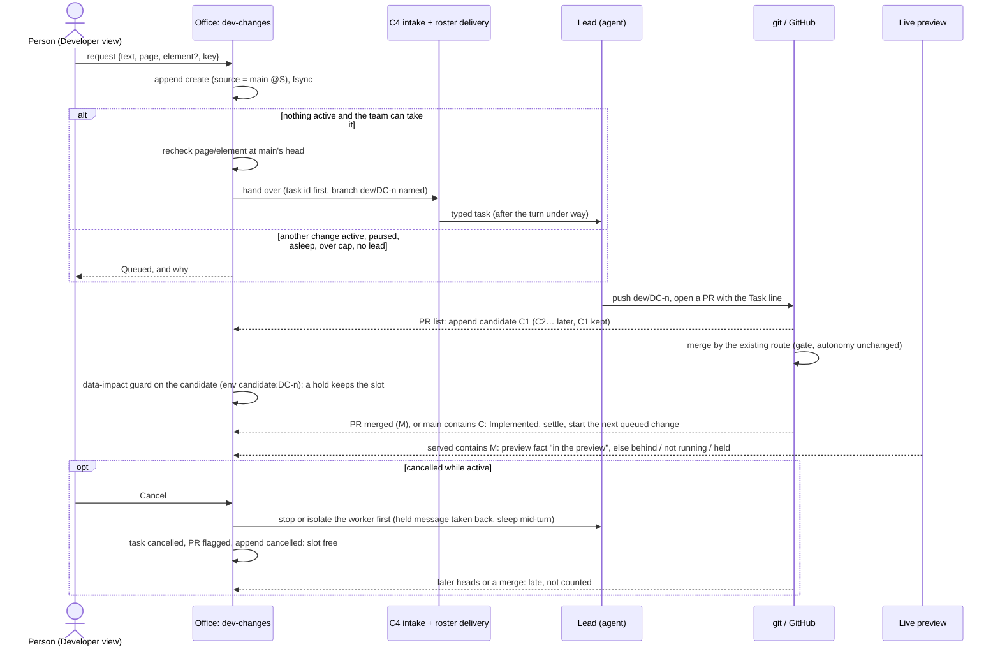
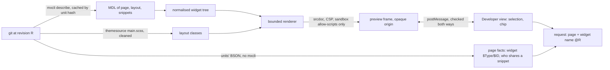

> [!NOTE]
> Describes the branch `feat/lifecycle-b` (Increment B, the complete change lifecycle, on top of release 74's Developer changes and Increment A). **Last checked against that branch on 2026-10-24.**
> **Verification scope:** the record, the queue, the four facts, active cancellation, settlement, the dependency note, corrections first, the link pass, possibly related commits, the explorer's candidate and the data-impact guard on candidates and external pushes are covered by tests that were run (`dev-changes`, `dev-changes-dom`, `lifecycle-b`, `lifecycle-b-links`, `docked-chat`, `docked-chat-dom`, `app-explorer-dom`), with fake agents, a fake GitHub and no mxcli. A smoke test on a copy of a realistic project with the runtime stopped was run in a test office. **No real agent ran this lifecycle yet**: the bounded real-agent request planned for Increment B was stopped because a test office can't pass the Claude gateway's credentials to an agent through a supported switch (see the design notes). How often agents follow the branch convention was **not** observed: the office says *candidate not found* when they don't.

A Developer change is one request, made in the Developer view or linked to it from another entry point. The office follows it through the revisions it goes through, and says where it is in plain words. The design is in `docs/mockups/developer-view/p0-design.md` (outside the published docs); this page describes what is built.

## The revisions the office names

| Role | What it is | Source of truth | Shown as |
|---|---|---|---|
| **Main (integrated)** | Main's head: the baseline everything is compared with | git: `origin/<default branch>` in the project folder (else the local branch) | *main @abc1234* |
| **Source** | The revision the request was made against: main's head at request time, or the revision on screen when the client names one | The change record, set at intake, never moved | *Asked at main @abc1234* |
| **Candidate** | A head seen on the change's branch `dev/DC-n`, or on a PR carrying its `Task:` line | The PR list and the branch as fetched into the project folder; each head seen is appended to the record (one seen after a cancellation is marked late and never counted) | *DC-3 candidate @def5678*; in the explorer, *Candidate of DC-3 (not merged)* |
| **Merge commit** | The commit that brought the candidate into main | The PR's merge commit; with no PR (a project without GitHub PRs), the commit on main's first-parent line that contains the candidate, from local git | *Implemented @f00d123* |
| **Running preview (served)** | What the live app actually serves | `LiveAppState.served` (`server/liveapp/`) | *preview @9f8e7d6 · behind main by 3*, or *preview: not running* |
| **Check revision** | The revision a check result is about | Each store's own revision field (test runs' `testedRevision`) | *2 checks passed on @def5678* |

Two rules carry *never silently reassign*:

1. **A result is shown against a revision only when its own revision is that revision** (`sameRevision` from `shared/testing/record.ts`). A check on an earlier candidate is listed as *on an earlier candidate*; a project with no CI shows *no checks on this candidate*, never *passed*.
2. **No record field is ever rewritten to a newer revision.** A new head is a new candidate, appended; older candidates keep their time and their checks.

The live app always follows main. **An unmerged candidate is never put in the live preview**, and there is no candidate preview of its own (it needs its own design decision: a separate app instance and database): before a change merges, its preview fact says the preview runs main, not this. The explorer can read the candidate's commit, though: its revision menu offers *Candidate of DC-n (not merged)*, and the tree, the Model preview and Select element then read that commit from git (any commit the project folder has).

## The Developer change record

`<data>/dev-changes/<project>.jsonl`: append only, one line per change made or per event on one, each **hash-chained** like the task record (`prev` is the sha256 of the line before, `hash` the line's own without it), so an edited, dropped or reordered line shows. Every append is fsync'd; intake waits for its line before it answers. Code: `src/server/dev-changes/store.ts`, folding in `src/shared/dev-changes.ts`.

It keeps **only what nothing else knows**:

| Line | What it holds |
|---|---|
| `create` | `DC-<n>`, the person's words, who asked and when, the client's idempotency key, the **source revision**, the app page on screen and its served revision, what it points at (`ref`, more in `refs`), **which entry point asked** (`via`: chat, dialog, validation, try, model, migrated), for a correction **the change it corrects** (`of`), and for a linked record **the old request it stands beside** (`linked`: CR-n or MCR-n, its task and member) |
| `activated` | It was handed to the lead: the C4 request (`CR-<n>`), its task and execution id, the member, the delivery (held, sent, woke), main's head then |
| `requeued` | Handed over again (Retry): back at the front of the queue, the earlier hand-over kept |
| `candidate` | A head seen: sha, branch, PR, how it was seen (`branch` or `pr`), when; folded as **late** when it arrives after a cancellation or supersession |
| `related` | A commit on main that overlaps it (possibly related) or names it (linked): sha, subject, the documents it touches |
| `link` | A person confirmed or dismissed a possibly related commit, and who |
| `clarify` | What it points at is gone at main's head (with that head): not started |
| `cancelled` | Cancelled, by whom; while active also how its worker was stopped (`stop`: slept, idle, asleep, gone, and held messages taken back) and the PR flagged |
| `superseded` | Marked replaced by a correction (`follow`), by whom; an active one's worker stopped first |
| `settled` | Its turn in the queue is over: `merged`, `cancelled`, `set-aside`, `not-found` or `abandoned` |

Everything else, the four facts included, is **derived each time** from the task record, the members' tasks on the roster, the PR list the project already polls, the served revision, local git ancestry, the workers on the project, the data-impact guard's holds and guided validation's reviews. When the derived view and a source disagree, the source wins.

**The element reference** is `{kind, doc, name}`: the kind (`page`, `widget`, `entity`, `attribute`, `microflow`, `nanoflow`), the document's qualified name (a page, snippet or layout; a microflow or nanoflow; a module's domain model by the module's name) and the element in it by name (a widget; an entity `Order` or attribute `Order.Notes`). References made before `kind` existed read as page or widget. The widget's `$ID` is kept as a hint only: a widget re-made under the same name gets a new `$ID`. From the Developer view it comes from the explorer (the page open in the Model preview, or the widget picked on it); from the Model tab's Change this, from the element picked there (associations, enumerations and constants can't be named and stay in that request's own record).

## The queue: one active change per project

Only Developer-view changes queue here. Project Management's work, the task queue and agents' own PRs are not held; they may move main meanwhile.

- **Queue instead of refuse.** A request is always kept (as *Queued*) and shows the condition it waits for: another change is with the team; no team lead is at work; the project is paused; the daily spend cap is reached; the lead is asleep; the hand-over was refused just now; the active change is merged but **held** by the data-impact guard; or (by policy) it **depends** on an earlier change nobody has tried. The 24-hour held messages are not used: the record is the queue, and it survives a restart.
- **One active change (the engineering slot).** The next queued change starts only when the active one is **implemented** (merged: its PR's merge commit, or main containing its candidate when there's no PR), **cancelled** (by a person, its worker stopped first; or its task cancelled), **superseded**, **set aside** (its task superseded), **abandoned** (its PR closed unmerged, the task done) or **finished with no candidate** (*candidate not found*). An open candidate whose task says done keeps the change active until it merges. A merge the data-impact guard holds keeps the slot until approved. A missing human review never holds the slot.
- **Order.** A change handed again (Retry) first, then **corrections** (linked with `of:`) by the project's policy (default on), then the oldest. The policy is `<data>/dev-changes/<project>.policy.json`, set by admins through `POST /api/dev-changes/policy`, audited.
- **Dependencies.** A queued or active change whose model units (the documents its references are in) overlap an earlier change's (its references, and what its candidate changed since its source, from the explorer's unit diff) that nobody has tried (no *Looks right*) shows **depends on DC-k (not yet tried)**. By default it proceeds with the note; with `waitForReview` it waits, saying why. Files outside the model aren't compared.
- **The context is checked again when a change starts.** The page and widget it points at are looked up at main's head in the model's units straight from git (`server/dev-changes/recheck.ts`, no mxcli, no runtime). If either is gone, the change is flagged **Needs clarification** and not started; the next one goes. When the model can't be read there, nothing is claimed.
- **The hand-over is C4's.** `server/change-requests/` mints the task id first, then types the task through the roster's delivery. The task names the change, its source revision and element, and asks the lead to work on branch `dev/DC-n` and keep the `Task:` line.
- **No duplicates.** The client sends one idempotency key per message (the docked composer's, or the dialog's); the same key again (a retry, a reconnect, two sends at once) gives back the change already made.
- **Cancel** works on a queued or flagged change, and on the **active** one (assessment correction 1): the office first **stops or isolates the worker** (`server/dev-changes/wire.ts`: held messages carrying `change: DC-n` are taken back from the roster's delivery; a worker mid-turn is stopped through the worker manager's `sleep`, as ⏸ Pause project does, its session kept; one between turns is told; one gone or asleep needs nothing), then marks the task cancelled on the task record, flags an open PR with a comment through `gh` (never closed, never deleted), appends `cancelled` (the slot is free from that line on) and only then moves the queue. When the worker can't be stopped, nothing changes and it says why. A merged change can't be cancelled. By whoever asked for it or an admin, audited (`dev-change.cancelled`, with how the worker was stopped).
- **Late results don't apply.** For a week after a change was cancelled or superseded while active, new heads on `dev/DC-n` and its PRs are still noted, folded as **late**, and shown as *after cancellation: … not counted*. They never settle the change (only an active change settles) and never move the queue.
- **Supersede**: a correction (`of: DC-k`) marks DC-k superseded, explicitly, by a person (whoever asked either, or an admin); an active DC-k's worker is stopped first, as for cancel; audited (`dev-change.superseded`).
- **Needs attention and Retry**: an active change whose worker has left the project, with no PR, says *Needs attention*; Retry marks its task superseded, appends `requeued` and hands it to the lead again from the front; audited (`dev-change.retry`).

The queue moves on events only: the PR list coming back, a project worker changing (debounced, only for a project with a waiting change), a change made or cancelled, the requests being read. It never merges, rebases or pushes, and the merge gate, autonomy and policy are read, not changed.

## One record for every entry point

Every way to ask for a change from the Developer view goes through the same intake (`DevChanges.intake`, reached by `POST /api/change-requests` or in-process) and makes the same record, so the queue, the receipts, Approvals and the audit log see one thing. Entry points outside it get a **linked** record with the same kind of id:

| Entry point | Code | What it carries |
|---|---|---|
| The docked chat's **Request a change** | `client/ui/app-workspace/dock/` through `ui/lead-panel/dock.ts` | The chip's page or widget reference, the revision viewed as source (main, the live app's revision, or a candidate's), a key per message, `via: chat` |
| The **Request a change** dialog (no chat on the page) | `client/ui/app-workspace/requests.ts` | The same, `via: dialog` |
| A guided check's **Something's wrong** | `server/guided-validation/` (C5's book) | The check, the version marked as source, `via: validation`; the C5 mark keeps the DC id |
| A **Please try this** card's **Something's wrong** | the same book, scenario `change:DC-n` | The version tried as source, the tried change's reference, `of: DC-n`, `via: try` |
| The Model tab's **Change this** | `server/http/routes/model-change.ts` → `dev-changes/links.ts` `mcrLink` | A **linked** DC beside `MCR-n` (its alias), with entity, attribute, microflow, nanoflow and page references, `via: model`. Still delivered to the member chosen there, when chosen; admins only, checked on the server |
| A request from before this record (C4 `CR-n` without a change id, any `MCR-n`) | `dev-changes/links.ts` `linkPass`, once per project per office start | A **linked** DC with the old id as its alias, `via: migrated`; the old record is read, never written |

**Linked, not folded, for Change this.** Folding it into the queue would change who gets it and when (the Model tab's role and "now" choices) and would make Model-tab work wait for the Developer view's one active change; that's a behaviour change for the person to decide. A linked record never takes the slot and can't be cancelled here; its work is followed from its alias (the task it was handed as, the PRs that name it).

**The link pass is append-only.** It reads `<data>/change-requests/<project>.json` and `<data>/model-change/<project>.json`, appends one `create` line with `linked` per alias not linked yet (oldest first), and changes nothing else: the old files, their ids and the change record's earlier lines stay byte for byte (tested on a copied data folder fixture), and running it again adds nothing.

A **Looks right** on a try card is a mark in C5's book for exactly the served revision (refused with a 409 for any other): a scoped review, read back on the change (`reviews`), never an acceptance; release acceptance stays in Acceptance.

**The chat is the lead panel's.** The Developer view lends the panel a header, cards and context chips through a small seam (`client/ui/lead-panel/dock.ts`); the conversation, its history and the lead are the panel's own, so there is no second chat. A change sent from the chat reaches the lead as its task when it's activated; while it waits, the lead gets a note after its turn (through the team's `tell`), so it knows but doesn't start early.

## Four facts, kept apart

Receipts, Approvals' list and `GET /api/dev-changes` (`facts`) keep four facts apart (assessment correction 2), each from its source (`shared/dev-change-facts.ts`):

| Fact | Values | Source |
|---|---|---|
| **Execution** (Work) | the states below | the record, the task, the PR list, git |
| **Verification** (Checks) | passed / failed / **incomplete** at the relevant revision (the newest candidate, or the merge commit once merged) | results whose revision is exactly that one (`candidateChecks`); none reported, a check without a verdict, or no CI is *incomplete*, never passed |
| **Preview availability** (Preview) | in the preview @S / behind / not running / **held** / runs main | git ancestry against the served revision; the data-impact guard's hold (env `candidate:DC-n`, or the live preview's on exactly its revision) |
| **Human review** (Your review) | *Looks right for @X* / *Something's wrong on @X* / none | guided validation's marks on `change:DC-n` |

Implemented (merged) never reads as accepted or as available to try: only the preview fact says whether it can be tried, only a review says it looks right, and neither is release acceptance. A merged change may still be **held** from runtime application.

**The data-impact guard on candidates** (`server/data-impact/seams.ts`, wired in `dev-changes/wire.ts`): the active change's newest candidate is checked (`checkCandidate`, from the revision main was at when it was handed over to the candidate, env `candidate:DC-n`) when it's seen and again before it settles as implemented. A hold shows as the preview fact *Held: possible data impact* with its findings; a held merge keeps the slot. Approval is the existing guard's: the `data-impact approval` permission, bound to environment, baseline, target and recovery evidence (for a candidate, *no data to keep*, since the live preview's dumps bind the live preview); any change voids it.

**External pushes** (`review-gate/pushes.ts` → `data-impact/external.ts`): when the push check finds commits on the default branch without a PR, from T3's persisted baseline, the range from the old tip to the new one is assessed (`checkExternal`, env `external:<branch>`). A finding is a Needs-you card of its own with its findings; it holds no Developer change and no other work (the live preview's own guard still holds its update independently).

**Commits on main and a change** (`dev-changes/related.ts`, assessment §5): first-parent commits on main since a change's source, other than any change's own candidates and merges, whose changed documents overlap the change's units are **possibly related**; one whose message names the change (its DC id, `dev/DC-n` or its task id) is **linked**. Both are appended as `related` (so they're seen once), shown on the change, and never make it implemented. A person confirms or dismisses a possible one (`POST /api/dev-changes/link`, `link` line, audited).

## The states

| Execution | Derived from |
|---|---|
| **Queued** (+ why) | The record says queued; the why is worked out now (the active change, the roster, the project's pause, the spend cap, the lead's status, a held merge, the dependency policy) |
| **Working** | Activated; nothing seen on its branch or a PR with its `Task:` line |
| **Working · candidate @C** | The newest candidate in the record that isn't late |
| **Implemented @M** | Its PR is merged with merge commit M, or (no PR) main contains the candidate and M is the first-parent commit that brought it in |
| **Needs attention** | Active, the worker it was handed to is gone, and there's no PR |
| **Abandoned** | Its PR was closed without merging and its task is done (settled `abandoned`) |
| **Needs clarification** | The recheck at main's head found the page or widget gone |
| **Cancelled** | Cancelled by a person (before it started, or while active with how its worker was stopped), or its task was cancelled by the team |
| **Superseded** | A person marked it replaced by a correction |
| **Candidate not found** | The team finished or set it aside and nothing follows the branch convention: said, never guessed |

Missing facts never move a change forward: a merged PR without its merge commit stays *Working · candidate*.

## The request lifecycle

## The revision strip

The docked chat's header shows one compact line: **main @M**, the **live preview @S** (*behind main by N*, counted with `git rev-list`, or *not running*), and, while a change is active, its **candidate @C**. There is no overlap analysis yet: *behind main* only. A chip that names a revision copies it on a click.

## The Model preview's boundaries

The Developer view's page preview is drawn from the model, never from the running app, so a request can point at a page or a widget with the app stopped. Its pipeline and where each boundary sits:

- **Extraction.** MDL per page, layout and snippet (`mxcli describe`, kept by content hash); the units' BSON for widget types, `$ID`s and snippet callers (`server/app-explorer/page-facts.ts`); the app's own theme files, cut down to layout and box properties of plain class rules, with nothing that fetches (`server/app-explorer/theme.ts`).
- **Rendering is bounded** (`client/ui/model/page-preview.ts`, `preview-parts.ts`): sample rows by list depth (3, 2, 1) with the rest said, a widget budget per page, conditions tagged and never evaluated, one case of a value drawn and the others named, unsupported widgets as labelled boxes, a report of everything left out. Sample values are synthetic and labelled as such.
- **Isolation.** The frame has its own opaque origin and a Content-Security-Policy that fetches nothing. On the Model tab it runs no script at all; in the Developer view it runs only Select element's script, allowed by a nonce made for each document (everything a page's text puts in is escaped, so nothing can carry the nonce). The page accepts a message only from that frame's window, with the sandbox's `null` origin, the expected shape, and an element index and name the drawing itself made (`client/ui/model/preview-pick.ts`).
- **Identity.** A picked element is the document (the page, or the snippet it's in) and the widget's name, unique per document and stable across commits; `$ID` is a hint (it changes when a widget is re-made under the same name). The reference is checked again by name at main's head before the change starts (`server/dev-changes/recheck.ts`).
- **What it doesn't claim.** Runtime behaviour, access rules, real data, evaluated visibility, responsive behaviour beyond the frame's width, and the other cases of a condition (named, not drawn).

## Not in this release

A candidate preview on an app instance with its own database (its own design decision), Undo, editing or reordering the queue by hand, comparing files outside the model for the dependency note, required-check lists (verification counts every reported check; with none, it's incomplete), and folding the Model tab's Change this into the queue (it's linked instead). The guards here protect against mistakes by people and agents; they are **not** a security boundary against an agent running as the office's own OS user ([Trust and authority](trust-and-authority.md)).

## See also

- [State and sources of truth](state-and-truth.md): where the change record sits among the office's records.
- [Execution lifecycle](execution-lifecycle.md): what happens to the task once the lead has it.
- [Developer view](../using-the-office/developer-view.md): requests, states, the queue and the strip as you see them.
