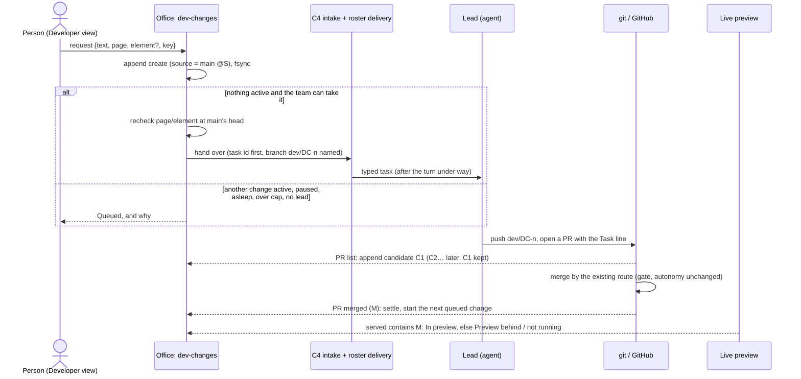
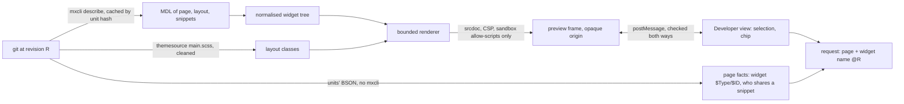

> [!NOTE]
> Describes the Developer view's first useful release, part 1 (branch `feat/dev-changes`, on top of release 73 and the view switch), written 2026-10-24.
> **Verification scope:** the record, the queue, the state table, the strip and the check binding are covered by tests that were run (`dev-changes`, `dev-changes-dom`), with fake agents and a fake GitHub. A smoke test on a copy of a realistic project with the runtime stopped is recorded in the design notes. How often agents follow the branch convention was **not** observed: the office says *candidate not found* when they don't.

A Developer change is one request made in the Developer view. The office follows it through the revisions it goes through, and says where it is in plain words. The design is in `docs/mockups/developer-view/p0-design.md` (outside the published docs); this page describes what is built.

## The revisions the office names

| Role | What it is | Source of truth | Shown as |
|---|---|---|---|
| **Main (integrated)** | Main's head: the baseline everything is compared with | git: `origin/<default branch>` in the project folder (else the local branch) | *main @abc1234* |
| **Source** | The revision the request was made against: main's head at request time, or the revision on screen when the client names one | The change record, set at intake, never moved | *Asked at main @abc1234* |
| **Candidate** | A head seen on the change's branch `dev/DC-n`, or on a PR carrying its `Task:` line | The PR list and the branch as fetched into the project folder; each head seen is appended to the record | *DC-3 candidate @def5678* |
| **Running preview (served)** | What the live app actually serves | `LiveAppState.served` (`server/liveapp/`) | *preview @9f8e7d6 · behind main by 3*, or *preview: not running* |
| **Check revision** | The revision a check result is about | Each store's own revision field (test runs' `testedRevision`) | *2 checks passed on @def5678* |

Two rules carry *never silently reassign*:

1. **A result is shown against a revision only when its own revision is that revision** (`sameRevision` from `shared/testing/record.ts`). A check on an earlier candidate is listed as *on an earlier candidate*; a project with no CI shows *no checks on this candidate*, never *passed*.
2. **No record field is ever rewritten to a newer revision.** A new head is a new candidate, appended; older candidates keep their time and their checks.

The live app always follows main. **An unmerged candidate is never put in the live preview**, and this release has no candidate preview of its own: before a change merges, its state says the preview runs main, not this.

## The Developer change record

`<data>/dev-changes/<project>.jsonl`: append only, one line per change made or per event on one, each **hash-chained** like the task record (`prev` is the sha256 of the line before, `hash` the line's own without it), so an edited, dropped or reordered line shows. Every append is fsync'd; intake waits for its line before it answers. Code: `src/server/dev-changes/store.ts`, folding in `src/shared/dev-changes.ts`.

It keeps **only what nothing else knows**:

| Line | What it holds |
|---|---|
| `create` | `DC-<n>`, the person's words, who asked and when, the client's idempotency key, the **source revision**, the app page on screen and its served revision, the page/element reference |
| `activated` | It was handed to the lead: the C4 request (`CR-<n>`), its task and execution id, the member, the delivery (held, sent, woke), main's head then |
| `candidate` | A head seen: sha, branch, PR, how it was seen (`branch` or `pr`), when |
| `clarify` | What it points at is gone at main's head (with that head): not started |
| `cancelled` | Cancelled before it started, and by whom |
| `settled` | Its turn in the queue is over: `merged`, `cancelled`, `set-aside` or `not-found` |

Everything else, the state included, is **derived each time** from the task record, the members' tasks on the roster, the PR list the project already polls, the served revision and local git ancestry. When the derived view and a source disagree, the source wins.

**The element reference** is the page (or snippet, layout) qualified name plus the widget name. The widget's `$ID` is kept as a hint only: a widget re-made under the same name gets a new `$ID`. In this release the reference is stored and checked; picking an element on the wireframe comes in part 2.

## The queue: one active change per project

Only Developer-view changes queue here. Project Management's work, the task queue and agents' own PRs are not held; they may move main meanwhile.

- **Queue instead of refuse.** A request is always kept (as *Queued*) and shows the condition it waits for: another change is with the team; no team lead is at work; the project is paused; the daily spend cap is reached; the lead is asleep; or the hand-over was refused just now. The 24-hour held messages are not used: the record is the queue, and it survives a restart.
- **One active change.** The next queued change starts only when the active one is **merged** (its PR merged with a merge commit), **cancelled** (its task cancelled), **set aside** (its task superseded) or **finished with no candidate** (*candidate not found*). An open candidate whose task says done keeps the change active until it merges.
- **The context is checked again when a change starts.** The page and widget it points at are looked up at main's head in the model's units straight from git (`server/dev-changes/recheck.ts`, no mxcli, no runtime). If either is gone, the change is flagged **Needs clarification** and not started; the next one goes. When the model can't be read there, nothing is claimed.
- **The hand-over is C4's.** `server/change-requests/` mints the task id first, then types the task through the roster's delivery. The task names the change, its source revision and element, and asks the lead to work on branch `dev/DC-n` and keep the `Task:` line.
- **No duplicates.** The client sends one idempotency key per dialog; the same key again (a retry, a reconnect, two sends at once) gives back the change already made.
- **Cancel** works on a queued or flagged change, by whoever asked for it or an admin, and is audited (`dev-change.cancelled`).

The queue moves on events only: the PR list coming back, a project worker changing (debounced, only for a project with a waiting change), a change made or cancelled, the requests being read. It never merges, rebases or pushes, and the merge gate, autonomy and policy are read, not changed.

## The states

| State | Derived from |
|---|---|
| **Queued** (+ why) | The record says queued; the why is worked out now (the active change, the roster, the project's pause, the spend cap, the lead's status) |
| **With the team** | Activated; nothing seen on its branch or a PR with its `Task:` line |
| **On candidate @C** | The newest candidate in the record |
| **Merged into main @M** | Its PR is merged with merge commit M, and whether the preview has it can't be told |
| **In preview** | The served revision contains M (git ancestry) |
| **Preview behind** | M is merged; the served revision doesn't contain it yet |
| **Preview not running** | M is merged; nothing serves |
| **Needs clarification** | The recheck at main's head found the page or widget gone |
| **Cancelled** | Cancelled before it started, or its task was cancelled by the team |
| **Candidate not found** | The team finished or set it aside and nothing follows the branch convention: said, never guessed |

Missing facts never move a change forward: a merged PR without its merge commit stays *On candidate*.

## The request lifecycle

## The revision strip

The Developer view's header shows one compact line: **main @M**, the **live preview @S** (*behind main by N*, counted with `git rev-list`, or *not running*), and, while a change is active, its **candidate @C**. There is no overlap analysis yet: *behind main* only. A chip that names a revision copies it on a click.

## The Model preview's boundaries

The Developer view's page preview is drawn from the model, never from the running app, so a request can point at a page or a widget with the app stopped. Its pipeline and where each boundary sits:

- **Extraction.** MDL per page, layout and snippet (`mxcli describe`, kept by content hash); the units' BSON for widget types, `$ID`s and snippet callers (`server/app-explorer/page-facts.ts`); the app's own theme files, cut down to layout and box properties of plain class rules, with nothing that fetches (`server/app-explorer/theme.ts`).
- **Rendering is bounded** (`client/ui/model/page-preview.ts`, `preview-parts.ts`): sample rows by list depth (3, 2, 1) with the rest said, a widget budget per page, conditions tagged and never evaluated, one case of a value drawn and the others named, unsupported widgets as labelled boxes, a report of everything left out. Sample values are synthetic and labelled as such.
- **Isolation.** The frame has its own opaque origin and a Content-Security-Policy that fetches nothing. On the Model tab it runs no script at all; in the Developer view it runs only Select element's script, allowed by a nonce made for each document (everything a page's text puts in is escaped, so nothing can carry the nonce). The page accepts a message only from that frame's window, with the sandbox's `null` origin, the expected shape, and an element index and name the drawing itself made (`client/ui/model/preview-pick.ts`).
- **Identity.** A picked element is the document (the page, or the snippet it's in) and the widget's name, unique per document and stable across commits; `$ID` is a hint (it changes when a widget is re-made under the same name). The reference is checked again by name at main's head before the change starts (`server/dev-changes/recheck.ts`).
- **What it doesn't claim.** Runtime behaviour, access rules, real data, evaluated visibility, responsive behaviour beyond the frame's width, and the other cases of a condition (named, not drawn).

## Not in this release

Reconciliation by overlap when main moves under a candidate, editing or reordering the queue, a candidate preview on an app instance, the docked coordinator chat, the Model tab's *Change this* in the same record, and Undo. Corrections made from guided validation still go straight through C4 and are listed under *Earlier requests and corrections*.

## See also

- [State and sources of truth](state-and-truth.md): where the change record sits among the office's records.
- [Execution lifecycle](execution-lifecycle.md): what happens to the task once the lead has it.
- [Developer view](../using-the-office/developer-view.md): requests, states, the queue and the strip as you see them.
