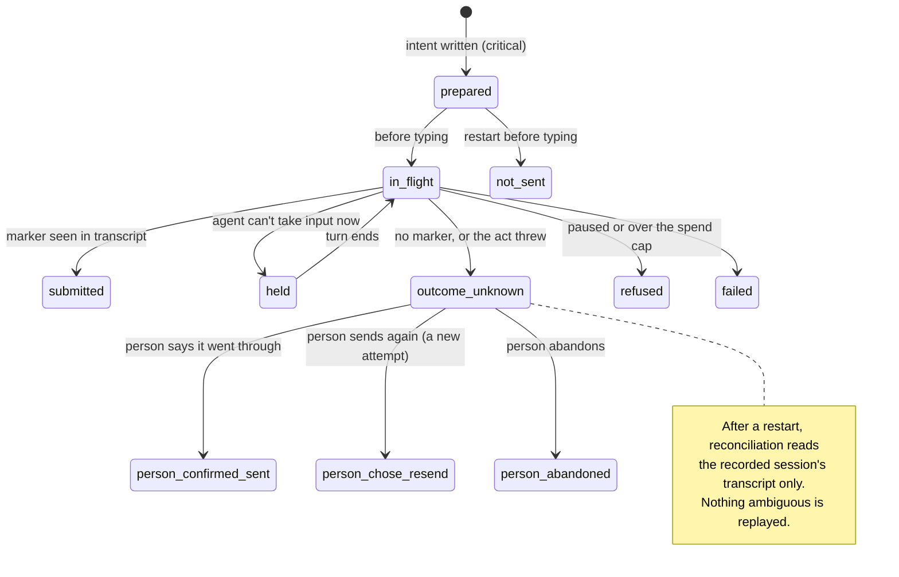

> [!NOTE]
> Describes release 66 (commit `39d0083a`), assessed 2026-10-20.
> **Verification scope:** the sources and writers were read in code. The durability of answers, hand-offs, task creation and the store readers is covered by tests that were run (`durable-dispatch`, `task-durability`, `store-safety`, `restart-truth`, `flow`). Readiness verdicts are pinned by `liveapp-ready`, including the case where a milestone with no journeys reads Ready. Power-loss durability is **not** claimed by the code and was not tested.

## The idea

The office is mostly a **reader** of other systems' truth (git, GitHub, transcripts, the toolkit's files) and a **writer** of a few records of its own (answers, hand-offs, tasks, audit, acceptance). It derives most of what you see, such as a task's outcome, a milestone's readiness or a stage's progress, again from those sources each time, instead of storing it.

Two rules follow:

- When the office's derived view and the source disagree, **the source wins**: GitHub for merge state, git for what is committed and merged, the transcript for what an agent received.
- An agent's own words are **evidence, not truth**. They are checked against git where the office can (the claims check), and labelled as claims where it can't.

## Sources of truth per subsystem

| Subsystem | Source of truth | Written by | Conflicts and reconciliation | Guarantee |
|---|---|---|---|---|
| Project list | `floors.json` in the data folder (the file keeps its old name) | Office | Single writer | Durable write; a corrupt file is quarantined |
| Team, escalations, held messages | `roster/<project>.json` | Office, on hook and HTTP events | Single writer, serialised | Background save, plus a critical flush on the answer, escalation and hand-off paths |
| Decision answers | `answers/<project>.jsonl`, hash-chained | Office, on a person's action | Revision numbers; a stale answer gets 409 | Append-only, fsync'd |
| Hand-off attempts | `dispatch/<project>.json` | Dispatcher | Reconciled from the recorded session's transcript only | Durable intent plus reconciliation; **not exactly-once** |
| Task identity | `tasks/<project>.jsonl`, hash-chained | Office | Append-only; the id is typed only after its line is on disk | Creation durable; later events best effort |
| Task outcome (integrated, verified) | Derived each time from GitHub's PR list, local git (`Task:` id, merged after assignment) and the roster | Office (derived) | GitHub is authoritative for merge state | Recomputed; the *unreviewed* mark is never cleared |
| Agent status | Memory and `workers.json`, from hook events | Hooks | Last event wins | Lost if a hook post fails (it is retried a few times, then dropped) |
| Code and work | git: working tree → commit → push → PR → merge on origin | Agents, people, GitHub | git | git's |
| Running app | The live app's process and its running commit, **in memory** | Live app manager | Follows the default branch every 60 s while running | **None across a restart** |
| Readiness | Derived: plan at main + build rows at main and live + test records at the live commit | Office (derived) | — | Recomputed; the news is said once (`.ready.json`) |
| Test evidence | `testing/<project>.jsonl`, hash-chained | Importers (PR checks, report files, gate-check, the office's `mxcli test`) | Each record carries its revision; report files declare their own | Append-only; the chain is **not verified** in production |
| Acceptance | `acceptance/<project>.jsonl`, hash-chained | Admin | 409 if the head or cycle moved | Chain checked when viewed; appends not fsync'd |
| Stage progress | Derived: gate-check output + `PROJECT.md` decision rows (written by agents) + the sign-off file | Toolkit script, agents, office | — | Recomputed |
| Budget | `budget/` ledger, from transcripts and usage | Office | — | Durable write about a second after a change; providers without metering have gaps (not re-checked) |
| Design binding | `design-systems/projects.json` in the data folder | Office | The adoption's operation record is reconciled with git at start | Critical write. The `design` key committed to `agent-office.project.json` is **written but never loaded as the binding** (the office only reads its digest at a git ref to recognise a squash merge, `src/server/design/adoption.ts`); an existing app adopting Atlas defaults gets no committed entry |
| Toolkit pin | `agent-office.project.json` + `toolkit-pins.json` + `PROJECT.md` | Office | Three copies; no documented reconciliation between them | Mixed |

## Distinctions the office keeps

These pairs look alike on a screen. They are not the same thing, and the office tracks them separately.

### Agent reports vs verified results

A task moves through states (`src/server/roster/task-verify.ts`): *claimed* (the agent said "task done"), *claimed (unverified)* (the claims check found nothing in git behind a claim), *integrated* (merged with its task id), *integrated (unreviewed)* (the review gate flagged its PR), and *verified* / *not verified* (only when the verification switch is on). Only *delivered*, *verified* and *legacy* count as delivered.

Live app **Ready** mixes kinds of evidence: commit subjects, PR titles and BUILD-LOG words for build rows, and report files whose revision the file itself declares. See [Claims check](../using-the-office/claims-check.md) and [Live app](../using-the-office/live-app.md).

### Stored decisions vs delivered instructions

Your answer is stored first, as a revision. Delivering it is a separate hand-off with its own state: *submitted* means the marker was seen in the agent's transcript, not that the agent acted on it. A third, separate check, *recorded as given*, looks for the agent's written record of your exact answer, at the current revision, merged into the default branch (`src/server/followthrough/`). See [Escalations](../teams-and-agents/escalations.md).

### Working tree vs commits vs merged

The follow-through check reports whether a record is in a working copy, on a branch, or merged into the default branch. The claims check flags model changes that exist only on unmerged branches. The *main is behind the work* banner shows branches ahead of main.

### Merged vs running revision

The live app runs whatever default-branch commit it last fetched while it was running. Its status line shows the running commit against main (`src/shared/liveapp/status.ts`). After an office restart it runs nothing until started.

### Passing tests vs acceptance

Passing checks gate only task verification, and only when that switch is on. Acceptance does not require passing tests: failing gates and CI become suggested exceptions on the acceptance draft (`src/server/acceptance/evidence.ts`). Walkthrough recordings are not acceptance evidence.

## Persistence and recovery

| What | On an office crash or kill | On 🔁 Restart safely | Not protected against |
|---|---|---|---|
| Answers, task creation | Kept (fsync'd append) | Kept | Power loss (not claimed) |
| Hand-off records, setup operation records, profiles, clients, design systems | Kept (critical write) | Kept, then reconciled | Power loss (not claimed) |
| Roster | Kept up to the last background save; answer and escalation paths flush critically | Kept | Changes in the half second before a crash on paths without a critical flush |
| `restart-pending.json`, project pauses, `queue.json`, review-gate state, toolkit pins, keep-awake | Atomic replace without fsync: old or new content, usually | Kept | An operating-system crash right after the write |
| Walkthrough settings and manifests, audit and incident appends, acceptance appends | Plain write or append | Kept | A crash mid-write |
| Live app running commit, tell-limit counts, last-message cache, walkthrough queue | **Lost** | **Lost** | — |
| Agent processes | Windows: **end with the office**, resumed by session id afterwards. Unix: survive | Same, after waiting for turns to end | A provider that no longer has the session (a fresh conversation, with only a toast) |

None of these stores is transactional across files. Where two records must agree (an answer and its hand-off, an adoption and its git commit), the office writes intent first and reconciles on start; it does not roll back.

The diagram shows a decision answer's hand-off (`src/shared/dispatch.ts`, `src/server/dispatch/`). Agent-to-agent tells and the idle-lead console prompt don't go through it.

## See also

- [Data locations](../administration/data-locations.md): where each store is on disk.
- [Execution lifecycle](execution-lifecycle.md): the same records, step by step.
- [Needs you](../using-the-office/needs-you.md): how these states reach you.
- [Proposed simplifications](proposals.md): **PROPOSED** provenance labels (*agent says* / *office checked* / *you decided*) and a single revision strip on the Live app.
