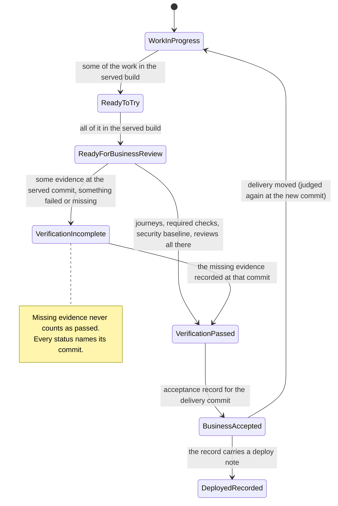
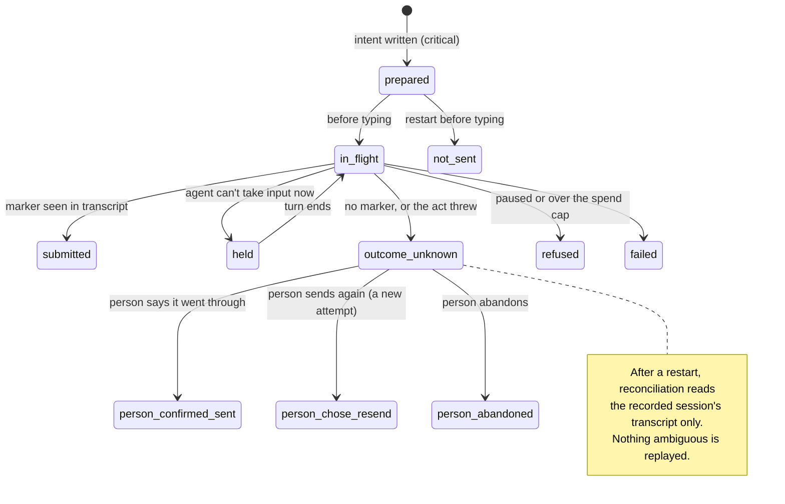

> [!NOTE]
> Describes release 74 (`c4c6a14` on `main`). **Last checked against release 74 on 2026-10-24** for the sources-of-truth table (including the stores added in releases 68 to 74), the running app, acceptance and the persistence table; first written against release 66 (`39d0083a`, 2026-10-20).
> **Verification scope:** the sources and writers were read in code. The durability of answers, hand-offs, task creation and the store readers is covered by tests that were run (`durable-dispatch`, `task-durability`, `store-safety`, `restart-truth`, `flow`). Readiness verdicts are pinned by `liveapp-ready`, including the case where a milestone with no journeys reads *built, no journey evidence yet* rather than Ready (changed after release 66). The business status (App Workspace C2, after release 71) is pinned by `business-status`, a table of scenarios over the shared function and the views that read it. Power-loss durability is **not** claimed by the code and was not tested.

## The idea

The office is mostly a **reader** of other systems' truth (git, GitHub, transcripts, the toolkit's files) and a **writer** of a few records of its own (answers, hand-offs, tasks, audit, acceptance). It derives most of what you see, such as a task's outcome, a milestone's readiness or a stage's progress, again from those sources each time, instead of storing it.

Two rules follow:

- When the office's derived view and the source disagree, **the source wins**: GitHub for merge state, git for what is committed and merged, the transcript for what an agent received.
- An agent's own words are **evidence, not truth**. They are checked against git where the office can (the claims check), and labelled as claims where it can't.

## Sources of truth per subsystem

| Subsystem | Source of truth | Written by | Conflicts and reconciliation | Guarantee |
|---|---|---|---|---|
| Project list | `floors.json` in the data folder (the file keeps its old name) | Office | Single writer | Durable write; a corrupt file is quarantined |
| Team, escalations, held messages | `roster/<project>.json` | Office, on hook and HTTP events | Single writer, serialised | Background save, plus a critical flush on the answer, escalation and hand-off paths |
| Decision answers | `answers/<project>.jsonl`, hash-chained | Office, on a person's action | Revision numbers; a stale answer gets 409 | Append-only, fsync'd |
| Hand-off attempts | `dispatch/<project>.json` | Dispatcher | Reconciled from the recorded session's transcript only | Durable intent plus reconciliation; **not exactly-once** |
| Task identity | `tasks/<project>.jsonl`, hash-chained | Office | Append-only; the id is typed only after its line is on disk | Creation durable; later events best effort |
| Developer changes (queue, source revision, candidates) | `dev-changes/<project>.jsonl`, hash-chained ([Revisions and Developer changes](revisions-and-changes.md)) | Office, on a request, a cancel, and the PR list | Append-only; candidates appended, never rewritten; state derived from tasks, PRs and the served revision | Each line fsync'd; intake answers after its line is on disk; one change per idempotency key |
| Task outcome (integrated, verified) | Derived each time from GitHub's PR list, local git (`Task:` id, merged after assignment) and the roster | Office (derived) | GitHub is authoritative for merge state | Recomputed; the *unreviewed* mark is cleared once a counting review of the merged revision exists (or the PR closed unmerged), and the clearing is kept in `<data>/merge-gate/<project>.jsonl` |
| Agent status | Memory and `workers.json`, from hook events | Hooks | Last event wins | Lost if a hook post fails (it is retried a few times, then dropped) |
| Code and work | git: working tree → commit → push → PR → merge on origin | Agents, people, GitHub | git | git's |
| Running app | The live app's process, its **served** commit (set only once a build answers) and its **target** (what it's building or updating to), **in memory**; the last served commit also in `live/<project>.served.json` | Live app manager | Follows the default branch every 60 s while running | The process and served commit: **none across a restart**; the last served commit is shown only as *last ran* |
| Readiness | Derived: plan at main + build rows at main and at the served commit + test records at the served commit | Office (derived) | — | Recomputed; the news is said once (`.ready.json`) |
| Test evidence | `testing/<project>.jsonl`, hash-chained | Importers (PR checks, report files, gate-check, the office's `mxcli test`) | Each record carries its revision; report files declare their own | Append-only; the chain is **not verified** in production |
| Acceptance | `acceptance/<project>.jsonl`, hash-chained | Admin | 409 if the head or cycle moved | Chain checked when viewed; appends not fsync'd |
| Stage progress | Derived: gate-check output + `PROJECT.md` decision rows (written by agents) + the sign-off file | Toolkit script, agents, office | — | Recomputed |
| Business status | Derived (`src/shared/business-status.ts`): readiness and journey results at the served commit + the verification policy's checks there + the security baseline's release gate there + unreviewed merges + the acceptance record and what changed since | Office (derived) | Each input bound to its revision; an input of another commit counts as missing | Recomputed; nothing stored (a few seconds' cache per project) |
| Budget | `budget/` ledger, from transcripts and usage | Office | — | Durable write about a second after a change; providers without metering have gaps (not re-checked) |
| Design binding | `design-systems/projects.json` in the data folder | Office | The adoption's operation record is reconciled with git at start | Critical write. The `design` key committed to `agent-office.project.json` is **written but never loaded as the binding** (the office only reads its digest at a git ref to recognise a squash merge, `src/server/design/adoption.ts`); an existing app adopting Atlas defaults gets no committed entry |
| Toolkit pin | `agent-office.project.json` + `toolkit-pins.json` + `PROJECT.md` | Office | Three copies; no documented reconciliation between them | Mixed |
| Reviews, merge-gate overrides, cleared *unreviewed* marks | `merge-gate/<project>.jsonl` | Office, from `Review:` comments, GitHub reviews, a person's review in the PR window, an admin's override | Each review bound to the head it reviewed; a new commit makes it stale | Append-only, each line fsync'd |
| Security policy, security read per commit, `mx check` per commit (including the office's own at a merge ask's or merge confirm's commit, release 82) | `security/<project>.json` | Office | Each read and check carries its commit | Durable write |
| Build-plan rows handed to each Lead (release 82) | `handoff/<project>.json` | Office | Rows and time per hand-off | Plain write (temp file, rename) |
| Each message's delivery per recipient, for the docked chat (release 82) | Memory only (`roster/delivery-log.ts`) | Office | What `Delivery.send` answered, and its held prompt typed | None: a restart starts the list again |
| Change requests (request ↔ task link) | `change-requests/<project>.json` | Office, on **Request a change** | The request's state is derived from the task, the PR and the served revision; only the link is stored | Durable write |
| Guided-validation marks | `guided-validation/<project>.json` | Office, on a person's mark | Only for the version the live app serves now (409 otherwise); evidence beside the business status, not an input of it | Durable write |
| What a project adopted from another app | `adopt-from/<project>.json` | Office, at setup | The binding, pin and role skills stay with the modules that own them | Critical write |
| What the Developer view's explorer shows | Derived: main's newest commit as this machine has it (no fetch), or the live app's revision when picked | Office (derived) | The running app is only information beside it (*n commits behind main*) | Read from git; nothing stored |

## Distinctions the office keeps

These pairs look alike on a screen. They are not the same thing, and the office tracks them separately.

### Agent reports vs verified results

A task moves through states (`src/server/roster/task-verify.ts`): *claimed* (the agent said "task done"), *claimed (unverified)* (the claims check found nothing in git behind a claim), *integrated* (merged with its task id), *integrated (unreviewed)* (the review gate flagged its PR), and *verified* / *not verified* (only when the verification switch is on). Only *delivered*, *verified* and *legacy* count as delivered.

Live app **Ready** mixes kinds of evidence: commit subjects, PR titles and BUILD-LOG words for build rows, and report files whose revision the file itself declares. See [Claims check](../using-the-office/claims-check.md) and [Live app](../using-the-office/live-app.md).

### Stored decisions vs delivered instructions

Your answer is stored first, as a revision. Delivering it is a separate hand-off with its own state: *submitted* means the marker was seen in the agent's transcript, not that the agent acted on it. A third, separate check, *recorded as given*, looks for the agent's written record of your exact answer, at the current revision, merged into the default branch (`src/server/followthrough/`). See [Escalations](../teams-and-agents/escalations.md).

### Working tree vs commits vs merged

The follow-through check reports whether a record is in a working copy, on a branch, or merged into the default branch. The claims check flags model changes that exist only on unmerged branches. The *main is behind the work* banner shows branches ahead of main.

### Merged vs running revision

The live app runs whatever default-branch commit it last fetched while it was running. It keeps three commits apart (`LiveAppState` in `src/shared/protocol/liveapp.ts`, set in `src/server/liveapp/app.ts`):

- **served**: the commit actually running and answering. It is set only once the new build answers on its port, and cleared the moment that runtime is stopped or stops by itself.
- **target**: the commit it's getting, building or starting. It is kept after that build fails, so the failure names it.
- **last served**: what served before, once nothing does.

Readiness, test evidence, Design captures, the readiness news and every "running …" label read **served**, never the target. The status line shows served against main (`src/shared/liveapp/status.ts`, `revisionLine`: *Running abc1234 · updating to def5678…*, *Update to def5678 failed · still running abc1234*, *… · nothing running*).

An update fetches first while the old build still serves, then stops it for the build: from then until the new build answers, nothing serves, and the state says so. Two updates don't restart (`src/server/liveapp/classify.ts`, the rule in `src/shared/liveapp/speed.ts`): when no app files changed, served moves to the new commit with `built` naming the commit its build came from; and with hot reload on, a page or logic change is moved into the running app's folder for mxcli's watch to apply, and served moves only once mxcli said it applied it and the app answers. A hot reload that doesn't confirm clears served at once and restarts. After an office restart it runs nothing until started. The last served commit is read back from `live/<project>.served.json` only as *last ran*, never as served.

### Passing tests vs acceptance

Passing checks gate only task verification, and only when that switch is on. Acceptance does not require passing tests: failing gates and CI become suggested exceptions on the acceptance draft (`src/server/acceptance/evidence.ts`). It does require the **security baseline** at the delivery commit, including a clean `mx check` there (unless the project's security policy is advisory); see [Security baseline](../using-the-office/security-baseline.md). Walkthrough recordings and guided-validation marks are not acceptance evidence.

### Business status derived from evidence

One pure function (`businessStatus` in `src/shared/business-status.ts`, its inputs put together by `src/server/business-status/`) says how far the delivery is: *Work in progress*, *Ready to try*, *Ready for business review*, *Verification incomplete* / *Verification passed*, *Business accepted*, *Deployed (recorded)*, and, only under the optional approval policy (not built yet, so always off), *Submitted for review* / *Changes requested* / *Release approved*. The progress bar's label, Home's project rows, the Overview's Status row and View App, the Live app chip, the phone's Status tab and the Teams digest all read it, so they can't disagree. Every status names its commit (served for what runs and was verified, main's head for work in progress, the acceptance record's delivery commit for accepted) and lists what's missing for the next one. Missing evidence never counts as passed: an input the office couldn't read is listed as missing. An accepted version whose delivery moved is judged again at the new commit, with *changed since acceptance* kept as a note.

## Persistence and recovery

| What | On an office crash or kill | On 🔁 Restart safely | Not protected against |
|---|---|---|---|
| Answers, task creation | Kept (fsync'd append) | Kept | Power loss (not claimed) |
| Hand-off records, setup operation records, profiles, clients, design systems | Kept (critical write) | Kept, then reconciled | Power loss (not claimed) |
| Roster | Kept up to the last background save; answer and escalation paths flush critically | Kept | Changes in the half second before a crash on paths without a critical flush |
| `restart-pending.json`, project pauses, `queue.json`, review-gate state, toolkit pins, keep-awake | Atomic replace without fsync: old or new content, usually | Kept | An operating-system crash right after the write |
| Walkthrough settings and manifests, audit and incident appends, acceptance appends | Plain write or append | Kept | A crash mid-write |
| Live app process and served commit, last-message cache, walkthrough queue (the tell-limit window is kept in `tell-limit.json`, a background file) | **Lost** (the last served commit is kept as *last ran*, its end time only if the office shut down) | **Lost** (the same) | — |
| Agent processes | Windows: **end with the office**, resumed by session id afterwards. Unix: survive | Same, after waiting for turns to end | A provider that no longer has the session (a fresh conversation, with only a toast) |

None of these stores is transactional across files. Where two records must agree (an answer and its hand-off, an adoption and its git commit), the office writes intent first and reconciles on start; it does not roll back.

The diagram shows a decision answer's hand-off (`src/shared/dispatch.ts`, `src/server/dispatch/`). Agent-to-agent tells and the idle-lead console prompt don't go through it.

## See also

- [Data locations](../administration/data-locations.md): where each store is on disk.
- [Execution lifecycle](execution-lifecycle.md): the same records, step by step.
- [Needs you](../using-the-office/needs-you.md): how these states reach you.
- [Proposed simplifications](proposals.md): **PROPOSED** provenance labels (*agent says* / *office checked* / *you decided*) and a single revision strip on the Live app.
