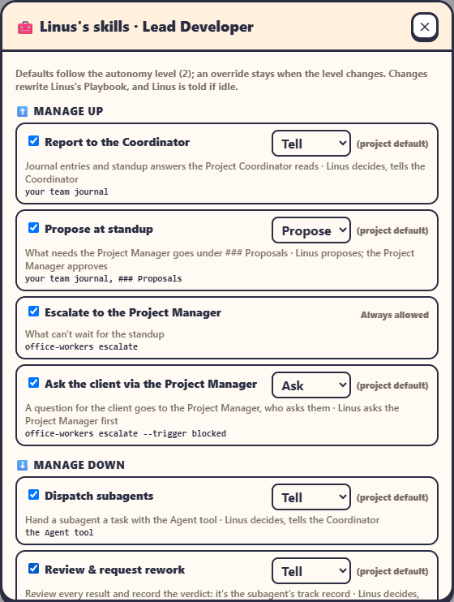

Each team member has **🧰 Skills**: what it may do, and how. Open them with **🧰 Skills** on its card in the [Org chart](../using-the-office/org-chart.md).

> [!NOTE]
> **"Skill" here means a permitted action, not reusable know-how.** The Manage up and Manage down entries are actions a member may take, each with a gate. Only the 🛠️ Craft group is about reusable instructions: it lists the toolkit skills the member's Playbook points to. See [Which "skill" is which](#which-skill-is-which) below.

## Gates

Every Manage up or Manage down skill that changes something has a **gate**:

| Gate | Means |
|---|---|
| **Ask** | It raises an escalation; the action happens only once you approve. |
| **Propose** | It goes into your **✅ Approvals**. Your decision goes back to the member: straight away between its turns, or kept as a note for when it's back at its desk. |
| **Tell** | The member decides; the Project Coordinator is told (batched a minute after the last one, kept through a restart, skipped on a project with no Coordinator). |
| **FYI** | The member decides; you get an FYI escalation. |

This gate is not the toolkit's **✋ gate** (a stage that needs a `CONFIRMED` decision): see [The toolkit](../integrations/toolkit.md).

## The skills

| Group | Skill | Default gate at level 1 / 2 / 3 / 4 | How |
|---|---|---|---|
| ⬆️ **Manage up** (everyone) | report | tell | |
| | propose | propose | |
| | escalate | always allowed | `office-workers escalate` |
| | ask the client | ask | `escalate --trigger blocked` |
| ⬇️ **Manage down** (Leads) | dispatch a subagent | tell | the Agent tool |
| | review a result | tell | `subagent review` |
| | warn a subagent | propose / tell / tell / FYI | `subagent warn` |
| | bench a subagent | ask / propose / tell / FYI | `subagent bench` |
| | swap a subagent's model | ask / propose / tell / FYI | `subagent swap-model` |
| | reinstate a subagent | tell | `subagent reinstate` |
| ⬇️ **Manage down** (Coordinator) | nudge a Lead | tell | |
| | reassign a Lead | ask / propose / tell / FYI | |
| 🛠️ **Craft** | one per toolkit skill the role works from | always allowed | |

## Overriding

As admin you can, per member and per skill:

- turn the skill **on or off**;
- pick another **gate**: the window marks it *(override · default X)*;
- **↺ Reset** to the project default.

Changes rewrite the member's Playbook.

## What the office enforces

> [!IMPORTANT]
> The office itself enforces the gates only on four `office-workers subagent` operations: **warn**, **bench**, **swap-model** and **reinstate**. For those it checks that the skill is on and applies the gate (an ask or propose waits for you). Every other gate, including dispatching a subagent, reviewing a result and the Coordinator's skills, is an **instruction in the Playbook** that the agents are asked to follow. The office does not block an agent that skips it.

The **🛠️ Craft** group is a list of pointers. Each entry is a toolkit skill the role's Playbook names, with its path in the project's [pinned toolkit](../administration/toolkit-versions.md). Turning one **off** only removes that pointer from the Playbook. The skill file is still in the toolkit folder, and an agent can still read it.

## Which "skill" is which

"Skill" means several different things around the office. They are not interchangeable:

| Term | What it is | Where it lives |
|---|---|---|
| **Skill (this page)** | An action a team member may take, with a gate. Really a permission. | The office's roster settings; shown in the Team tab's 🧰 Skills window. |
| **Toolkit skill** | A reusable instruction file for one kind of work, the same for every client. | `skills/<name>.md` in the toolkit; each project reads it from its pin. The Craft group lists them. |
| **Company skill** | The same kind of file, true only for one company's apps. | `skills/` in that client's [company brain](../using-the-office/clients.md), reached through its `ROUTING.md`. Not shown in the Team tab. |
| **mxcli skill** | Instruction files mxcli itself puts into a project. | The project's `.ai-context/skills/`, refreshed by mxcli. |
| **Playbook** | The office-written instruction file for one role on one project: rights, gates, toolkit skills, journal and lesson rules. Technically a Claude Code skill file. | `.ai-context/skills/team-<role>/SKILL.md`, mirrored to `.claude/skills/team-<role>/SKILL.md`. |
| **Lesson** | A dated note an agent appends to the project's lessons file. Not a skill until someone reviews and promotes it. | The project's lessons file. |

> [!NOTE]
> **Proposal, not current behaviour:** renaming this window's skills to **permissions** (and the gate to an *approval rule*), and moving the Craft list to a separate knowledge list, has been proposed to end the clash. Nothing has been renamed. The code, the API action `skill` and the audit names keep the word "skill" either way. See [Proposals](../architecture/proposals.md).

## See also

- [Reusable skills and knowledge](../architecture/reusable-skills-and-knowledge.md): toolkit skills, company brains and lessons side by side.
- [Trust and authority](../architecture/trust-and-authority.md): what the office enforces, and what is only an instruction.
- [Glossary](../reference/glossary.md).
