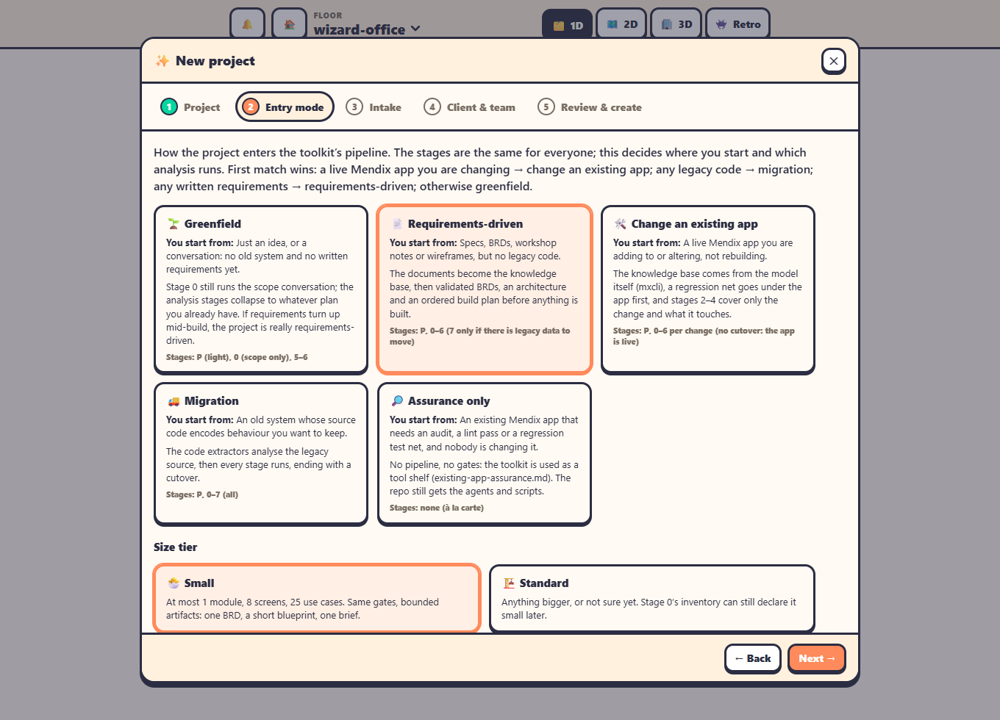

The **✨ New project** wizard on **/home** turns a few answers into a ready project: a private GitHub repository, a floor in the office, a blank Mendix app (`.mpr`), the toolkit's scaffold, recorded decisions, the project team at their desks and a Discovery issue for the Chief Analyst.

> [!NOTE]
> Only an admin (the Project Manager) can create a project. The wizard uses a separate **admin token** that can create repositories: `~/.agent-office-admin-gh-token`. The agents never see it. See [Security & tokens](../administration/security-and-tokens.md).

## Open the wizard

Go to **🏠 Home → 🏢 Projects** and click **✨ New project**. This browser tab keeps your answers while you work, so a reload doesn't lose them.

## Page 1: Project

- Choose **✨ A new project**, or **🛠️ Changes to an existing app** (then pick its repository).
- **Name**: becomes the repository name, in lower case with dashes.
- **Owner organization**: `AI-Taskforce-Labs` by default.
- **Description**, **Private repository** (on by default), and the **Mendix (Studio Pro) version**: the versions installed on the office's machine, with the newest 11.12 (11.12.4) picked by default (11.6.4, mxcli's validated line, when no 11.12 is installed). A new project's Mendix app is created with it. For an existing app that is already a floor, the wizard picks the version its `.mpr` was last saved with.
- Tick **I created this repository myself** if you made the repo by hand. The wizard then only checks that it exists.

## Page 2: Entry mode

Pick how the project starts. The toolkit adapts its stages to it.

| Entry mode | When |
|---|---|
| 🌱 Greenfield | A new app from an idea. |
| 📄 Requirements-driven | You already have requirements or a BRD. |
| 🛠️ Change an existing app | Changes to an app that exists. |
| 🚚 Migration | Moving an app from another platform. |
| 🔎 Assurance only | Review and test an app; no building. |

Then pick the **size tier**: 🐣 **Small** (at most 1 module, 8 screens and 25 use cases) or 🏗️ **Standard**.

## Page 3: Intake

The toolkit's kickoff questions, as a form. Mark each answer **Answered**, **Assumed** or **Unverified**. The wizard fills in three for you: Q1 (entry mode), Q9 (interview mode: **Steering**, every question asked and waited for, the default; **Assist**, questions batched at the gates and small ones assumed; or **Auto**, unattended: nothing blocks and every assumption is recorded. These are the toolkit's `interview-mode.sh` modes, written to `PROJECT.md` as `Interview mode:`) and Q11 (exec approval: auto or ask).

## Page 4: Team and budget

The team and the budget come **after** the intake, so the office can recommend a shape and a level from what you said. There are two dials: the [team shape](../teams-and-agents/team-shapes.md) (Solo, Startup or Enterprise) and the budget level (Lean, Balanced or Fast).

**The recommendation.** A box at the top names the recommended shape and level, with why, for example *★ Recommended: Solo · Lean — small tier, greenfield, you said: POC / demo, one module or feature, no integrations must stay, no SME needed*. It reads:

- the **size tier** and the **entry mode**.
- **Q2**, what drives the project: a POC or demo, a hard date (and whether it's soon), or open-ended.
- **Q4**, how much it covers: one module, flow or feature, or the whole app (three or more modules).
- **Q5**, what must stay as it is: nothing, or integrations (three or more is "several").
- **Q7**, the SME: not needed, available, or slow to answer.

An answer it can't read changes nothing. The rules:

| Shape | When |
|---|---|
| 🧑‍🚀 Solo | Assurance only; or a small greenfield or POC project with no integrations to keep. |
| 🚲 Startup | A small project that's a migration, keeps several integrations or covers the whole app; a small requirements-driven or change project; a standard greenfield or POC project with nothing heavy. |
| 🏢 Enterprise | A standard project that's a migration, keeps integrations or covers the whole app; any other standard requirements-driven or change project. |

| Level | When |
|---|---|
| 🪙 Lean | A POC; or nothing said about the driver on a Solo project. |
| ⚖️ Balanced | A hard date; open-ended; or nothing said. |
| 🚀 Fast | A hard date that's soon ("asap", "in three weeks"), unless the SME is slow to answer (agents would only wait faster). |

**The shape cards.** Each of the three cards has a **Lean / Balanced / Fast** switch, its budget at that level (in dollars and the local currency) and the working days it expects. The recommended card is pre-selected and badged **★ Recommended**. Clicking a card picks that shape at the level its switch shows. Each card's estimate is the [plan](../using-the-office/budget.md#the-expected-plan) priced for that shape (see [team shapes in the plan](../using-the-office/budget.md#team-shapes-in-the-plan)) times the level's factor:

| | Lean | Balanced | Fast |
|---|---|---|---|
| **Small greenfield app** | | | |
| 🧑‍🚀 Solo | $60 | $100 | $160 |
| 🚲 Startup | $90 | $140 | $220 |
| 🏢 Enterprise | $110 | $170 | $270 |
| **Small requirements-driven** (like travel-approval) | | | |
| 🧑‍🚀 Solo | $120 | $180 | $290 |
| 🚲 Startup | $170 | $270 | $430 |
| 🏢 Enterprise | $220 | $330 | $530 |

The levels:

| Level | What it sets | Preset budget |
|---|---|---|
| 🪙 **Lean**: lowest cost | Leads and Discovery on Sonnet. Subagents on Haiku where the role allows it (the Developer, UI/UX Designer and Business Analyst stay on Sonnet). Early drafts off. Autonomy by stage on (Guided, then Delegated in build). At most 1 subagent at once per Lead. | 0.65 × the shape's estimate |
| ⚖️ **Balanced**: the default | Leads on Sonnet, the Chief Analyst on Opus for Discovery, subagents on Sonnet. Early drafts on. At most 2 subagents at once per Lead. | the shape's estimate |
| 🚀 **Fast**: speed first | Leads on Opus, up to 4 subagents at once per Lead. Early drafts on. Autonomy by stage on (Delegated, then Autonomous). | 1.6 × the shape's estimate (Opus rates plus a 15 % margin) |

**Customize** sets the cards aside: tick the roles to staff yourself (the five Enterprise roles and the Solo Lead) and use the full level picker, Manual included (type the budget and pick each setting), with the total, the alert threshold (80 % by default) and auto-pause at 100 %. The ticked roles decide the shape: the Solo Lead makes it Solo, only the Chief Analyst and the Lead Developer make it Startup, anything else Enterprise.

When the setup reaches its **Hire the project team** step, it sets the floor's shape and coverage first, then saves the budget and applies the level's models and settings, then hires the shape's roles: the Solo Lead; or the Chief Analyst and the Lead Developer; or the full team. To change the level of a running project, use its [Budget tab](../using-the-office/budget.md#budget-levels).

## Page 5: Client and Discovery

- **Client name(s)** and **Operator(s)**.
- **Discovery**: open a *Discovery* issue for whoever covers Analysis: the Chief Analyst, or the Solo Lead (on by default). Tick **Hand it to the … now** and that member is hired with the issue as its first task, on the model you pick for Discovery (the level's Discovery model by default; its role's own model on the Team tab stays as it is for later hires). Without that member on the team, tick **Queue it now for an agent** and pick the agent's model.

## Page 6: Review & create

Check the summary and click **✨ Create project**. The wizard says *Here's how I'll set up travel-approval* and shows the setup as five groups that tick in order: **Repository**, **Mendix app**, **Toolkit & gates**, **Save & publish** and **Team**. The group that's running opens by itself; click any group to see its real steps (the 14 below), each marked done, running, failed or skipped. A skipped step says why, in the step's own words: in an offline test office, for example, *skipped: offline test office: nobody is hired*. A done group with skipped steps says how many. Every step can be retried, and a step that is already done is skipped.

| Group | Its steps |
| --- | --- |
| Repository | 1–2 |
| Mendix app | 3–4 |
| Toolkit & gates | 5–8 and 10 |
| Save & publish | 9, 11 and 12 |
| Team | 13–14 |

1. Create the GitHub repository (`gh repo create`, private, with the admin token). It first asks GitHub whether the repository is there, and creates it only when GitHub says plainly that it isn't. A repository that's there already is used as it is and is never the setup's to delete. When GitHub can't say (a timeout, a login that doesn't work, no permission, GitHub down), the step stops with *Couldn't check whether owner/name exists on GitHub: …* rather than guessing: check the office's GitHub login in 🔌 Connections, then Retry. When it creates the repository, the setup records that it did, with GitHub's id for it; when step 2 clones the folder, it records that too. Cancel & undo relies on these records.
2. Clone it as a floor. On Windows the clone gets `core.longpaths true` in its own config (a Mendix app's npm packages go past 260 characters inside a worker's worktree; the office's own git has long paths from its environment anyway), and the floor's folder is marked trusted in the office's Claude Code config, so the team's agents start without the *Do you trust the files in this folder?* prompt.
3. Write `.claude/toolkit.env` (MXBUILD_PATH, mxcli nightly, Python).
4. Create the Mendix app (new projects only): Studio Pro's own `mx create-project` makes a blank app named after the project (`travel-approval` → `TravelApproval.mpr`) at the repository's root, where the toolkit looks for it. Without `mx` in that Studio Pro it falls back to `mxcli new`. Mendix's generated files (`deployment/`, `.mendix-cache/`, `theme-cache/`, `*.mpr.lock` and so on) are added to `.gitignore`. An existing app is left alone; the step only reports which Studio Pro its `.mpr` was saved with.
5. Run the toolkit's `init-project.sh` (after the app, so its `CLAUDE.local.md` names the `.mpr`), from a **pin** of the fork's newest commit: the project stays on that toolkit commit until you update it (see [Toolkit versions](../administration/toolkit-versions.md)), and its session-start ritual doesn't pull.
6. Install the pre-commit hook.
7. Write the intake answers to `intake.md`.
8. Record decisions in `PROJECT.md`: entry mode, size tier, Mendix version and interview mode, each `CONFIRMED` with today's date.
9. Save the client, operator and role settings in `agent-office.project.json` at the project's root. It is committed with the project, so every office that opens it sees the same client and team.
10. Refresh the gate dashboard (`gate-check.sh`).
11. Commit and push: the scaffold and the app in one commit.
12. Open the Discovery issue: *"Discovery: kickoff with the client (Stages P → 4)"*.
13. Hire the project team: set the floor's team shape, then hire its roles (or the ones you ticked under Customize), the roster's way (the same as **Hire** on the Team tab). A role already at work is not hired again.
14. Queue the Discovery task for an agent (when you ticked it and whoever covers Analysis isn't on the team; otherwise that member already has it).

If a step fails, its group turns red with *Setup stopped at one step*, the step's error in plain words (a command is named by its file; **View setup details** shows the full log), and two buttons: **Retry** carries on from the failed step once you've fixed the cause, and **Cancel & undo…** (admins) opens the dialog described under [Unfinished setups](#unfinished-setups). Cancel & undo only removes what this setup recorded creating. **✏️ Edit answers** goes back to the form.

When it's done, the card says *travel-approval is ready*, with **Open project**, **Open in Studio Pro** (when the office can open the new project's `.mpr`: it opens the project page and asks there, as the page's own button does) and **View setup details** (every group open, and the log).

### Unfinished setups

A setup that hasn't finished never takes over **✨ New project**: it always opens a fresh wizard. Unfinished setups are cards instead, at the top of the wizard's first page and on Home (Projects), each with where it stopped (its group and step) and why, how many of the 14 steps are done, and:

- **Retry** carries on from the step that stopped. It says first what would stop it right now, rather than failing again: *This project is paused (by Keith): resume it, then Retry* (a paused project takes no new agents, so the team can't be hired) with a **Resume project** button for admins; the same for a project paused because its budget is reached, a pause or resume under way, a safe restart, and Studio Pro open on the project when the steps left write in its folder.
- **Show setup** opens the setup's progress in the wizard, to carry on with it there (Edit answers, Retry).
- **Open project**, once its floor is there.
- **Cancel & undo…** (admins) undoes what the setup did, in reverse. The dialog lists the steps that ran, says exactly what will happen, and asks you to type the repository's name (`owner/name`), as GitHub does:
  1. The project comes off the office the way [Delete project](../using-the-office/delete-project.md) does it: agents stopped and sent home, worktrees removed, the office data archived and then removed, the floor taken off `floors.json`, its project id retired.
  2. **Also delete the local folder**: offered (ticked) only when the setup recorded cloning it, and the folder is still that folder: inside the projects folder, not a junction or link pointing somewhere else. A folder that was a floor already is never offered.
  3. **Also delete the GitHub repository**: offered (ticked) only when the setup recorded creating it and GitHub still shows the same repository (the same id) under that name. It's never offered when you created it yourself (*I created this repository myself*), when it was there already, when a different repository now has that name, or when GitHub can't say right now. It also needs a token with the `delete_repo` scope, as Delete project does. When the repository isn't offered, the dialog says why and links to its settings on GitHub.

  Setups started with an older version of the office have no such records, only their log lines (*created … on GitHub*, *cloned into …*). For those, Cancel & undo still takes the project off the office and removes the setup, but it keeps the folder and the repository. The dialog says: *this setup's log says it created it, but the office didn't record proof, so delete it on GitHub yourself if you're sure.* The office also checks all of this again on the server, right before deleting anything, so a request that asks for more than the dialog offered is refused for that item.
  4. The setup itself is removed, so New project no longer lists it.

  The Mendix app (`.mpr`) lives in the folder and the repository, so it goes with them. A Mendix Portal or Team Server app is never deleted automatically: remove it in the Portal yourself if there is one. Cancel & undo is refused while an agent is mid-turn on the project, a pause or resume of it is under way, or a safe restart is running. If a step fails (a locked file, GitHub down), it stops and says why; the card shows *Cancel & undo stopped* and **Carry on cancelling…** picks it up from that step. The audit log records `project.setup-cancel` (and Delete project's `project.delete`).

Editing the answers later (from the floor's **🧰 Project setup** panel) writes the intake answers, decisions and settings again and commits them. A role you tick that wasn't ticked before is hired too, but never one the floor already has in any state: at work, benched, or sent home on purpose. Unticking a role sends no one home. The Discovery issue isn't handed out again.

> [!NOTE]
> Agents, queue workers, **🔄 Re-check gates** and the live app all run with the project's `.claude/toolkit.env` over the office's own environment, so an 11.12.4 project builds with 11.12.4's mxbuild even when the office was started with an `MXBUILD_PATH` for another Studio Pro.

The setup is a [workflow](../automation/workflows.md): it is saved after every step, so an office restart halfway loses nothing (the step it was on shows as failed, and Retry carries on from it). The steps that talk to GitHub (create, clone, push, the issue) and creating the app try again by themselves, twice, when the connection drops or GitHub is busy; the log says *↻ … trying again in 3s*.

## After the wizard

The new floor's Command Center shows a **🧰 Project setup** panel with the toolkit's stages **P** to **4**. Each one is ✅ PASS, ⏳ PENDING, ⚠️ FAIL, ↷ WAIVED or ✋ MANUAL, and a ✋ stage waits for your sign-off. The panel goes away once Stage 4 (the build plan) is confirmed. See [The toolkit](../integrations/toolkit.md).

> [!TIP]
> The Discovery brief tells the Chief Analyst to stop at the ✋ gates 0, 3 and 4, and to record `CONFIRMED` only when the client says so. You confirm by answering its escalations.

## Add an existing repository instead

**➕ Add project** opens *Add a project*. Search your repositories or type `owner/name`. The office clones it with its own `gh` login and opens it as a floor. Admins can choose the folder with **📁 Change folder**.
