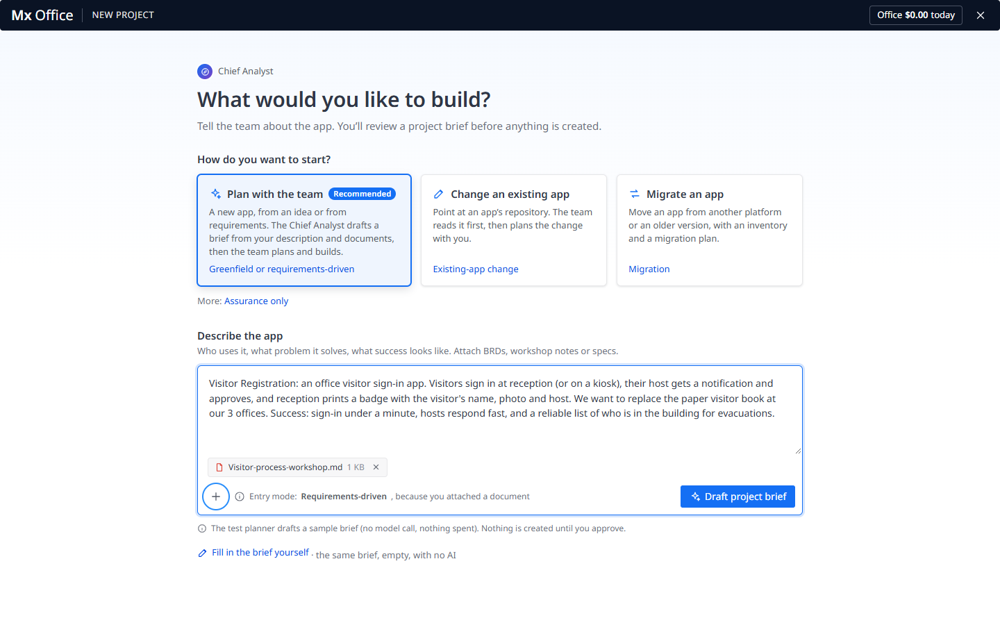
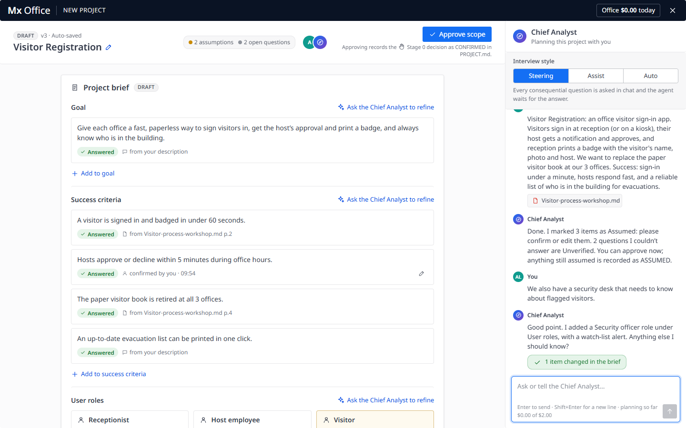
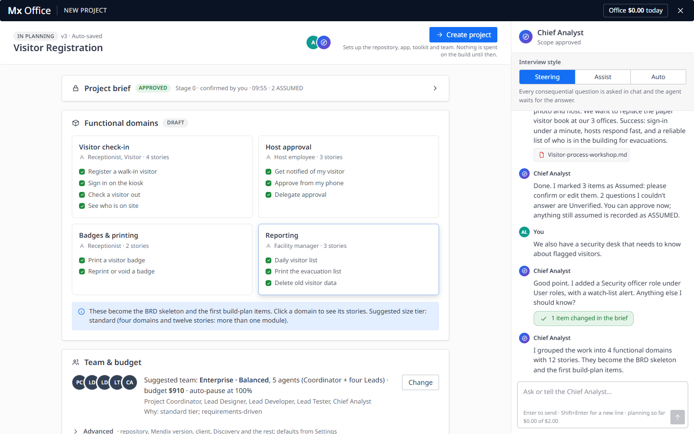
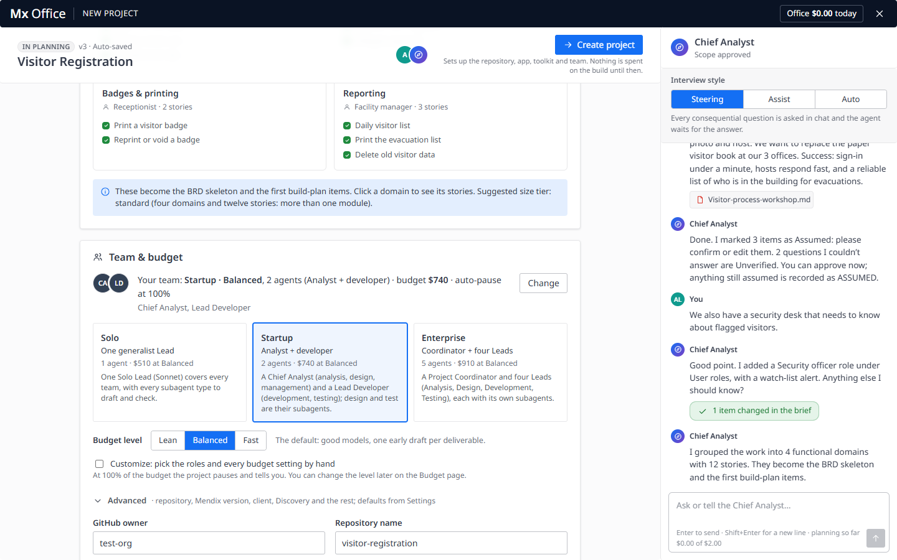
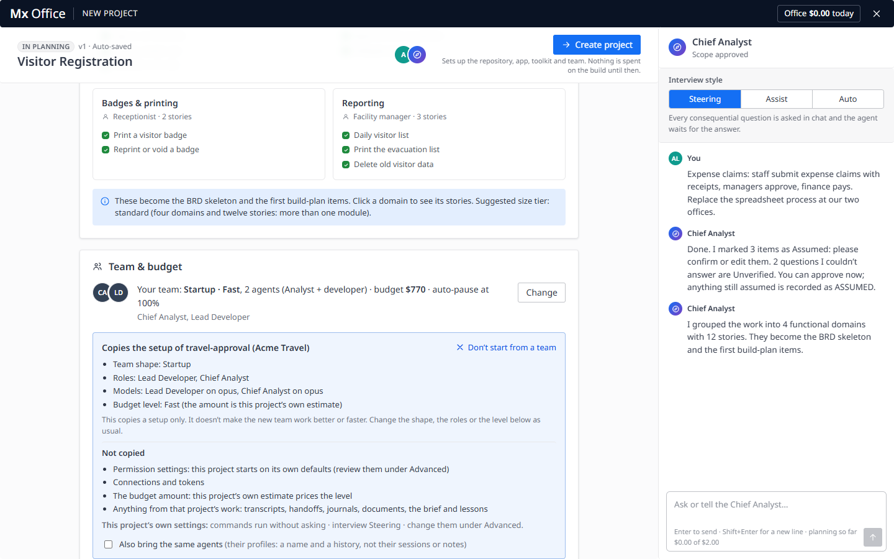
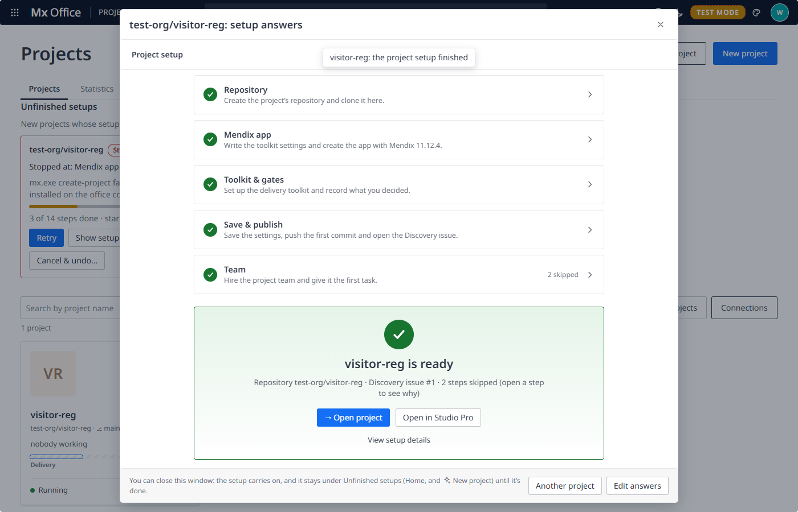
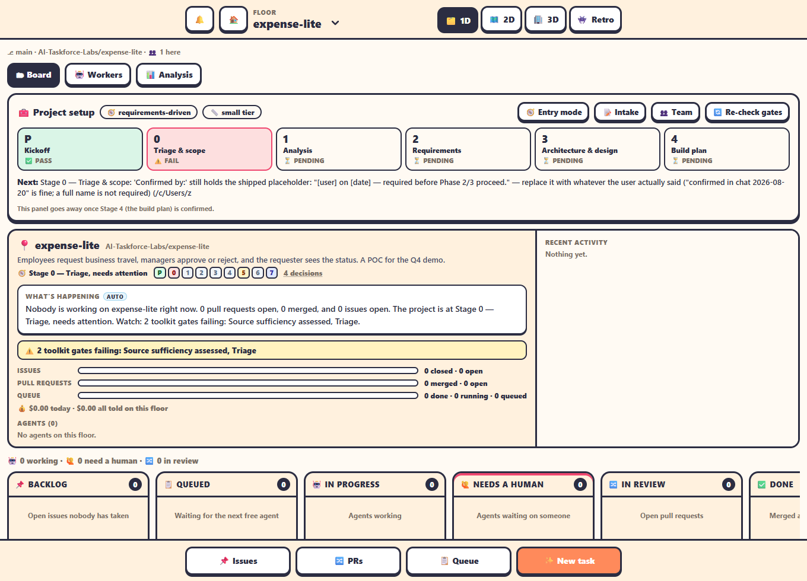

**✨ New project** on **/home** turns a description of the app into a ready project. You describe it (and attach any documents), the **Chief Analyst** drafts a **project brief** with you, you approve the scope, look over the functional domains and the team and budget, and click **Create project**. Then the office makes a private GitHub repository, a project, a blank Mendix app (`.mpr`), the toolkit's scaffold with your answers and decisions recorded, the project team at their desks and a Discovery issue for the Chief Analyst.

> [!NOTE]
> Only an admin (the Project Manager) can create a project. Creating the repository uses a separate **admin token** that can create repositories: `~/.agent-office-admin-gh-token`, or the one in 🔌 Connections. The agents never see it. See [Security & tokens](../administration/security-and-tokens.md).

## Open New project

Go to **🏠 Home → 🏢 Projects** and click **✨ New project**. It opens a page over the office with a slim bar: **Office $… today** (what the office has spent today, planning included) and **✕**, which closes it. Your draft is kept in the office, so closing the page, a reload or another tab loses nothing: the start page offers **Continue** (or **Discard**) for it next time. Continue brings back the description, the way you started and, for a change or assurance, the app's repository. Setups that didn't finish are cards at the top of the start page (see [Unfinished setups](#unfinished-setups)).

## 1. What would you like to build?

**How do you want to start?** Pick one card:

| Card | Entry mode | When |
|---|---|---|
| **Plan with the team** (recommended) | 🌱 Greenfield, or 📄 Requirements-driven as soon as a document is attached (the line under the box says which) | A new app, from an idea or from requirements. |
| **Change an existing app** | 🛠️ Change an existing app | Changes to an app that exists: name its repository (`owner/name`) in the box that appears. The brief is drafted from your description and documents: the Chief Analyst is told the repository's name (and its GitHub description, when the office's repository list already has it) but doesn't read the repository. The team reads the app after setup. |
| **Migrate an app** | 🚚 Migration | Moving an app from another platform or an older version. Attach its code with **Add a source folder…** (see [A source folder](#a-source-folder) and [Migrate an app](migrate-an-app.md)). |
| More: **Assurance only** | 🔎 Assurance only | Review and test an app nobody is changing (it asks for the repository too). |

**Describe the app** in the big box: who uses it, what problem it solves, what success looks like. The **+** menu attaches documents (**Upload files…**) and, for **Migrate an app** and **Change an existing app**, a local folder of the app's code (**Add a source folder…**); Confluence and SharePoint are listed as *coming later*.

### Attached documents

`.pdf`, `.docx`, `.md` and `.txt`, at most 5 MB each and five files. They're kept with your draft in the office's data folder (`wizard-drafts/`), copied into the project's `sources/` (the toolkit's drop folder, git-ignored by default) at setup, and removed with the draft once the project is set up. The page says what happened to each one, plainly:

| File | What the office does with it |
|---|---|
| `.md`, `.txt` | *read as text*: the first 60 KB of each (150 KB in all) go to the Chief Analyst; a longer file says how much was read. |
| `.docx` | *text extracted (no images)*: its words, paragraph by paragraph; pictures, text boxes, headers and comments aren't read. |
| `.pdf` | *handed to the Chief Analyst to read*: the planning call gets a copy in an empty temporary folder and only the Read tool, confined to that folder. Afterwards it says *read by the Chief Analyst*, or *not read* when the Chief Analyst didn't say it read it. |

### A source folder

For **Migrate an app** and **Change an existing app**, **+** › **Add a source folder…** takes the full path of a folder on the office's machine (copy it from File Explorer's address bar) and **Check folder** looks at it before anything is copied:

- It is refused when it isn't a full path, isn't there or isn't a folder, is a whole drive, your home folder (or the folder of home folders), a system folder (Windows, Program Files, ProgramData, AppData\Roaming), or inside or around the office's own code, its data folder or the projects home.
- Otherwise the dialog says what will be copied, for example *212 files, 9 MB; skipped: node_modules, 2 secrets-like files*, with the first files of its index. Left out wherever they are: `node_modules`, `.git`, `.next`, `dist`, `build`, `coverage`, `.turbo` and `__pycache__` folders, any file over 5 MB, symbolic links, and secrets-like files (`.env` and `.env.*`, `*.pem`, `*.key`, `*.pfx`). A folder with more than 200 MB or 20,000 files after that is refused: pick the app's own folder.

The folder shows as a chip under the description (its name, how many files, *confidential*) and is kept with your draft, so a draft you come back to still has it. The Chief Analyst doesn't read it: the planning call gets only its **file index** (the paths and sizes of up to 150 files, shallowest first) and is told the team reads the code after setup. At setup it is imported into the project's `sources/legacy/<name>/`, `docs/project-brief.md` and the Discovery brief mark it confidential, and the Discovery brief names its absolute path. Admins only, like the rest of the brief.

**Where the code goes.** The snapshot is **stored locally**, in the project folder on the office's machine, and it is **never published to GitHub**: `sources/legacy/` is git-ignored, so it is never committed or pushed. It is **not** kept from the hosted model: after setup the team's agents read the code and send what they read to Claude, through Anthropic's API, to work on it (as they do with everything else in the project). Earlier releases said the folder *never leaves the machine*; that was only true of the office itself, not of the agents' work. If the client doesn't allow its code to be processed by a hosted model, don't attach the folder.

**What the snapshot is.** Each import is a fresh, complete copy of the folder as it is at that moment (with the exclusions above), described by `sources/legacy/<name>.manifest.json` beside it: every file's relative path, size and sha256, and a digest of the whole list. The copy is made in a staging folder next to it, checked against the source and the manifest, and only then swapped in, so the snapshot holds exactly the manifest's files. A **Retry** of the setup step imports the folder again as it is now: an edited file comes in as edited, a deleted one is gone. If a file changes while it's being copied it is copied again; if the folder keeps changing, or changed in a way only its bytes show, the step stops with the paths that changed: stop whatever is writing to it (an editor, a build, a sync client) and Retry. The source folder itself is only read, never written. An import the office was stopped in the middle of is never published half-done: the next Retry throws the partial copy away (or finishes swapping in one that was already complete and checked) before importing again.

### Drafting, and what it costs

**Draft project brief** starts one planning call: the Chief Analyst, through the office's `claude` CLI, on **Sonnet** by default. The line under the box says about what a draft costs, worked out from the prices the office books the model at (the brief, one chat message and the domains, more with large attachments; `sonnet` is priced as the model the CLI runs for it, Sonnet 5.5), and the cap: *about $0.15 of office spend (capped at $2)*. The first real draft (a one-page PDF, one chat message, the domains) cost $0.125. Planning is office spend, booked as *New project planning (the Chief Analyst)* in the Budget pages and the **Office $ today** chip. The hard limits:

- **A cap per draft**, $2 by default: every call gets what the draft has left (`--max-budget-usd`); when it's used up, the brief so far is kept and the page says so, and you carry on by hand.
- **A timeout per call** (4 minutes), **one request at a time per person**, **20 calls an hour** across the office, and a pause of a few minutes after three failures in a row.

The model, the cap and the limits are set with `AGENT_OFFICE_PLANNER_*` ([environment variables](../reference/environment-variables.md#new-project-wizard)).

**Fill in the brief yourself** opens the same brief, empty, with no AI and nothing spent. It's also the way on whenever the Chief Analyst can't draft: no `claude` CLI on the office's machine, the hourly cap reached, paused after failures, switched off (`AGENT_OFFICE_PLANNER=off`), or a test office without the test planner. The line under the box says which.

> [!NOTE]
> A test office never calls the real Claude. Started with `AGENT_OFFICE_PLANNER=fake`, it drafts with the **test planner**: the same sample *Visitor Registration* brief every time, no model call, nothing spent. Without it, briefs are filled in by hand there.

## 2. The project brief

The brief is on the left, the Chief Analyst on the right (a sheet at the bottom on a phone: tap its header to open it). While it's drafting, the sections wait under shimmering lines; the Chief Analyst writes all six in one go, and when the brief arrives they appear one by one. The sections: **Goal**, **Success criteria**, **User roles** (each with a *When I…, I need to…* statement), **Scope** (in and out), **Constraints** and **Open questions**. A role's tag and source are about the role; its statement is usually the Chief Analyst's own wording, and then says *Statement drafted by the Chief Analyst* until you edit or confirm the role.

Every item has a tag, as a word and a colour, and says where it came from:

- **Answered**: you said it, or a document says it (*from your description*, *from workshop.pdf p.2*).
- **Assumed**: a concrete default the Chief Analyst chose (*inferred from "hosts respond fast"*). Anything inferred stays Assumed until you confirm it. **Confirm** makes it Answered, *confirmed by you · 10:42*; **Edit** changes it in place (Answered, *edited by you*).
- **Unverified**: an open question nobody could answer yet, with the document that raised it when there is one (*open question (from workshop.pdf p.3)*). Something nobody stated is an open question, never an assumption. **Answer in chat** puts it in the chat box.

Every section can be added to (**Add user role**, **Add to scope**…), and **Ask the Chief Analyst to refine** starts a chat message about it. A **chat message** is a planning call too: the Chief Analyst answers in a few sentences and updates the brief. Meanwhile the brief waits, dimmed, under an *Updating the brief…* card (you can read the chat, not change the brief); then what it changed is highlighted and scrolled to, or *No changes to the brief* says so. It never undoes what you confirmed or edited, and what you tell it is recorded as yours (*from the chat with you*); an item that was already in the brief and that you confirm in the chat says *confirmed by you in the chat · 10:44*, is highlighted and counts as a change. The header shows **DRAFT v3 · Auto-saved** (the version goes up with every change) and *N assumptions · M open questions*; the pencil renames the project.

**Interview style** (above the chat) is the toolkit's interview mode, written to `PROJECT.md` as `Interview mode:` and to intake Q9: **Steering** (every consequential question is asked and waited for; the default), **Assist** (questions batched at the gates, small ones assumed and reported) or **Auto** (nothing blocks; every position recorded as ASSUMED).

## 3. Approve scope

**Approve scope** is the brief's one primary action: *Approving records your scope decision for ✋ Stage 0 in PROJECT.md. Stage 0 passes when the Chief Analyst’s triage is signed off.* If items are still Assumed, it asks first: *2 items are still Assumed; they'll be recorded as ASSUMED. Approve anyway?* **Review them** takes you to the first one; **Approve anyway** goes on. Once approved, the brief folds away (*✋ Stage 0 scope · approved by you · 10:45 · 2 ASSUMED*) and can't be changed here: a message to the Chief Analyst after that is noted for Discovery.

### What the approval records

At setup, the brief goes into the project in the toolkit's own formats, every item keeping its tag and its source:

| Where | What |
|---|---|
| `intake.md` | **Q2** the goal and the success criteria, **Q4** the scope in and out and the input documents, **Q5** the constraints, **Q8** the open questions (*Unverified — how to verify: ask the client…*). Each answer starts *Answered (CONFIRMED):*, *Assumed:* or *Unverified — how to verify:* (one Assumed item makes the answer Assumed) and lists each item with `[Answered, from …]` or `[ASSUMED, inferred from …]`. Q1, Q9 and Q11 come from your choices; Q3, Q6, Q7 and Q10 from Advanced, or the Chief Analyst asks them. |
| `PROJECT.md` | Stage 0 rows in the Decisions table: *Scope: project brief approved (docs/project-brief.md)* `CONFIRMED <date>` (by whom, at what time); *Goal: …*; and one *Brief assumption …* row per item still Assumed, `ASSUMED <date>`, each also listed under *Assumptions (ASSUMED, unresolved)*. The open questions go into the *Open questions* table (`OQ-01`…, *Raised at* the brief, `OPEN`), which the office's setup panel lists as questions still to answer. Nothing inferred is ever recorded as CONFIRMED. |
| `docs/project-brief.md` | The whole brief with every tag and source, who approved it, the functional domains and how each attached document was read. Committed with the project. |
| `sources/` | The attached documents. The folder is git-ignored, so it's only in the project's own folder, never in an agent's worktree: the Discovery issue and the analyst's Playbook give its full path and say to inventory it first (the toolkit's `bin/source-sufficiency.sh init . --sources` with that path), so the gates' source ledger has a row for each file. |
| The Discovery issue | The goal, the roles, the scope, what is still ASSUMED (to confirm with the client first), the open questions and the domains. |

> [!NOTE]
> The toolkit's Stage 0 gate (`gate-check.sh`) passes on `triage.md`'s `## Sign-off`, not on a `PROJECT.md` row, and Stage 0 also wants its capability map (and, with documents, the inventory). So the approval is recorded as the Stage 0 scope decision, and Stage 0 still shows as pending until the Chief Analyst has built `triage.md` from the brief and the client has signed it off. The Discovery issue tells it exactly that: start from the approved brief, confirm the ASSUMED items, and don't redo the scope conversation from nothing.

## 4. Functional domains

After the approval the Chief Analyst groups the work into **functional domains** (a second planning call, under the same cap): a card per domain with its roles and stories. Click one for a side panel with each story (*As a …, I want …, so that …*), its id (VIS-1) and how many acceptance criteria it has. *These become the BRD skeleton and the first build-plan items*: they go into `docs/project-brief.md` and the Discovery issue, every story ASSUMED until the client confirms it. The domains also suggest a size tier (used for the team recommendation; change it under Advanced). No modules are suggested here: the Lead Developer picks them at ✋ Stage 3. The BRDs themselves (`analysis/knowledge-base/brd/*.brd.json`, with full use cases) are written in Discovery, not here. A brief filled in by hand gets no domains: they're left to the BRDs.

## 5. Team & budget

One card: the recommended [team shape](../teams-and-agents/team-shapes.md) and budget level, with the budget for it and *auto-pause at 100%*, for example *Suggested team: Startup · Balanced, 2 agents (Analyst + developer) · budget $740*, the roles, and why. **Change** opens the three shapes (Solo, Startup, Enterprise), each priced at the level, and **Budget level**: Lean, Balanced or Fast.

**The recommendation** reads the size tier, the entry mode and what the brief says: its goal as Q2 (what drives the project: a POC or demo, a hard date, open-ended), its scope as Q4 (one module, or the whole app), its constraints as Q5 (what must stay as it is), and Q7 (the SME) when you answer it under Advanced.

An answer it can't read changes nothing. The rules:

| Shape | When |
|---|---|
| 🧑‍🚀 Solo | Assurance only; or a small greenfield or POC project with no integrations to keep. |
| 🚲 Startup | A small project that's a migration, keeps several integrations or covers the whole app; a small requirements-driven or change project; a standard greenfield or POC project with nothing heavy. |
| 🏢 Enterprise | A standard project that's a migration, keeps integrations or covers the whole app; any other standard requirements-driven or change project. |

| Level | When |
|---|---|
| 🪙 Lean | A POC; or nothing said about the driver on a Solo project. |
| ⚖️ Balanced | A hard date; open-ended; or nothing said. |
| 🚀 Fast | A hard date that's soon ("asap", "in three weeks"), unless the SME is slow to answer (agents would only wait faster). |

**The shape cards.** Each of the three cards has a **Lean / Balanced / Fast** switch, its budget at that level (in dollars and the local currency) and the working days it expects. The recommended card is pre-selected and badged **★ Recommended**. Clicking a card picks that shape at the level its switch shows. Each card's estimate is the [plan](../using-the-office/budget.md#the-expected-plan) priced for that shape (see [team shapes in the plan](../using-the-office/budget.md#team-shapes-in-the-plan)) times the level's factor:

| | Lean | Balanced | Fast |
|---|---|---|---|
| **Small greenfield app** | | | |
| 🧑‍🚀 Solo | $60 | $100 | $160 |
| 🚲 Startup | $90 | $140 | $220 |
| 🏢 Enterprise | $110 | $170 | $270 |
| **Small requirements-driven** (like travel-approval) | | | |
| 🧑‍🚀 Solo | $120 | $180 | $290 |
| 🚲 Startup | $170 | $270 | $430 |
| 🏢 Enterprise | $220 | $330 | $530 |

The levels:

| Level | What it sets | Preset budget |
|---|---|---|
| 🪙 **Lean**: lowest cost | Leads and Discovery on Sonnet. Subagents on Haiku where the role allows it (the Developer, UI/UX Designer and Business Analyst stay on Sonnet). Early drafts off. Autonomy by stage on (Guided, then Delegated in build). At most 1 subagent at once per Lead. | 0.65 × the shape's estimate |
| ⚖️ **Balanced**: the default | Leads on Sonnet, the Chief Analyst on Opus for Discovery, subagents on Sonnet. Early drafts on. At most 2 subagents at once per Lead. | the shape's estimate |
| 🚀 **Fast**: speed first | Leads on Opus, up to 4 subagents at once per Lead. Early drafts on. Autonomy by stage on (Delegated, then Autonomous). | 1.6 × the shape's estimate (Opus rates plus a 15 % margin) |

**Customize** sets the cards aside: tick the roles to staff yourself (the five Enterprise roles and the Solo Lead) and use the full level picker, Manual included (type the budget and pick each setting), with the total, the alert threshold (80 % by default) and auto-pause at 100 %. The ticked roles decide the shape: the Solo Lead makes it Solo, only the Chief Analyst and the Lead Developer make it Startup, anything else Enterprise.

When the setup reaches its **Hire the project team** step, it sets the project's shape and coverage first, then saves the budget and applies the level's models and settings, then hires the shape's roles: the Solo Lead; or the Chief Analyst and the Lead Developer; or the full team. To change the level of a running project, use its [Budget tab](../using-the-office/budget.md#budget-levels).

### Start from a team

**Start from a team** (under the team line) lists the projects in the office that have had a team: each with its client, if it has one, its shape, how many members it has had, its budget level and its agents. Pick one and the card says *Copies the setup of travel-approval*, line by line:

- **Copied**: the team shape, which roles it has, each role's model as that project has it now, and the budget level (Lean, Balanced or Fast). A project on a manual budget has no level to copy, so the suggested one stays. Roles that make none of the three shapes exactly are copied as a customised team.
- **Not copied**: the permission settings (the new project starts on its own defaults: the card shows them, change them under Advanced), connections and tokens, the budget amount (the new project's own estimate prices the level, so the same level can cost a different amount) and anything from that project's work: transcripts, handoffs, journals, documents, its brief and lessons.

It copies a setup only; it doesn't make the new team work better. Everything stays editable as usual: **Change** the shape or the level, or **Customize** the roles. Picking another level lets the copied models go (each role's model follows the level you picked); dropping a role drops its model. **Don't start from a team** puts the suggestion back.

**Also bring the same agents** (a separate tick) picks that project's [agent profiles](../using-the-office/agents.md) for the new project's seats, one per role you kept. An agent on no project is hired with the team. One that is working on a project (or benched there) needs a **Move**, as with [Hire from your agents](../using-the-office/agents.md#hire-from-your-agents): **Create project** first lists each one and what happens there (a handoff note, which stays with that project, then a fresh session here; its seat there is then open), and nothing starts until you confirm. At the **Hire the project team** step the agents are brought through the same Move as the Team tab's (recorded before each step, so a restart carries it on and never hires anyone twice; a move that stops shows Retry and Cancel on Home › Agents), and the rest of the team is hired as usual. An agent's Discovery task, if it has one, runs on the Discovery model.

The setup records where the team came from: in the plan, in the audit log (`wizard.team-from`, with the source, what was copied and the agents) and in the project's `agent-office.project.json` (`teamFrom`; when the source is another client's project, only *another client*, never its name).

### Advanced

Collapsed under the card, with the defaults from the office's settings and the brief: everything else the wizard needs. A problem shows next to its field when you click **Create project**, and Advanced opens on it.

- **The repository**: GitHub owner (your organization by default), repository name (from the brief's title: *Visitor Registration* → `visitor-registration`), visibility (**Private** by default) and description (the brief's one line). For **Change an existing app** and **Assurance only**: the app's repository. Without an admin token: paste one (saved in 🔌 Connections), or tick **I created this repository myself** and the setup only checks that it exists. An offline test office says it makes local bare repositories.
- **Mendix version**: the Studio Pro versions installed on the office's machine, the newest 11.12 (11.12.4) by default (11.6.4, mxcli's validated line, when no 11.12 is installed). The new app is created with it.
- **Size tier**: 🐣 **Small** (at most 1 module, 8 screens and 25 use cases) or 🏗️ **Standard**; the domains' suggestion by default.
- **Exec approval** (Q11): auto or ask. **Interview mode** (Q9) is the Interview style in the chat.
- **Keep this project off GitHub (local / Team Server only)**: new projects only, and unticked by default: a migration with a source folder still gets the usual private GitHub repository (the copied source is git-ignored, so it's never pushed). Tick it only when the client won't allow a private GitHub repository. See [Local only (not on GitHub)](#local-only-not-on-github). No admin token is needed then.
- **Client & Discovery**: client name(s) and operator(s); open a *Discovery* issue for whoever covers Analysis (on by default); **Hand it to the … now** hires that member with the issue as its first task, on the model you pick for Discovery (the level's Discovery model by default); without that member on the team, **Queue it now for an agent**.
- **Kickoff questions the brief doesn't answer**: Q3 (fidelity), Q6 (licence and security), Q7 (the SME), Q10 (work done elsewhere), each **Answered**, **Assumed** or **Unverified**, or blank for the Chief Analyst to ask.
- **Toolkit version**: the newest commit of the toolkit fork, pinned for the project when it's created ([Toolkit versions](../administration/toolkit-versions.md)).

### A migration's budget cap

For **Migrate an app** the card also shows the planner's estimate with *Migrations have run over this estimate; set a cap*, and a **Budget cap (USD)** field filled in with the level's budget. The cap is the project's budget: auto-pause at 100% is on, and the level's models and settings stay as they are. Change it later on the 💰 Budget tab.

## 6. Create project

Click **Create project** (the primary button once the team card shows). The page says *Here's how I'll set up travel-approval* and shows the setup as five groups that tick in order: **Repository**, **Mendix app**, **Toolkit & gates**, **Save & publish** and **Team**. The group that's running opens by itself; click any group to see its real steps (the 14 below), each marked done, running, failed or skipped. A skipped step says why, in the step's own words: in an offline test office, for example, *skipped: offline test office: nobody is hired*. A done group with skipped steps says how many. Every step can be retried, and a step that is already done is skipped.

| Group | Its steps |
| --- | --- |
| Repository | 1–2 |
| Mendix app | 3–4 |
| Toolkit & gates | 5–8 and 10 |
| Save & publish | 9, 11 and 12 |
| Team | 13–14 |

1. Create the GitHub repository (`gh repo create`, private, with the admin token). It first asks GitHub whether the repository is there, and creates it only when GitHub says plainly that it isn't. A repository that's there already is used as it is and is never the setup's to delete. When GitHub can't say (a timeout, a login that doesn't work, no permission, GitHub down), the step stops with *Couldn't check whether owner/name exists on GitHub: …* rather than guessing: check the office's GitHub login in 🔌 Connections, then Retry. When it creates the repository, the setup records that it did, with GitHub's id for it; when step 2 clones the folder, it records that too. Cancel & undo relies on these records (see [When the office isn't sure what happened](#when-the-office-isnt-sure-what-happened)).
2. Clone it as a project. On Windows the clone gets `core.longpaths true` in its own config (a Mendix app's npm packages go past 260 characters inside a worker's worktree; the office's own git has long paths from its environment anyway), and the project's folder is marked trusted in the office's Claude Code config, so the team's agents start without the *Do you trust the files in this folder?* prompt.
3. Write `.claude/toolkit.env` (MXBUILD_PATH, mxcli nightly, Python).
4. Create the Mendix app (new projects only): Studio Pro's own `mx create-project` makes a blank app named after the project (`travel-approval` → `TravelApproval.mpr`) at the repository's root, where the toolkit looks for it. Without `mx` in that Studio Pro it falls back to `mxcli new`. Mendix's generated files (`deployment/`, `.mendix-cache/`, `theme-cache/`, `*.mpr.lock` and so on) are added to `.gitignore`. An existing app is left alone; the step only reports which Studio Pro its `.mpr` was saved with.
5. Run the toolkit's `init-project.sh` (after the app, so its `CLAUDE.local.md` names the `.mpr`), from a **pin** of the fork's newest commit: the project stays on that toolkit commit until you update it (see [Toolkit versions](../administration/toolkit-versions.md)), and its session-start ritual doesn't pull.
6. Install the pre-commit hook.
7. Write the intake answers to `intake.md` (the brief's, see [What the approval records](#what-the-approval-records), and any typed under Advanced), the brief to `docs/project-brief.md`, and the attached documents into `sources/`. A source folder is copied into `sources/legacy/<name>/` here, off the event loop, with the same rules as the check (a Retry keeps the files already there).
8. Record decisions in `PROJECT.md`: entry mode, size tier, Mendix version and interview mode, each `CONFIRMED` with today's date; and the brief's ✋ Stage 0 rows: the scope approval `CONFIRMED`, the goal, and every item still Assumed as `ASSUMED`.
9. Save the client, operator and role settings in `agent-office.project.json` at the project's root. It is committed with the project, so every office that opens it sees the same client and team.
10. Refresh the gate dashboard (`gate-check.sh`).
11. Commit and push: the scaffold and the app in one commit.
12. Open the Discovery issue: *"Discovery: kickoff with the client (Stages P → 4)"*, with the approved brief in it: the goal, the roles, the scope, what is still ASSUMED, the open questions and the functional domains.
13. Hire the project team: set the project's team shape, then hire its roles (or the ones you ticked under Customize), the roster's way (the same as **Hire** on the Team tab). A role already at work is not hired again.
14. Queue the Discovery task for an agent (when you ticked it and whoever covers Analysis isn't on the team; otherwise that member already has it).

If a step fails, its group turns red with *Setup stopped at one step*, the step's error in plain words (a command is named by its file; **View setup details** shows the log), and two buttons: **Retry** carries on from the failed step once you've fixed the cause, and **Cancel & undo…** (admins) opens the dialog described under [Unfinished setups](#unfinished-setups). Cancel & undo only removes what this setup recorded creating. **Edit answers** opens the setup's answers in the classic form (see below).

### When the office isn't sure what happened

Creating the GitHub repository and cloning the folder can't simply be done twice, so the office writes down what it's about to do before it does it, and what came of it afterwards. If the answer never arrives (GitHub stops responding, the connection drops, the office restarts at that moment), the setup doesn't guess. Its group shows, instead of the error and Retry:

> **Repository creation may have completed**
> GitHub stopped responding before Office could confirm the result. Setup is paused so it doesn't create or remove the wrong thing.

*May have completed* means exactly that: GitHub may have made the repository, or not. Until the office knows, no later step runs, Retry isn't offered, and Cancel & undo won't delete the repository.

- **Check GitHub again** asks GitHub whether the repository is there. The office also does this by itself once when it starts, and before any Retry.
  - Not there: the create didn't happen. The box goes, and Retry creates it as usual.
  - GitHub still can't say (a timeout, a login that doesn't work, no permission): the setup stays paused, and the box says so. Check the office's GitHub login in 🔌 Connections, then Check GitHub again.
  - There: the box says *owner/name is on GitHub, but Office can't prove it created it*, with GitHub's creation time (and *after Office asked for it* when that fits), and offers **Use this existing repository**.
- **Use this existing repository** appears only after a look has found it. It records the repository as **adopted**, and setup carries on from there. An adopted repository is used like one you created yourself: **Cancel & undo never deletes it**. Delete it on GitHub yourself if it isn't wanted.

The office never decides on its own that it created a repository it found afterwards, even when the timing fits: only GitHub's own *created* answer to the office's command counts. The same goes for the project folder (*Cloning the project folder may have completed*, **Check the folder again**, **Use this existing folder**). The unfinished-setup card on Home shows the same box and buttons, and every step of this is in the audit log (`project.setup-operation`).

When it's done, the card says *travel-approval is ready*, with **Open project**, **Open in Studio Pro** (when the office can open the new project's `.mpr`: it opens the project page and asks there, as the page's own button does) and **View setup details** (every group open, and the log).

### Unfinished setups

A setup that hasn't finished never takes over **✨ New project**: it always opens a fresh wizard. Unfinished setups are cards instead, at the top of the wizard's first page and on Home (Projects), each with where it stopped (its group and step) and why, how many of the 14 steps are done, and:

- **Retry** carries on from the step that stopped. It says first what would stop it right now, rather than failing again: *This project is paused (by Keith): resume it, then Retry* (a paused project takes no new agents, so the team can't be hired) with a **Resume project** button for admins; the same for a project paused because its budget is reached, a pause or resume under way, a safe restart, and Studio Pro open on the project when the steps left write in its folder.
- **Show setup** opens the setup's progress in the wizard, to carry on with it there (Edit answers, Retry).
- **Open project**, once its project is there.
- **Cancel & undo…** (admins) undoes what the setup did, in reverse. The dialog lists the steps that ran, says exactly what will happen, and asks you to type the repository's name (`owner/name`), as GitHub does:
  1. The project comes off the office the way [Delete project](../using-the-office/delete-project.md) does it: agents stopped and sent home, worktrees removed, the office data archived and then removed, the project taken off `floors.json`, its project id retired.
  2. **Also delete the local folder**: offered (ticked) only when the setup recorded cloning it, and the folder is still that folder: inside the projects folder, not a junction or link pointing somewhere else. A folder that was a project already is never offered.
  3. **Also delete the GitHub repository**: offered (ticked) only when the setup recorded creating it and GitHub still shows the same repository (the same id) under that name. It's never offered when you created it yourself (*I created this repository myself*), when it was there already, when you chose **Use this existing repository**, while the office isn't sure whether it created it, when a different repository now has that name, or when GitHub can't say right now. The delete itself is written down before it's sent, so a delete whose answer was lost is checked on GitHub when you carry on cancelling, never sent twice on a guess. It also needs a token with the `delete_repo` scope, as Delete project does. When the repository isn't offered, the dialog says why and links to its settings on GitHub.

  Setups started with an older version of the office have no such records, only their log lines (*created … on GitHub*, *cloned into …*). For those, Cancel & undo still takes the project off the office and removes the setup, but it keeps the folder and the repository. The dialog says: *this setup's log says it created it, but the office didn't record proof, so delete it on GitHub yourself if you're sure.* The office also checks all of this again on the server, right before deleting anything, so a request that asks for more than the dialog offered is refused for that item.
  4. The setup itself is removed, so New project no longer lists it.

  The Mendix app (`.mpr`) lives in the folder and the repository, so it goes with them. A Mendix Portal or Team Server app is never deleted automatically: remove it in the Portal yourself if there is one. Cancel & undo is refused while an agent is mid-turn on the project, a pause or resume of it is under way, or a safe restart is running. If a step fails (a locked file, GitHub down), it stops and says why; the card shows *Cancel & undo stopped* and **Carry on cancelling…** picks it up from that step. The audit log records `project.setup-cancel` (and Delete project's `project.delete`).

Editing the answers later (the project's **🧰 Project setup** panel: **🧭 Entry mode**, **📝 Intake** and the rest, or **Edit answers** on a setup) opens them in the classic form, a page per subject; saving writes the intake answers, decisions and settings again and commits them. A project's brief stays as it was approved. A role you tick that wasn't ticked before is hired too, but never one the project already has in any state: at work, benched, or sent home on purpose. Unticking a role sends no one home. The Discovery issue isn't handed out again.

> [!NOTE]
> Agents, queue workers, **🔄 Re-check gates** and the live app all run with the project's `.claude/toolkit.env` over the office's own environment, so an 11.12.4 project builds with 11.12.4's mxbuild even when the office was started with an `MXBUILD_PATH` for another Studio Pro.

The setup is a [workflow](../automation/workflows.md): it is saved after every step, so an office restart halfway loses nothing (the step it was on shows as failed, and Retry carries on from it). The steps that talk to GitHub (create, clone, push, the issue) and creating the app try again by themselves, twice, when the connection drops or GitHub is busy; the log says *↻ … trying again in 3s*. The setup keeps the first 300 lines of its log and the last 2,700, with *… N lines left out …* between them, so both the start and a failure near the end survive a long toolkit run; **View setup details** shows its last 400 lines.

## Local only (not on GitHub)

**Keep this project off GitHub** under Advanced makes a project that never reaches GitHub. What changes:

| | Normally | Local only |
|---|---|---|
| Step 1 | `gh repo create` on GitHub | A bare git repository on this machine, `<projects home>/.local-git/<owner>/<name>.git`. No `gh` runs at all. |
| Step 2 | Clone from GitHub | Clone from that bare repository: it is the project's `origin`, so pushes and the worktrees' `origin/main` stay on the machine. |
| Step 9 | `agent-office.project.json` | Also `"localOnly": true`, and a *Local only* section in the project's `CLAUDE.md`: never push to GitHub or run `gh` commands that publish; local branches, the Lead merges into main locally. Every hire is told the same in one line. |
| Step 12 | A GitHub issue | `docs/discovery-brief.md`, committed with the scaffold and handed to the Chief Analyst (or queued) as a file. |
| Overview | The GitHub link | *Local only: not on GitHub*, with the project's folder. |

**What doesn't work in a local-only project** (each says so rather than failing): the office asks GitHub nothing for it, and every GitHub call answers *Local only: not on GitHub, so issues, pull requests and PR checks are unavailable for this project*. So there are no GitHub issues or pull requests on its boards, no PR checks or main-branch checks on the Testing page, no merges, comments or labels from the office, no **Open PR** for a worker, no stale-PR rows in stuck detection, and no *integrated* or *verified* task outcomes (those come from merged PRs and closed issues: a task ends as the agent's *task done* claim, pending your check). Team Server isn't wired by the wizard: add it as a remote yourself if you need it. Cancel & undo removes the folder it made, but leaves the bare repository in `.local-git` (delete it by hand).

## After the wizard

The new project's Command Center shows a **🧰 Project setup** panel with the toolkit's stages **P** to **4**. Each one is ✅ PASS, ⏳ PENDING, ⚠️ FAIL, ↷ WAIVED or ✋ MANUAL, and a ✋ stage waits for your sign-off once the stages before it have passed. The panel goes away once Stage 4 (the build plan) is confirmed. See [The toolkit](../integrations/toolkit.md).

> [!TIP]
> The Discovery brief tells the Chief Analyst to stop at the ✋ gates 0, 3 and 4, and to record `CONFIRMED` only when the client says so. You confirm by answering its escalations.

## Add an existing repository instead

**➕ Add project** opens *Add a project*. Search your repositories or type `owner/name`. The office clones it with its own `gh` login and opens it as a project. Admins can choose the folder with **📁 Change folder**.
