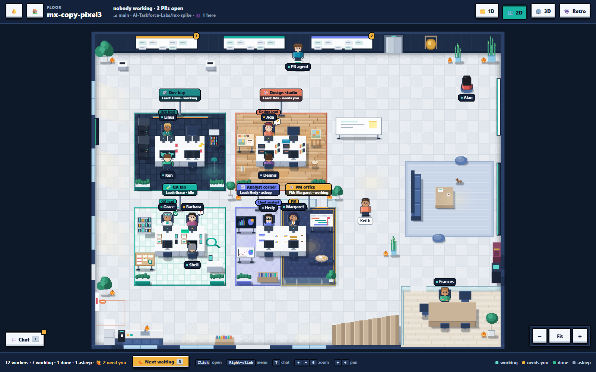

This page shows where everything is. Each screen has its own page under [Using the Office](../using-the-office/_index.md).

## The pages

| Address | What it is |
|---|---|
| `/start` | **Home**: what needs you across every project (top 5, each with its client and project), the active projects with their progress, team and live app, the clients' spend, recent milestones and the office's health. Where the wordmark and a bare `/` go. See [Home](../using-the-office/home.md#home-start). |
| `/home` | The **Projects** page: every project as a card, office-wide **📊 Statistics**, a **🗺️ 2D Overview** of all projects, the **🧾 Audit log** and **Budget** of the whole office, and **👥 Agents** (every agent profile). See [Home](../using-the-office/home.md). |
| `/clients` | **Clients**: each client's projects and company brain. See [Clients](../using-the-office/clients.md). |
| `/lite?floor=<id>` | The **1D view** of one project, with a tab for everything. The default and most useful view. |
| `/pixel?floor=<id>` | The **2D Office view**: the project from above in pixel art, opened from the 1D view's **Go to Office**. See [2D Office view](../using-the-office/2d-view.md). |
| `/firm` | **🏛️ The Firm**: independent Reviewer Agents that audit a project and report to you. See [The Firm](../using-the-office/the-firm.md). |
| `/docs` | These docs. |

## The top bar

On the 1D view: the launcher, **Mx Office**, the project, the search, **Go to Office**, the bell, help, dark mode, **🎨** (color theme) and your avatar (the **☰** menu). The 2D Office view has the same bar with **OFFICE · &lt;project&gt;** and **Return to Project**. See [Top bar & menu](../using-the-office/top-bar-and-menu.md).

## The pages of a project (1D view)

In the Portal themes (the default) a project's pages are in the left navigation, in groups. The other themes show the same pages as a tab row.

| Group | Page | Use it to… |
|---|---|---|
| General | **Overview** | See what needs you, the progress bar, the project brief and recent activity. The team lead is in the panel on the right; the team chatter is in the 📱 Team phone. The default page. See [Command Center](../using-the-office/command-center.md). |
| General | **Team** | Hire, wake, bench, rename and change the model of the team; skills and subagents. See [Org chart](../using-the-office/org-chart.md). |
| General | **Team boards** | One board per team, with its Lead, journal and team panels. |
| General | **Documents** | Every team's documents by toolkit stage: on main, on a branch, drafts and what's missing. |
| Project Management | **Board** | Move work along the Kanban, from issue to merged PR. |
| Project Management | **Approvals** | Proposals and escalations waiting for the Project Manager. |
| Project Management | **Questions** | The questions batched for the Project Manager. See [Questions](../using-the-office/questions.md). |
| Project Management | **Design gallery** | The administration patterns, which page uses which, and runtime screenshots. See [Design systems](../using-the-office/design-systems.md). |
| Project Management | **Standup** | The daily standup and its proposals. |
| App Insights | **Analysis** | Compare models, and see Jeff · Router's judgements. |
| App Insights | **Budget** | Spend against the budget, by stage, role, agent, model, day and issue. |
| App Insights | **Audit log** | Who did what, when, and the incidents. See [Audit log](../using-the-office/audit-log.md). |
| App Insights | **Testing** | Test runs bound to the revision they tested, coverage per use case, and verification of merged tasks. See [Testing](../using-the-office/testing.md). |
| Repository | **Git** | The branch map: every branch and PR as a railway line. |
| Repository | **Model** | The Mendix app as Studio Pro shows it (App Explorer, domain models, microflows) on main or any branch, and what a branch changed. See [Model tab](../using-the-office/model.md). |
| Deployment | **Live app** | Run the app from the default branch and click through it (admins start it), with its readiness card. See [Live app](../using-the-office/live-app.md). |
| Deployment | **Walkthroughs** | Captioned videos of the app's workflows. See [Walkthroughs](../using-the-office/walkthroughs.md). |
| Monitoring | **Agents** | Every agent on the project and how it's doing, ranked A–F. |
| Monitoring | **Tests** | The Test Mode page (admins). |
| (bottom) | **Settings** | Every setting: you, the agents, the team, notifications, budget, connections and the rest. See [Settings](../using-the-office/settings.md). |

Under Settings, **View App** opens the running app and **Edit in Studio Pro** opens the project in Studio Pro (Mendix projects).

> [!TIP]
> The address says where you are: `/lite?floor=acme-orders&tab=standup`, or `&tab=teams&team=testing`. Bookmark or share it. See [URL parameters](../reference/url-parameters.md).

## Which view when?

- **1D** for daily work. It shows the most, on any screen, phone included.
- **2D** to see who is busy at a glance, with a team-room feel. **N** jumps to the next agent that needs you.

The 3D and Retro views are gone; see [The two views](../concepts/views.md).

