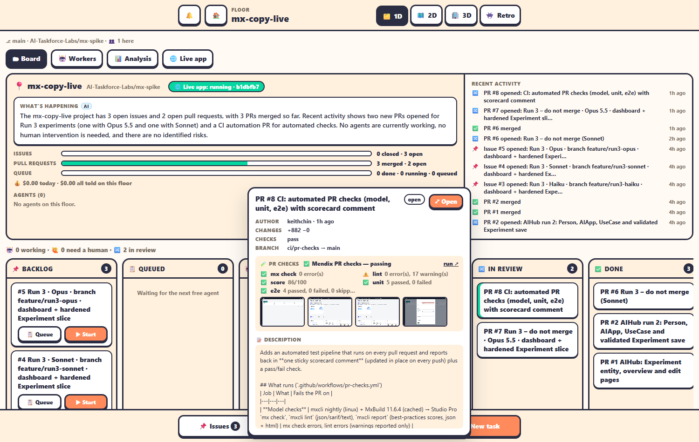

A project whose repository has a **pr-checks** GitHub Actions workflow (`.github/workflows/pr-checks.yml`) runs it on its pull requests, and the office shows the results.

> [!IMPORTANT]
> **New projects get no CI from the office.** The New project wizard doesn't write a workflow, and the toolkit doesn't either. Until someone adds one (see [Adding CI to a project](#adding-ci-to-a-project)), a project's pull requests have no checks: PR cards show none, and checks a verification policy requires read as **missing**, never as passed. Local-only projects have no pull requests, so no PR checks at all.

## What such a workflow checks

The office expects these steps (it reads whichever of them the scorecard reports):

1. Studio Pro's consistency check, **`mx check`**.
2. **`mxcli lint`**.
3. A **best-practice score** (`mxcli report`).
4. **Unit tests** with `mxcli test`.
5. **Playwright UI tests** against the running app.

It posts one sticky **scorecard** comment on the PR, and keeps the screenshots and test results as artifacts. A run takes about 5 Actions minutes.

## In the office

- Hover a PR card on the board for its **checks panel**: the scorecard rows (mx check, lint, score, unit and e2e tests) and a strip of Playwright screenshots. Click one to see it bigger.
- The same panel is in the PR window and on the Testing team's board (**🧪 CI scorecards**).
- A PR with failing checks shows **❌ PR #n has failing checks** in Needs you.

The office downloads the screenshots of the newest run on the PR's branch once, with its own `gh`. The workflow and artifact names can be changed with `AGENT_OFFICE_PR_CHECKS_WORKFLOW` (default `pr-checks.yml`) and `AGENT_OFFICE_PR_SHOTS_ARTIFACTS` (default `screenshots,test-results`).

## Adding CI to a project

The office reads CI; it doesn't provide it. To give a project CI, someone with write access to its repository adds a GitHub Actions workflow there:

1. Add `.github/workflows/pr-checks.yml` (or another name, and set `AGENT_OFFICE_PR_CHECKS_WORKFLOW` to it) that runs on `pull_request` and does the steps above. The runner needs what the steps need: mxcli, a Mendix build (`mx check`, the app for Playwright) and Postgres for the app.
2. For the office's checks panel, have it post **one sticky PR comment** that contains the marker `<!-- mx-pr-checks-scorecard -->` and a Markdown table with one row per check (the check's name in the second column, its result in the third, for example `mx check` → `0 errors`), and upload the screenshots and test results as artifacts named `screenshots` and `test-results` (or set `AGENT_OFFICE_PR_SHOTS_ARTIFACTS`). Without the comment, the office still reads the checks' pass or fail from GitHub, but shows no scorecard.
3. To make the checks count on GitHub, require them in the default branch's protection (see [Branch protection](branch-protection.md)).

A workflow from one of your own projects can be copied into a new project's `.github/workflows/`. Having the office write a CI template into new projects is **planned**, not built.

## CI emails from the office's own repository

Mx Office itself (keithchin/mx-office) runs its full test suite on every push to `main`. A GitHub email about a failed run means something broke there. That workflow never publishes releases.
