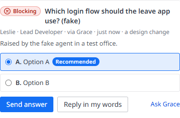

An **escalation** is a structured question from an agent to you, with an urgency, options and a recommendation. It's how the team comes to the Project Manager.

## Where escalations come from

- **An agent** runs `office-workers escalate` (or the MCP tool `escalate`). See [office-workers CLI](../reference/office-workers-cli.md).
- **A handoff note** ends with `AWAITING-PM: <question>` and there's no open escalation for it. The office raises one for the Lead.
- **Jeff · Router**, when *Waiting on you* is **On**: an agent ended its turn waiting on you but didn't say so. See [Jeff · Router](../automation/jeff-router.md).
- **An *ask* gate**: a Lead wants to do something its skill says it must ask about first. See [Skills and gates](../automation/skills.md).
- **A review loop out of rounds**: a Lead sent the same subagent's work back more times in a row than its autonomy level allows (2 rounds at levels 1 and 2, 3 at levels 3 and 4). The office raises one `revisions-exhausted` escalation for the Lead and stops nudging it about that subagent. See [The review loop](review-loop.md#bounded).

## The same ask, raised again

An agent's escalation that asks for what's already open on the floor isn't opened a second time: it joins the open one as a **+1 from** *name*, its details are added, and that agent hears your answer too.

- **The same title, or nearly** (three quarters of the words shared): joined straight away.
- **The same ask in other words** (*Set repo secret X*, *One command to set the e2e secret*, *Secret 404: set it in the web page instead*): when no title matches, [Jeff](../automation/jeff-router.md#the-same-ask-in-other-words) is asked whether it's the same ask as one of the open ones, and it's joined only when he's at least 85% sure. While his **Waiting on you** judgement is Off he isn't asked; when he doesn't answer within 10 seconds, or fails, it's raised as its own.

The Activity line says *Jeff judged it the same ask* when he joined it, and so does the Audit log.

## What's in one

| Field | Notes |
|---|---|
| **Urgency** | `info`, `important` (default), `urgent` or `critical` |
| **Trigger** | Optional: plan, scope, design, architecture, revisions-exhausted, blocked, milestone, repeated-failure, budget-risk, security, data-loss, client-milestone, budget-overrun, blocked-no-path |
| **Title** | Required, up to 160 characters |
| **Details** | Up to 6000 characters |
| **Options** | Up to 6 |
| **Recommendation** | Up to 400 characters |

The office stamps who raised it (name, role, team) and the autonomy level at the time, and works out whether it's an **FYI** for that level. See [Autonomy levels](autonomy.md#fyi-escalations).

## How you're told

- Every open, non-FYI escalation is in **🚨 Needs you** (in Portal, the Overview's Needs you card shows it in full: the question, the options with the recommendation marked, why, and **Send answer** / **Reply in my words** / **Ask &lt;lead&gt;**) and **✅ Approvals**.
- An **urgent** or **critical** one also makes a toast and a desktop notification.
- Jeff rates each open one and, with his **Priority** on (the default), the lists show them in his order with a **🧑‍⚖️ #1 · resolve first** chip. See [Jeff · Router](../automation/jeff-router.md#priority-which-escalation-first).
- The Project Coordinator is told about the team's escalations (batched a minute after the last one), so it can summarise them for you. The relay says it needs no reply. While the Coordinator is benched or asking someone, or the floor's daily cost cap is reached, they wait for it, kept in the roster file so a restart doesn't lose them. An asleep Coordinator is woken with all its relays in one message, at most once a minute. A floor with no Coordinator at all skips them (they're on the Command Center and the next standup page anyway).

## Answering

On the card, as admin:

- **💬 Reply**: send an answer or a question back.
- **✅ Approve**: go ahead (pick an option first to fill in *Go with: …*).
- **❌ Reject**: no, with a reason.
- **✓ Noted**: for an FYI.

The answer goes to the agent as a prompt: *REPLIED*, *APPROVED*, *REJECTED* or *NOTED*.

- If it's **asking something in its terminal** (a permission prompt or a question, or it's still starting up), the answer isn't typed there, where Enter would pick one of the dialog's options and the answer would be lost. It waits, and goes in once that turn is over, with any other answers it's owed, in one message. The Activity says *… has a question open in its terminal: the answer goes in once that's answered*, and the answer counts as not delivered until then.
- If it's **asleep**, it's woken with your answer.
- If it was **benched**, its role gets the answer: in its current session, or by re-hiring it with your answer in its first message (when hiring is open).

Your answer goes through even when the floor's daily cost cap is reached: the cap holds the office's own prompts, not yours. See [Models and costs](models-and-costs.md#the-daily-cost-cap).

> [!NOTE]
> A Lead waiting on an open escalation of its own is never benched for idling. It is waiting on you, not idle.

## Asks that need a person: `needs-human` and `question`

Two triggers are never filed as FYI, at any autonomy level: **`needs-human`**, a hands-on action only a person can do (merge a pull request, sign in such as `mxcli auth login`, paste a key, install a tool, allow something at the terminal, restart a preview), and **`question`**, a question only the Project Manager can answer. They toast, relay to the Coordinator and post to Teams like a blocking escalation. The Playbooks tell every Lead to raise hands-on asks with `office-workers escalate --trigger needs-human`, never as a `task` proposal; a standup proposal whose words are such an action becomes the **human-action** kind, which waits for the Project Manager at every level (a plain task is still the team's at level 4).

## FYI escalations are shown, not hidden

An escalation below the level's threshold is still filed as FYI (no toast, no Teams post), but Needs you lists it as a low **FYI** card with **Noted**, not counted in *N waiting on you*, so an ask filed quietly is still seen. An FYI that has options or asks a question is shown, and counted, as a decision, with a *filed as FYI* note.

## Answers, outcomes and ids

Besides Reply, Approve and Reject, a [decision card](../using-the-office/command-center.md#decision-cards) answers with **Noted** (an FYI) or **I've done it** (a hands-on action: the agent is told *&lt;you&gt; says it's done: please re-check*, never *APPROVED*). Each is kept as an outcome beside a verdict an older office knows (noted: *dismiss*; done: *reply "Done"*). An escalation also keeps the explicit ids it is about (`refs`: a BRD question key, a decision id such as `OW-1`, a PR number, a stage, a stuck item, a journey such as `J-08`), read from its title when it names exactly one of a kind; Needs you groups it with the other sources of the same decision only on those. Escalations from before this have no stored ids: Needs you reads them from the title with the same rule when it builds the cards (nothing is written back), and the card says *id read from the title*.

## Escalations the office files for an agent

- **From the chat.** Whoever covers Management (the Coordinator, or the lead on a Solo or Startup team) has Jeff's waiting judgement On by default (**The lead's chat** in Team settings, which can be set back to Shadow). When its last message really asks you something and it filed no escalation in that turn, the office files one for it, titled *From the chat: …*, as `question` or `needs-human`; the same ask isn't filed again within a day, and another open escalation doesn't hold it back.
- **From an `AWAITING-PM` line.** Each item of the newest `AWAITING-PM:` line of a team journal (split on `;` and numbered parts) becomes an escalation of its own, read wherever the newest entry is: the project folder, an agent's worktree, its branch head (local git only). It happens on bench, on pause and in the office's five-minute look, once per entry. When the line is gone from the newest entry, the escalation is **not** closed: its card in Needs you says so, with **Resolved** and **Still needed: ask &lt;agent&gt;** (a missing line isn't an answer, and a journal the office couldn't read says nothing either way). An escalation the agent raised itself in the same words isn't doubled.
- **From an approved `human-action` proposal.** Approving one makes its issue (once, even if two people approve it at the same moment) and files a hands-on escalation for the proposer, open in Needs you until you press **I've done it**.
