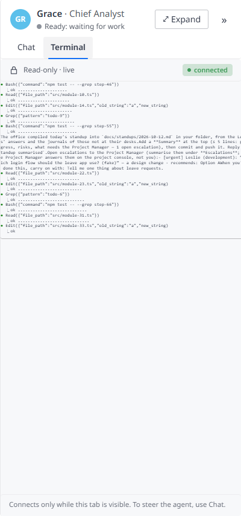

The **🎛️ Command Center** is the first tab of every project and the place to keep open. Entering a project always opens it (from Home, the project switcher, the launcher, **Return to Project** on the 2D Office view, or switching project inside the 1D view); only a link that names a tab (`?tab=…`, from Needs you, a notification or a PR's *View in Model*) opens another, and a reload keeps the tab you were on. From top to bottom: **Needs you** (one row), the **Project setup** panel (toolkit projects being set up; one line once its gates are fine), and the **project summary** with **Recent activity** beside it. The agent who leads the team is the [team-lead panel](#the-team-lead-panel) docked on the right of this and every other project tab. The team chatter is in the [📱 Team phone](team-phone.md) now.

**It fits the screen.** On a desktop window (at least 1024 × 560 px) the Command Center is a fixed-height layout: the page doesn't scroll, and neither does any column. Needs you and the folded setup line share one row, and the summary's columns (the project, recent activity) take exactly the height that's left above the bottom bar. Each card scrolls inside its own frame when it has to, with a thin scrollbar in the theme's colors: **What's happening** and **Agents** keep their height while there's room and give it up in proportion when there isn't, **Progress** keeps its rows, each risk is one line (hover for all of it), and Recent activity's list scrolls in its box. Each section of the summary (**What's happening**, **Progress**, **Agents**, **Recent activity**) folds with a click on its heading, and a folded one gives its room to the others. On a short window (under 820 px) the setup panel starts folded even with a failing gate (its line says so in red); opened, its own frame scrolls. A phone or a narrow window stacks everything and the page scrolls as usual.

### In a Portal theme: the Overview

In Portal (Light) and Portal (Dark) the Command Center is the **Overview** (the first item of the [left navigation](top-bar-and-menu.md#portal-layout)), laid out as cards, and the page scrolls instead of fitting the screen:

- **The header**: the project's tile, name and what it's for, **Pin project** (it comes first on Home's Projects page) and the blue **New task**. Under it the band with the project's line (the budget chip and **● Running | Pause**, the run-state control below). **Call an audit** is on the [Audit log](audit-log.md) page.
- **Progress**, across the page: the toolkit's stages (then Handover and Accepted) as bars, each with its name and a line under it (*done*, *✋ confirmed 2 Oct*, *✋ needs your sign-off*, what was measured for the stage in progress, *next*), the current stage as a chip and the 🧰 toolkit chip on the right. A long stage name wraps onto a second line rather than being cut off (with the team-lead panel open, the stages take a second row when there isn't room for them in one); hover or focus a stage for all of it. A click opens the setup panel, the documents or the acceptance record, as the [progress bar](#the-progress-bar) does.
- **The main column**:
  - **Needs you**: everything that waits on you, most urgent first, with a count (*3 now*, or *All clear*). Each **escalation is a full card**: a tag in words as well as colour (*Blocking*, *Decision*), its title, who raised it (*Dylan · Lead Developer · via Ada · 18m ago · a design change*), the question, the options with the recommended one marked **Recommended** and picked for you, and *Why A: …*. **Send answer** sends the option picked (*Go with: …*), **Reply in my words** opens a box for your own answer, and **Ask &lt;lead&gt;** puts *About "…":* in the team-lead panel's box. A pull request merged but not verified (when [judging](testing.md) is on) is a *Not verified* card with **Re-run checks**, **Waive** (opens Testing, where a waiver takes a reason) and **Send back** (with what you write). Everything else is a row with its tag and its button: an agent asking (*Asking you* · **Answer**), a ✋ sign-off (*✋ Sign-off* · **Sign off**), an approval, a failing PR, the budget, and the rest of the [Needs you items](#needs-you). An answered escalation shows as *Answered* with what was sent. Someone who isn't the Project Manager sees the cards but can't answer them.
  - **Project brief**, for a project made from an approved brief in the new-project flow: its goal, an *Approved* chip, its functional domains and its open questions, and **Open in Documents** for the whole of `docs/project-brief.md`.
  - **Recent activity** as a list with the time first, and **What's happening** under it.
- **The right column**: **Team** (each hired member with its face, the lead first as *Name · role*, what each is doing and its status in words: *Working*, *Ready*, *Asking you*, *Waiting on you*, *Asleep*, *Benched*; a lead nobody covers shows *Not hired* and **Hire**; other agents as *+ N other agents*; **Open team** opens the org chart), **Budget** (spent of the budget with a meter, today, the forecast at the end, the alert threshold and auto-pause; **Details** opens the Budget page), **Quick links** (**Open in Studio Pro** and **View App**, with why when either can't) and **Details** (repository or folder, branch, Mendix version, toolkit pin, last commit, budget and the live app). Rows the office doesn't know are left out.

The columns reflow with the team-lead panel: open, the cards go under Needs you once the page is too narrow for two columns; collapsed, they come back beside it. On a phone everything is one column. In the other themes the Command Center is as described above, and **Answer** on an escalation in Needs you opens the [Approvals](approvals.md) page, where its card is.

**Running or paused.** Beside the budget chip on the project's line (*⎇ main · repo · 💰 $42 today · $252 / $600 · 42 %*) is one control for the project's run state, on every tab, the team pages included, and on the 2D view's bar:

| It shows | State | Tooltip | A click (admins) |
| --- | --- | --- | --- |
| ▶ **Running**, a green dot | The team is at work | *Running: 2 agents working, 3 asleep* | **⏸ Pause project**, with its confirm |
| ⏸ **Paused** (*· 2 waiting*) | Paused | *Paused by Keith at 14:05*, *… for a safe restart* or *Paused at 14:05: budget reached*, and *· 2 waiting on you* | The **▶ Resume** preview |
| ⏳ **Pausing 1/3** or **Resuming 2/3**, amber, with a thin progress bar | A run is going | How far it is | Starts nothing; opens the run's progress (**⏸ Hold**, **✕ Cancel run**) |

Everyone sees the state; only admins (the Project Manager) can act on it. The Clean themes draw line icons instead of the emoji. See [Resume and pause](resume-and-pause.md).

**Loading.** Changing project (the project picker, a *🙋 waiting on* button, a link with `?floor=`, or a project opened from Home) dims the page a little under an overlay that says *Loading project mx-spike… 57 %* and what it's waiting for. The percentage is real: it moves as each thing the page needs comes in (the project itself, its workers, the team, the summary, the budget, the setup panel and the team lead's conversation) and the page is drawn with them. The top bar stays usable, so you can change your mind and pick another project (that cancels the first load); **✕** or **Esc** hides the overlay while the project carries on loading. If it takes more than 5 seconds it says it's still loading, and after 15 it goes away by itself.

## The progress bar

Between the project's line and the tabs, on every tab (in Portal, the Overview's **Progress** card): the project's toolkit stages, then Handover and Accepted, coloured by what was measured (gate verdicts, deliverables on main). The ✋ gates and decisions are marks on them. Hover a stage for its deliverables, dates and planned against actual spend. Click it to open the setup panel, the deliverables or the acceptance record. **▾** folds it to a thin line. See [Progress bar and acceptance](progress-and-acceptance.md).

## 📑 The Firm strip

It's on the [Audit log](audit-log.md) page now, above the log (in a Portal theme in its page header): **📑 Call an audit** and **The Firm →** when no audit is running (calling one is for admins); *The Firm is auditing this project: N reviewers · $spent of $cap · phase* with **View →** while one runs (amber at 80 % of the budget); **📑 Audit report ready from The Firm → Read** when it's delivered. See [The Firm](the-firm.md).

## 🚨 Needs you

Everything waiting for a human on this project, as **one row of counts** (*🚩 2 escalations · 🙋 1 asking · ❌ 1 failing PR*, red for what blocks something) and **Open in the team phone →**. Any count opens the phone's pinned **Needs you** section, which has the full list, most urgent first (escalations in Jeff's order when his [priority sort](../automation/jeff-router.md#priority-which-escalation-first) is on), with each item's button. When nothing is waiting it says *✅ Nothing needs you right now.* (A view without the phone shows the list here, folded after five items.)

The items, and their buttons in the list:

| Icon | Item | Button |
|---|---|---|
| 🙋 | *&lt;name&gt; is asking: …* (a question or a permission prompt) | **Answer**: opens its terminal |
| ✅ | *&lt;name&gt; finished: &lt;summary&gt;, not looked at yet* (not for a [quiet turn](../concepts/workers-and-worktrees.md#quiet-turns): one the office started, or a team member's at autonomy 3 and up) | **Review**: opens its terminal |
| 🚩 | An escalation, tagged CRITICAL, URGENT, IMPORTANT or INFO (one the office filed for an agent too: an ask *From the chat*, or an item of its journal's `AWAITING-PM` line) | **Answer** (admin) or **View**: jumps to the card |
| ℹ️ | An escalation filed as FYI (below the autonomy level's threshold), tagged **FYI**: shown low and not counted, so nothing an agent asked is hidden. An FYI with options or a question is shown, and counted, as a decision, with a *filed as FYI* note | **Noted** (an FYI), or **Answer** |
| 🔀 💸 🧰 📝 | An approval: a merge, a cost cap, a subagent action, a proposal | **Review**: opens Approvals |
| 💤 | *&lt;name&gt; is idle with an open task: …* (idle 10 minutes, nothing escalated) | **Nudge**: tells it to carry on, or escalate if it's blocked ([back to work](../teams-and-agents/interruptions.md#back-to-work)) |
| 💸 | *Spend cap reached: office prompts paused; agents finish their current turn* (the daily cap is spent) | **Settings** |
| ⏳ ❓ 🔴 🔁 🧱 | Work the office found stuck, tagged **Stuck**: a PR with no activity, a decision waiting on you, a test failing for days, the team going in circles, build-plan rows still blocked ([Stuck detection](stuck-detection.md)) | **Ask &lt;lead&gt;**, **Answer**, **Ask for blockers** or **Review**: opens the item's card |
| 🤝 | *3 assumptions made without your consent: …*, tagged **Consent** (PROJECT.md decisions marked `ASSUMED` with no consent recorded) | **Agree** (your consent goes to the lead to record) or **Discuss** (the lead escalates them with options) |
| ⚠️ | *Gate advisory in &lt;agent&gt;'s copy: …*, tagged **Advisory** (the toolkit's gate-check wrote it to `.claude/.gate-advisories` and printed it only to that agent) | **Ask &lt;lead&gt;** or **Mark as seen** |
| 📤 | *N agent updates aren't on main (standups, journals, handoffs) · &lt;agent&gt;: M commits*, tagged **Not on main** (info: shown, not counted) | **Ask &lt;lead&gt; to open a docs PR** or **Hide** |
| 👀 | *Ready for your review: 5 BRDs, design system, 9 wireframes*, tagged **Review** (info: shown, not counted) | **Documents** or **Mark as seen** (a new one shows it again) |
| ❓ | *Question for the client: OQ-07 …*: each open question in the BRDs waiting on you, a card of its own ([Questions](questions.md)); a question you answered but the toolkit hasn't read recorded yet shows as info | **Answer**: opens the Questions page at that question |
| ❌ | *PR #n has failing checks* | **Open PR #n** |
| ✋ | *Stage X waits for your sign-off*: every ✋ stage gate-check marks MANUAL (3, 4, 7, and 5–6 where it wants a person), also after Stage 4 | **Sign off**: scrolls to the setup panel, or past Stage 4 to the progress bar |
| 🌿 | *This project's folder is on &lt;branch&gt;, N commits behind main* (only past 10 commits; last of this project's items) | **Setup** |
| 🌐 | *The live app failed* | **Live app** |
| 🌿 | A worktree was deleted outside the office | **Fix** |
| 🙋 | *N waiting on &lt;other project&gt;* | **Go** |
| 📑 | *Audit report ready from The Firm* (and The Firm's budget warnings) | **Read** |

**Nothing waits on you unseen.** Agents' asks used to reach you only through channels the office didn't count: their chat, a journal's `AWAITING-PM:` line, an FYI escalation, a branch nobody merged. Now each comes here: an ask in the lead's chat that it didn't escalate is filed for it *From the chat*; every item of an `AWAITING-PM` line, in the newest entry of any team journal (the project folder, an agent's worktree or its branch; on bench, on pause and every five minutes), is an escalation of its own (when the line goes from the newest entry, its card asks you whether it's resolved: a missing line isn't an answer); FYI escalations show as info rows; and the rows below the stuck items say what's not on main, what was assumed without your consent, what the toolkit warned an agent about and what's ready for your review. Info rows (ℹ️ 📤 👀) are shown but not counted in *N waiting on you*. These come from the office's look at the project every five minutes (`GET /api/asks`), soon after a turn ends, a bench or a pause; their buttons go through `POST /api/asks/act`, and a message goes to whoever covers Management after their turn.

### Decision cards

On the Overview, every item is a **decision card** that says what is asked and by whom, the options and the recommendation, the evidence, what it blocks, and what happens after you answer. The card's header counts what's waiting: *3 decisions · 2 actions for you · 4 FYIs*. Only decisions and actions count in *N waiting on you*.

The kind of card decides its buttons:

| Kind | What it is | Buttons | After you press |
|---|---|---|---|
| **Decision** | An escalation with a question or options, a client question, a proposal, a ✋ sign-off | The options, **Reply in my words**, **Ask &lt;lead&gt;** | *&lt;agent&gt; gets it after their current turn and records it. This card shows Sent until then.* |
| **Action for you** | A hands-on action only a person can do (an escalation with trigger `needs-human`, or an approved `human-action` proposal) | **I've done it**, **Can't now: tell &lt;agent&gt;**, **Ask &lt;lead&gt;** | *&lt;agent&gt; is told and re-checks. Pressing it doesn't prove it worked.* |
| **FYI** | An FYI that asks nothing | **Noted** | *Noting doesn't approve anything.* |

- **I've done it** tells the agent *&lt;you&gt; says it's done: please re-check*, never *APPROVED*. Where a harmless read-only check exists, the office runs it afterwards and shows it on the card, labelled as a check, not proof: `gh auth status` for a GitHub sign-in, and `mxcli auth status` for a Marketplace sign-in when the office's mxcli has that command. In test mode the check is faked. **Can't now** tells the agent, after its turn, and keeps the card open.
- **Noted** never resolves a decision, and **I've done it** never resolves anything as an approval: the office refuses both on the wrong kind of card.
- The answers are recorded beside a verdict an older office knows (Noted as *dismiss*, I've done it as *reply "Done"*), so going back a release still shows them.

**One card per decision.** Sources fold into one card only when they share an **explicit id**: a BRD question's key (`F002#OQ-07`), the same question id in `PROJECT.md`'s register (OQ-07 is the BRD's OQ-07 when only one BRD has that id), a register decision id (`OW-1`), a PR number (`#98`, across escalations, `AWAITING-PM` lines, asks *From the chat*, `human-action` proposals and stuck items), a stage id, or a journey or test id (`J-08`). Similar wording never merges anything; a free-text test name only shows *Possibly related*. The card lists every source (*Also found in: … one decision, 7 sources*), and **Separate** splits a source a card shouldn't have (kept for the project, and in the [Audit log](audit-log.md) as `decisions.separate`). Answering a card answers every escalation on it; the FYIs among them are noted.

**A missing source is not an answer.** When an `AWAITING-PM` line goes from the agent's newest entry, its escalation stays open and the card says *The AWAITING-PM line is gone from &lt;agent&gt;'s newest entry*, with **Resolved** and **Still needed: ask &lt;agent&gt;**. When the office can't read a source (a git error, an unreadable file), it keeps the item as it was and says *couldn't re-read at 14:02*: nothing resolves on a failed read.

Escalations from before decision cards have no ids of their own: the card reads one from the title with the same rule (only when it names exactly one of a kind, nothing written back) and says *id read from the title*; one whose title names none, or two, shows on its own with a *recorded before decision cards* note. Nothing is grouped on a guess. Every action on a card is an admin's, checked by the office (`POST /api/decisions/action`).

**Finished, not looked at yet.** An agent that ended its turn and that nobody has opened since counts as waiting on you. Its worker card says *👀 Finished, not looked at yet: … open it to see*. Opening its terminal clears it.

### Answers whose outcome is unknown

Every answer you give (on a card, in Approvals, from the phone, a question's **Send**, a stuck item's answer, a model change request, a question to the lead) is written to disk before anything is typed: first your answer, in full, then the attempt to type it (who it's for, which session, the exact text). Only after it went in does the card change. What the office guarantees is **durable intent plus reconciliation, and no automatic replay of an ambiguous attempt**. It does not promise that an answer is delivered exactly once.

If the office stopped while it was sending, it looks when it starts again: in the agent's own session, from where it was when the answer went out, for the typed message that carries the answer's marker line (*[office answer dsp_… · ESC-3f9c2a1b7e rev 1]*). Only that message counts: the marker quoted in the agent's reply, in a tool's output or in another session proves nothing. Found, the card settles as typed. Not found, or the session can't be read, the card in Needs you says so:

> ⚠ **Couldn't confirm your answer was typed to Linus**
> **Open Linus's terminal** · **Send again** · **It went through** · **Abandon**

- **Send again** types it once more as a new attempt (a new marker), never the office on its own.
- **It went through** records *your* confirmation. It is shown as yours (*You said it went through*), never as the office seeing it.
- **Abandon** stops tracking the attempt; the decision stays as it was (an escalation stays open, so you can answer it again).

A proposal's issue works the same way. The proposal is marked approved before the office asks GitHub to make the issue, and the issue body ends with *office-proposal: &lt;id&gt; rev &lt;n&gt;*. When the outcome is unclear (gh failed or timed out, or the office stopped), the card says *The issue may or may not have been created* with **Check GitHub** (one search for the marker: only a match settles it, because GitHub's search can lag minutes), **Create it** and **It exists: link #…**. The office never makes the issue again by itself.

A decision that changed since you opened the card (someone else answered it) is refused with *This decision changed since you opened it*, and nothing is written or typed. Every one of these actions is an admin's, checked by the office (`POST /api/dispatch/action`), and audited as `dispatch.*`.

**Answer → lands on the escalation in one step.** In Portal the Overview scrolls to its card in Needs you, the card is outlined and **Send answer** gets the focus; in the other themes it opens Approvals.

## 🧰 Project setup

Shown for toolkit projects until the build plan is confirmed. **Once its gates are fine** (no stage failing or waiting for a sign-off, the folder not behind main) it **folds to one line**: *🧰 Project setup · 3 passed · 3 pending · next: stage 3* with **Show ▾**. **Hide ▴** folds it whatever the gates say; this browser remembers your choice.

- Chips for the entry mode (🧭) and the size tier (📏).
- Buttons **🧭 Entry mode**, **📝 Intake** and **👥 Team** reopen the wizard at that page.
- **The stages are read from the project's default branch on GitHub** (`origin/main`, from `origin/HEAD`, else `main` or `master`), not from whatever branch the project's folder is on: `PROJECT.md`, `intake.md`, `triage.md` and the gate dashboard `index.html`, after a quiet `git fetch` at most every 90 seconds. A committed `index.html` is often stale, so whenever `origin/main` moves (a pull request merged) the office runs the toolkit's `gate-check.sh` on it in a temporary detached worktree, with the project's `toolkit.env`, and deletes the worktree afterwards: at most once every three minutes per project, one at a time, five minutes at most. The project's folder is never written to.
- When the folder isn't on the default branch, or is behind it, the panel says so: *This folder is on run4/discovery-p-4, 23 commits behind main; the stages below are read from main.* More than 10 commits behind also puts a 🌿 item in Needs you.
- **The Toolkit line**: *🧰 toolkit 7b4b4cf (2026-10-08) · 3 newer commits available (fix/new/gate-rule changes) · 📌 pinned*. The project runs on its own pinned toolkit commit, and every gate-check here runs from that pin. Click it (or the 🧰 chip at the end of the progress bar) for the Toolkit window and, for admins, **Update toolkit** with a preview of which stage verdicts would change. See [Toolkit versions](../administration/toolkit-versions.md).
- **🔄 Re-check gates** (admins only) runs that gate-check now. A project with no remote is read from the project's folder as before, and Re-check runs `gate-check.sh` there (it rewrites `index.html` and the *Current stage* line in `PROJECT.md`, left uncommitted). It doesn't change answers or decisions, start agents or push anything. **ℹ️ What does Re-check gates do?** under the panel says the same.
- The stages **P** Kickoff, **0** Triage & scope, **1** Analysis, **2** Requirements, **3** Architecture & design, **4** Build plan, each ✅ PASS, ⏳ PENDING, ⚠️ FAIL, ↷ WAIVED or ✋ MANUAL.
- *Next: …* and **❓ N open questions**.
- **📄 Documents**: per stage, how many expected documents are on main (and how many only on a branch or drafts), and **Open documents →** for every team's list. See [Deliverables](deliverables.md).

See [The toolkit](../integrations/toolkit.md).

## The project summary

- **📍 Name**, the repo, a **🌐 Live app** chip (it opens the Live app tab) and, for a Mendix project, **Open in Studio Pro** (see below).
- The goal, and **🧭 phase** with stage dots and how many decisions are recorded.
- **What's happening**: a short story of the project, written by Claude Haiku (*AI*) or put together by the office (*auto*).
- **Risks**: agents waiting on a human (and for how long), blocked or failing things.
- Progress bars for **issues**, **pull requests** and the **queue**, and **💰 $x today · $y all told on this project**.
- **Agents (N)**, and **Recent activity** on the right: the newest 8, with **More (N) ▾** for the rest.

## Open in Studio Pro

For a project with a Mendix project, **Open in Studio Pro** in the summary's heading (and ☰ → 🧱 **Open in Studio Pro**, on every view) opens the project's `.mpr` in Studio Pro **on the office's computer**. It's the project in the project's own checkout (at its top or one folder down), not the live app's clone.

- **Admins only.** Everyone else sees it greyed out. It's on every project page (in Portal, **Edit in Studio Pro** at the bottom of the navigation), never hidden: when it truly can't work it's greyed out and its tooltip says why.
- **The project folder is brought up to date first.** Before it opens, the office fast-forwards the project's folder to `origin/main` when that's safe (see [The project folder stays current](#the-project-folder-stays-current)), so Studio Pro opens what main has. When it can't, it says why and what to do (*Your project folder is 386 commits behind GitHub and has local changes in README.md — commit or stash them, then try again*); with a `.mpr` there it still opens the folder as it is, and the confirm says how far behind it is.
- **A confirm first.** Studio Pro locks the project while it's open, and the agents write it with `mxcli exec` (one writer per app: the Lead Developer). The confirm says the office pauses their mxcli writes automatically while Studio Pro is open (see [Studio mode](#studio-mode)), and lists the agents on the project in the middle of a turn. Let them finish their turn before you change anything in Studio Pro.
- It goes through Mendix's **Version Selector**, which starts the Studio Pro version the project was saved in (*Opening in Studio Pro 11.6.4…*). Without the Version Selector, the `studiopro.exe` of that version under `C:\Program Files\Mendix` (never another version: it would offer to convert the project).
- Opening it is written in the [Audit log](audit-log.md) (`studio.open`, under *Workers*), said in Team chatter, and toasted to everyone on the project.
- It can't open when the office isn't on Windows, runs without a desktop (over SSH, in CI, headless), or Studio Pro isn't installed: the button is greyed out and says why.

## The project folder stays current

Agents work in worktrees cut from GitHub's main and their pull requests merge on GitHub, so nothing used to move the project's own folder (the one the wizard cloned, which Studio Pro opens): it could sit hundreds of commits behind, without the `.mpr` main had. Now the office brings it up to date by a **fast-forward** (`git merge --ff-only origin/main`) when the office starts, when it notices main moved on GitHub (whenever it fetches, or the Live app sees main move), when someone opens the project, and before **Open in Studio Pro**. No polling of its own.

It only ever does it when nobody can lose anything, and otherwise leaves the folder exactly as it is and says why:

- **Local changes**: anything staged, changed or untracked (what `.gitignore` ignores, and the office's own `.agent-office/` folder with the worktrees in it, don't count). Commit or stash them.
- **Another branch, or no branch**: the folder isn't on main (`git switch main`).
- **Diverged**: the folder's main has commits GitHub hasn't got. Push them (or open a pull request), then reset main to `origin/main`.
- **A merge, rebase, cherry-pick or revert in progress**: finish or abort it.
- **Studio Pro has the project open**: the office never changes files under an open Studio Pro. Close it (and commit what you changed).
- **An agent mid-turn in the folder itself** (one without a worktree of its own): it waits until the turn ends.

A move is in the [Audit log](audit-log.md) as `floor.sync` (from → to, and how many commits); a refusal as `floor.sync-refused`, once per reason until the folder is current again, never on every look.

To look at the app without Studio Pro, or at what a worker's branch changed, use the **📐 Model** tab: the App Explorer, domain models and microflows drawn as Studio Pro draws them, read-only, on any branch. See [Model tab](model.md).

### Studio mode

The office looks for itself whether Studio Pro has the project open, however it was opened (the button, the Version Selector, Studio Pro's own start page), every 4 seconds, for projects with a `.mpr` only. While it's open, the project is in **Studio mode**:

- Beside the button, a chip says **Studio Pro open · mxcli paused** (with **· MCP** when Studio Pro's MCP server answers), and the button turns into a greyed-out **Studio Pro is open**. Hover either for since when, and the process.
- **The agents' model writes are held.** Every Claude worker on the project has a PreToolUse hook for Bash (`bin/studio-guard.js`) that denies `mxcli exec`, `fix`, `layout`, `rename`, `widget sync`, `theme switcher install`, an `mxcli -c` with a statement that writes, the mxcli REPL, the toolkit's `bin/exec.sh` and `bin/restore-mpr.sh`, its `wf-*.py` patches and `mx update-widgets`/`convert`, from the project's checkout or any worktree. The agent is told why (*Studio Pro has &lt;app&gt; open… Don't write to the model with mxcli*) and to work on reviews, tests or docs, or escalate, meanwhile. Reads (`mxcli check`, `lint`, `report`, `show`, `describe`, `diff`, `--dry-run`) and `bin/verify-model.sh` still run. Each held write is in the Audit log (`studio.denied`, under the agent's name).
- **Through Studio Pro instead.** On Mendix 11.10 and up, Studio Pro serves MCP at `http://localhost:7782/mcp` (`AGENT_OFFICE_STUDIO_MCP_PORT` or `AGENT_OFFICE_STUDIO_MCP_URL` to change it). When it answers, the agents are told to route their writes through it with `mxcli --mcp http://localhost:7782/mcp …`, which the hook lets through: Studio Pro makes the change itself.
- It's said once in Team chatter (*Studio Pro is open on &lt;app&gt; — mxcli writes paused*, and *Studio Pro closed — mxcli writes allowed again*), toasted, and written in the Audit log (`studio.opened`, `studio.closed`).
- **When Studio Pro closes**, writes are allowed again. If the checkout then has model changes nobody committed (the `.mpr` or `mprcontents/`), **Needs you** says *Commit your Studio Pro changes so the agents build on them* until they're committed.
- **Stale lock.** Studio Pro writes `<app>.mpr.lock` (with its process id) and leaves it behind when it closes. A lock whose Studio Pro isn't running is written in the Audit log (`studio.stale-lock`) and mentioned in the open confirm, but gets no chip on the Command Center (most Mendix projects have one) and writes aren't paused for it.

How it knows: a `studiopro.exe` whose command line names the `.mpr` (or its folder), or the lock's process id being a running `studiopro.exe`. Windows only: elsewhere there's no Studio Pro to see. What changed is kept in the project's `.agent-office/studio-mode.json`, so a restart picks up where it was (a Studio Pro that closed while the office was down is a `studio.closed` on the first look). While Studio mode is on, the office keeps `.agent-office/studio-open.json` in the project's checkout: that's what the hook reads. Workers started before this version get the hook when they're next started or resumed, and agents other than Claude Code aren't held.

## 💬 Team chatter

The team chatter moved into the [📱 Team phone](team-phone.md) (bottom right), where each project is a channel, escalations and conversations are threads, and you can message the agents. Nothing was dropped: the same messages, filters (**All**, **Between agents**, **With me**, one person) and history, kept in `<office data>/chatter/<project>.jsonl` (the newest 1000 per project).

## The team-lead panel

On the right of **every project tab** (Overview, Board, Testing, Model, Settings…), about 400 px wide and the full height under the top bar: the agent who leads the team, which is whoever covers Management on the team's shape: the **Project Coordinator** on an Enterprise team, the **Chief Analyst** on a Startup team, the **Solo Lead** on a Solo team. It's mounted once and stays put as you go between tabs, with its chat, its scroll and what you're typing; this browser also remembers them for next time (open or collapsed, Chat or Terminal, each project's draft and scroll).

- **The header**: its face, its real name and role (*Ada · Project Coordinator*), a dot and a line saying how it is (*Working: reviewing PR #81*, *Ready: waiting for work*, *Asking you: …*, *Asleep*, *Benched: session cleared*), **Chat | Terminal** (← → on the keyboard), **⤢ Expand** on the Terminal view, **⏰ Wake** when it's asleep, and **»** to collapse it.
- **Chat** (the default): its conversation as messages. Your prompts on one side; its replies on the other with its face, in Markdown (bold, lists, links, `code`, code blocks that scroll inside their box); each tool call as one quiet line with ✓, ✗ (and why it failed) or … while it runs, runs of edits, reads or searches folded into one (*Edited 3 files*). A question it asks you (AskUserQuestion), or a permission it wants, is a highlighted card with **Open terminal to answer**: you answer in its terminal, never from the chat. Three dots and what it's doing show while it works; **Show earlier** brings older rows. It reads the lead's Claude Code session transcript, which the office tails on its own machine and sends only to the browsers showing it; what a tool printed or read never leaves the office. A lead on another agent (Codex, OpenCode…) shows its terminal's text instead.
- **N waiting on you →** at the top of the chat: every actionable item in Needs you (escalations and decisions, a pull request merged but not verified, ✋ sign-offs, agents asking, approvals…), the same number as on the Overview. A click switches to the Overview, scrolls to **Needs you** and outlines it.
- **The box**: *Ask Ada…*; Enter sends, Shift+Enter adds a line, ↑/↓ recall what you sent. While the lead is mid-turn a note says so (*Ada is mid-turn (4 min): send now or after their turn?*) with **Send now** and **After their turn** (Enter does the second: the office holds the message and types it when the turn ends).
- **Quick actions**: **Status update**, **Run standup**, **What's blocked?** and **Plan next steps**. When anyone they'd reach is mid-turn, a small window lists who is ready and who is working (on what, for how long) and asks, per person or the same for all: **Interrupt now**, **After their current turn** (the default) or, for the standup, **Skip: use their journal**. See [Interruptions and back to work](../teams-and-agents/interruptions.md).
- **Terminal**: its live terminal, read-only. It's connected only while you can see it: switch to Chat, collapse the panel, or hide the browser tab and it lets go, so a collapsed panel costs nothing (and no longer counts as watching the lead, which used to keep it from being benched for idling). **⤢ Expand** opens it wide in an overlay; **✕** or **Esc** closes it and gives the focus back to **⤢ Expand**.
- **Collapsed** (**»**): a slim rail with the face, the name written down the side and a red badge counting the lead's messages since you last looked; **«** or the face opens it again.
- **Nobody leads yet**: *No one leads the team yet*, what the role does, and **Hire** (admins). **Benched**: its latest handoff note and **Hire again**.
- **On a phone** (up to 760 px): a round button with the lead's face (and the unread badge) bottom right opens the panel as a bottom sheet, chat only; **Open terminal** shows the terminal full screen. **✕**, a tap outside or **Esc** closes the sheet and gives the focus back to the button.
- Whether it shows at all, and which view it opens in, are yours alone, kept in this browser: **Show the team-lead panel** and **Team-lead panel view** in ⚙️ Settings › 🧍 You (`/lite?tab=settings&section=you`).

## 🚩 Escalations to you

In Portal they're the full cards in the Overview's **Needs you** (see [above](#in-a-portal-theme-the-overview)); in every theme they're on the [Approvals](approvals.md) page too, where each card shows:

When Jeff's **Priority** is on (the default) and he has rated them, the open cards are in his order under *Sorted by Jeff · Router — resolve from the top*, each with a chip beside it: **🧑‍⚖️ #1 · resolve first**, **#2**, **#3**… (hover for why). A critical or urgent one he hasn't rated yet stays on top. See [Jeff · Router](../automation/jeff-router.md#priority-which-escalation-first).

- **who raised it**: the agent's 2D character, big, with its name and role title, and what it needs in a speech bubble beside it;
- the urgency tag (or FYI), the title, the trigger and how long ago;
- **Details** (expandable), the **options** (⭐ marks the recommended one; clicking one fills in *Go with: …*) and **Recommends: …**.

As admin you answer with a reply box and **💬 Reply**, **✅ Approve** or **❌ Reject** (reply and reject need text). An FYI gets **✓ Noted**. Answered cards fold into **Answered (N)**. However you answer, it goes back to the agent that raised it as its next prompt.

See [Escalations](../teams-and-agents/escalations.md).
