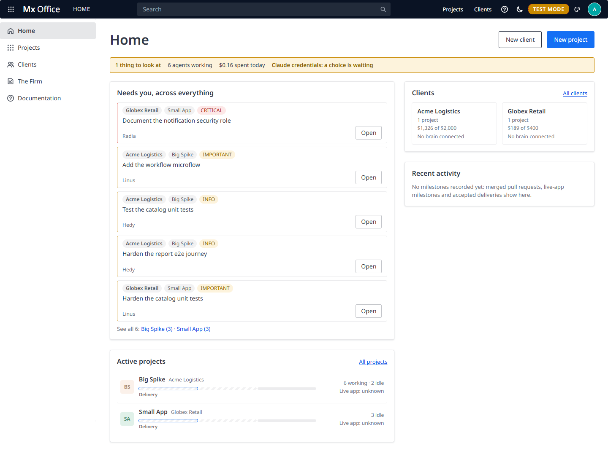
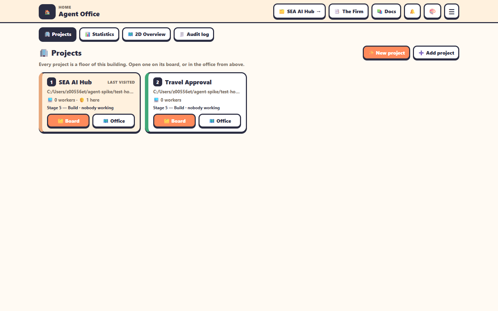
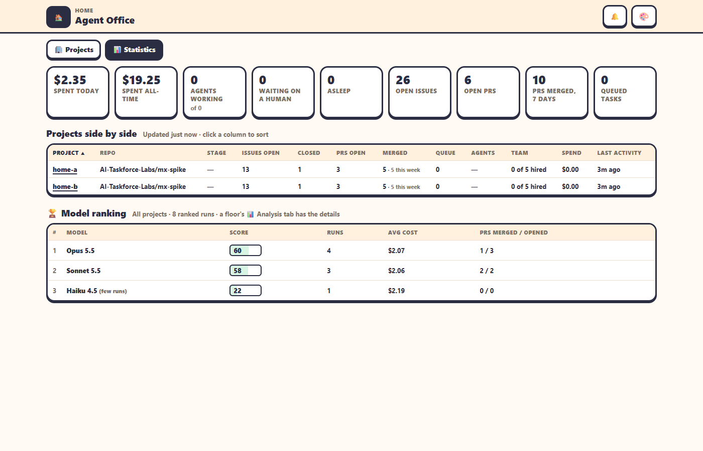
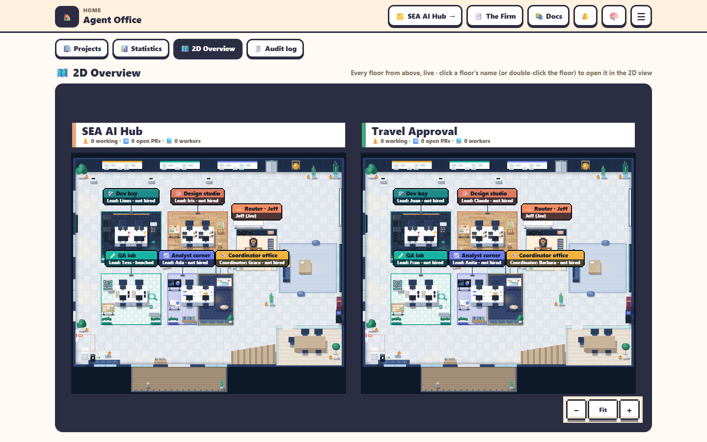

## Home (`/start`)

**Home** is where the office opens: the **Mx Office** wordmark at the top left, the **🏠** in the other looks, a bare `/` and the end of sign-in all go there, and it's the first item of every left navigation (above the project card on a project's pages, picked on Home itself). It answers *what needs me, and how is everything going?* across every client and project, as a summary with links to the page that has the whole of it:

- **Needs you, across everything**: the five most urgent red items of every project (blocking ones first), the same ones the desktop tray and Teams get, each tagged with its client and its project and with its **Open** at the bottom right. **See all** lists each project with items and how many, each to its Overview's Needs you card. A project whose items couldn't be read is named, never left out silently. Red items are a subset of a project's Needs you: approvals, incidents (sev1 too), idle agents, finished turns nobody looked at and info rows aren't red, so Home can show 0 for a project whose Overview has items waiting. The phone's push notifications follow nearly the same rule, but not exactly: they skip an agent asking in a turn the office started, and include a sign-off already given that waits for the lead to record it. [Needs you](needs-you.md) has the table of what each place counts.
- **Active projects**: the most recently active eight (the Projects page's *Recent activity* order), one row each: the client, the project's small [progress bar](progress-and-acceptance.md) and where it is (the same measured phases as the project's own bar: no made-up percentage), the team (*2 working · 1 asking · 3 idle*) and the live app (*ready*, *starting*, *failed*, *stopped*, or *unknown* when nobody opened it since the office started). A project with stuck work ([stuck detection](stuck-detection.md)) or a PR with failing checks is red and says how many. Click a row to open the project; **All projects** goes to the Projects page.
- **Clients**: a small card per client with its project count, what its projects spent against their budgets (a budget total only when every project has one; otherwise how many have none) and whether a company brain is connected. Click one for its page.
- **Recent activity**: the latest milestones the office recorded: pull requests merged (with GitHub's merge time), live-app milestones told ready and deliveries accepted. Nothing else is guessed at.
- **Quick actions** beside the title: **New project**, **New client** (admins) and **Open live app · *project*** for the most recently active project, only while its live app is ready.
- **The health strip** under the title: agents working, today's spend (against the office's daily budget when one is set), the agents' Claude credentials and a newer build ready to restart into. It's quiet when all is well and turns amber with what to look at.

An office with no projects shows **Create your first project** (**New project**, **Add project**) instead of empty sections; a new office's admin is still sent to 🚀 first-run setup first. Home reads three things when it opens (`GET /api/start`, the budget and the clients) and again only when a project's waiting count or team changes, at most every 15 seconds and never while the tab is hidden; the projects follow the office live over its connection.

## Projects (`/home`)

`/home` is the **Projects** page (its 🏠 goes to Home). It has six tabs. The last one you used is remembered, and a link can open one with `?tab=projects`, `?tab=stats`, `?tab=overview`, `?tab=audit`, `?tab=budget` or `?tab=agents` (add `&profile=prf_…` for one agent's page). Clients, once a tab, is a page of its own: `?tab=portfolios` opens [the Clients page](clients.md).

The top bar has **🏠**, a **back link** to the project you were last on (in the view you last used), **📑 The Firm** (opens [/firm](the-firm.md)), **📚 Docs**, **🎨** and **☰**.

**Loading.** Home, the 1D and 2D views and the phone version open on **Mx Office**'s loading screen, drawn by the page itself so it's there at once: *Loading Mx Office… 60 %*, moving on as the page's code loads, your sign-in is checked, the connection comes up, the office's data arrives and the first view is drawn, then it fades. In the page's color theme, without emoji in the Clean themes, and without animation when your system asks for reduced motion. If the office can't be reached (it's restarting, down, or the computer just woke from sleep), it says *Reconnecting to Mx Office…*, keeps trying, and carries on once the office answers; a connection lost for more than 2 seconds later brings it back the same way. Only the office itself says it is restarting (**Restarting… reconnecting**, see [Running the office](../administration/running-the-office.md#which-version-is-running)).

## 🏢 Projects

**In the Portal themes** (the default) this tab is a **Projects** page, like a low-code platform's portal:

- the page's title, **Projects**, with **Add project** and **New project** (the wizard) at its right, over Home's tabs (Projects, Statistics, 2D Overview, Audit log, Budget, Agents) drawn as underline tabs;
- a filter row: **Search by project name** (the name or the repository), a status select (*All statuses*, *Needs you*, *Running*, *Paused*, *Being added*), the sort (*Pinned*, *Recent activity*, *Name*) with a button that turns the order round, and **Pause all projects** / **Resume all** and **Connections** (admins). The status and the sort are remembered in this browser;
- a card per project: a tile with its letters in the project's colour, its name (opens its board), `repo · ⎇ branch`, the one-line summary, the small progress bar, and at the bottom its status (*Running*, *Needs you*, *Paused*, *Being added*) and what it has spent against its budget;
- at each card's top right: **👁 watch** (on by default; a project you stop watching no longer calls you over from another project's pages or counts in the tab title), **pin** (pinned projects come first under *Pinned*), and **⋯**: *Open project*, *View live app*, *Edit in Studio Pro* (asks to open it from the project's page, admins) and, for admins, *Pause project* or *Resume project*.

Pins and watches are kept per viewer, in this browser. The cards follow the office live; on a phone they're one a row.

In the other themes the tab is as below.

One card per project:

- its number, name and a *last visited* tag;
- `repo · ⎇ branch`, or a progress bar while it clones;
- **🙋 N waiting · 👷 N working · 💻 N workers · 🧑 N here**;
- the one-line project summary (for example *Stage 3 · 2 agents working · 🙋 1 needs you*);
- a small [progress bar](progress-and-acceptance.md): the project's phases as coloured segments, and where it is (*Stage 3 · Architecture & Design*) or which version was accepted (*v1 accepted · 2026-10-08*);
- **🗂️ Open project**: its 1D view, on the Command Center (the 2D Office view is the project's **Go to Office**).

By the name, an icon says whether the project is [paused or running](resume-and-pause.md). Hover it for more:

| Icon | State | Tooltip |
| --- | --- | --- |
| ⏸ | Paused | Who paused it and when, and why: *Paused by Keith at 14:05*, *… for a safe restart*, or *Paused at 14:05: budget reached*. |
| ▶ | Running | *Running: 2 agents working, 3 asleep* (and anyone waiting on you). |
| ⏳ (amber) | Pausing or resuming | How far the run is: *Pausing: 2 of 4 agents*. |

The Clean and Portal themes draw them as line icons. The 2D Overview's banners show the same state at their right, and inside a project the same state is the one control beside its budget chip (see [Command Center](command-center.md)).

Opening a project shows *Loading project mx-spike… 0 %* over this page at once; the project's page then shows **Mx Office**'s loading screen and the project's own loading overlay, with real progress.

Above the cards:

- **✨ New project** opens the wizard. See [Create your first project](../get-started/first-project.md).
- **Unfinished setups**: a new project whose setup didn't finish is a card above the projects (and at the top of the wizard's first page), with where it stopped, **Retry** (which first says what would stop it, such as a paused project, with **Resume project**), **Show setup**, **Open project** and, for admins, **Cancel & undo…**. New project always opens a fresh wizard. See [Unfinished setups](../get-started/first-project.md#unfinished-setups).
- **➕ Add project** adds an existing repository.
- **⏸ Pause all projects** or **▶ Resume all projects** (admins), one button that follows the projects: *Pause all* while any project is running, *Resume all* once every one is paused. With a mix there's a **▶ Resume N paused** link beside it that resumes only the paused ones. While a pause or resume is going, the button shows its progress (*⏸ Pausing… 3 of 7*) and can't be clicked. Everyone else sees the state in words (*⏸ 2 of 4 projects paused*). It and the icons keep up by themselves (every 15 seconds, every 2 while a run is going).

## 📊 Statistics

- **Tiles**: spent today, spent all-time, agents working, waiting on a human, asleep, open issues, open PRs, PRs merged in 7 days, queued tasks.
- **Projects side by side**: a sortable table with stage, issues open and closed, PRs open and merged, queue, agents, team, spend and last activity.
- **🏆 Model ranking**: the top 8 models across all projects by score, with runs, average cost and PRs merged and opened. See [Analysis](model-analysis.md).

## 🗺️ 2D Overview

Every project drawn in pixel art on one canvas, each under a banner with its name and numbers. It refreshes every 10 seconds.

- Hover a worker, or a benched Lead on a break, for details. A Lead's subagents are there as in the 2D view: on stools beside its desk while they work, about the office otherwise.
- Click a banner (or double-click a project) to open the project (its 1D view).
- Zoom with the wheel or pinch, drag to pan, **+ − 0** and the arrows work too.

## 🧾 Audit log

The office's [audit log](audit-log.md) across **Every project**, with a project column and a project picker (or **Office-wide** for sign-ins, settings and projects added and removed). Same filters, histogram, chain badge and, for admins, CSV / JSONL export as a project's tab.

## 💰 Budget

Every project's spend in one place. For each project you get:

- a status chip: *Within budget*, *Close to budget*, *Over budget* or *Paused*.
- what it has spent against its budget, as a meter.
- its forecast at completion and today's spend.
- a 14-day sparkline; hover it for the numbers.

Click a project's name to open its [Budget tab](budget.md). Under the table:

- **the office's own calls**, by source: Jeff, the analyzer, task naming, the project summary and the Firm.
- **the Firm's audits**, with what each spent against its budget.

The tiles across the top give today's spend for the whole office, the all-time total, the background-call overhead and the audits.

## 🗂️ Clients

Clients (the companies you build for, each with its projects pointed at the same company brain) have their own page, `/clients`, next to Projects in the launcher and as **🗂️ Clients** on Home's bar: a card per client in the Projects page's grid, **＋ New client**, and each client's page with **Rename**, its brain and its projects as Projects cards. Clients organise knowledge; they aren't access control. See [Clients](clients.md).

## 👥 Agents

Every agent profile in the office (each team member's office-wide name and history) with where it is now, its roles and its projects; and each agent's page, with its projects and dates, a track record that says *not measured yet*, your notes (admins; never given to an agent) and ✏️ Rename. A profile is a name and a history: each project starts a fresh session. See [Agents](agents.md).
