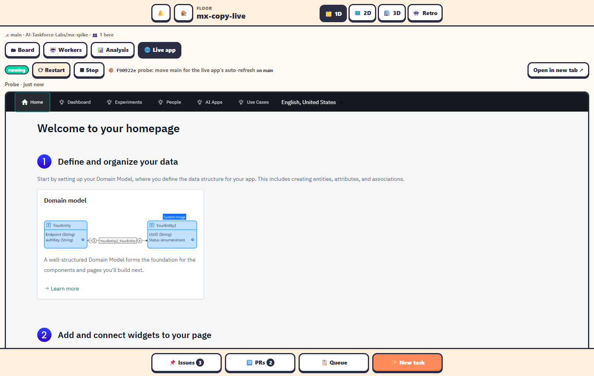
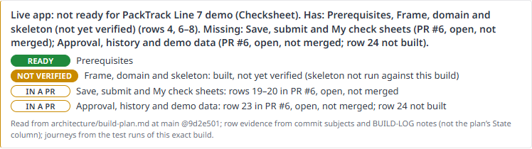

The **🌐 Live app** tab runs the project's Mendix app from its `main` branch, on this laptop. **Open live app** shows it in a window of its own, and the tab's **Console** shows the runtime's log and the requests the app makes, like Studio Pro's Console.

## Start, restart, stop

Only admins can start or stop it. Everyone else watches.

| Button | Does |
|---|---|
| **▶ Start** | Clones or updates the live checkout, builds and starts the app. |
| **⟳ Restart** | Stops and starts it again. |
| **■ Stop** | Stops it. |

The status pill says what is actually there: *not started* (nobody started it since the office started), *starting…*, *building…*, *running*, *updating to 1a2b3c4…*, *stopping…*, *stopped*, *build failed at 10:27*, or *stopped (crashed at 10:27)* when it was running and stopped by itself. Beside it is the commit it runs against main, *main @dd960bd from 16 Oct 23:36 · 2 commits behind main @f790bed* (or *· up to date*), and when the running build came up. The same words are on the tab's chip, the Overview's **Live app** row and **View App**.

A crashed app shows when it stopped, on which commit, mxcli's last lines and **⟳ Restart**; a toast says so, and Needs you has a row that Teams and phone push send once per crash.

Live apps don't start by themselves when the office starts. Open the tab and click **▶ Start**.

## Is it ready?

Under the buttons, a card says whether the app is ready, from evidence only:

> **Live app: not ready for Sample check-sheet demo (Checksheet).** Has: Prerequisites, Frame, domain and skeleton (not yet verified) (rows 4, 6–8). Missing: Save, submit and My check sheets (PR #6, open, not merged); Approval, history and demo data (PR #6, open, not merged; row 24 not built).

Then one line per milestone, tagged **Ready**, **Not verified**, **Restart**, **In a PR**, **Partly** or **Not built**.

- **Milestones** are the phases of the project's build plan (`architecture/build-plan.md`, the `### Phase N — …` headings over the numbered row tables), each with the **BUILD** rows it needs; the whole plan is the last milestone, named from the plan's title.
- **Which rows are built** comes from what the team wrote as it worked, never the plan's State column (agents don't update it): commit subjects naming the row (*Row 16: sheet form page applied*, *Rows 19-21: …*) on a commit that changed build files or says applied / proven / done / PASS, merged PR titles (*rows 4-14*), and `### <date> — Row N` notes in `docs/BUILD-LOG.md`. A *Draft row 16* or *Journal: row 3* commit only mentions it.
- For the commit the app runs, a milestone's rows are **in the running build**, **merged to main but not in it yet** (⟳ Restart picks them up), **in a PR** (only on an unmerged branch, with its PR from GitHub's list), or **not built**.
- **Ready** means every BUILD row is in the running build **and** every journey tied to the milestone passed against that very build: a `tests/e2e/*.journey.json` whose `requirement` names one of its rows (`build-plan row 10`), with a test-run record in **App Insights › Testing** whose tested revision is the running commit. Journeys that name no row belong to the whole plan; broken controls (`…-broken`) don't count. Built but not yet passed is *built, not yet verified*, never ready.
- Nothing is ready while the app isn't running.

When a milestone becomes ready in the running app you get a toast, an FYI row in Needs you for a day (not counted as waiting on you), and a Teams, phone push and desktop alert, once per milestone, even across restarts of the office. A milestone told ready that the running app no longer has is said too.

The card is read again when the app starts, stops or crashes, when a fetch lands in the project's folder, and when test evidence lands; never on a timer of its own.

## Main behind the work

When an agent's branch or an open PR has commits main hasn't and changes the model (`.mpr`, `mprcontents/`, `mdlsource/`), this tab and the [Model](model.md) tab show a banner: *main is 75 commits behind Sophie's branch, which has model changes (PR #6, open, not reviewed)*. The live app runs main, so it shows none of that until it merges. **View it in the Model tab** opens the Model tab, which can show the branch; **Ask Katherine to review** (admins) tells the team lead, after their turn, to have the PR reviewed per the [review gate](review-gate.md). The review state is the gate's: *reviewed by X* once a complete `Review:` by someone other than the opener is on the PR; *review not checked yet* while the office hasn't read the PR's comments, which the board reads for merged PRs only.

## Open live app

When the app runs, **↗ Open live app** opens it in a window of its own: a browser window (or tab), or in the [desktop app](../administration/desktop-app.md) a separate *Live app* window. There the app is the page itself, so every widget works. **Copy link** copies its address.

Why not in the tab itself: inside the office's page the app would be a frame on another origin (its own port), and Mendix's pluggable widgets, such as Data grid 2, read the top window, which the browser refuses across origins. Those pages fail to load (*An error occurred while loading page …*). **Preview here** still shows the app in a frame on the tab, with that warning; use it for a quick look, not to judge whether a page works.

The window opens through the office's **recording proxy** for the app, so the Console sees its requests. To the app, that address is simply where it lives: its login and cookies work as usual. The office's own sign-in is never passed to the app (see [How it works](#how-it-works)).

In the desktop app the Live app window's menu is its toolbar: **Back** (Alt+←), **Forward** (Alt+→), **Reload** (F5), **Hard reload** (Shift+F5), **Home**, **Copy address**, **Open in browser** and **Developer tools** (F12). It has its own browser session, so it shares no cookies with the office window. In a browser you use the browser's own Back, Forward and Reload.

## Console

Under the app's status, the **Console** has two tabs. It streams only while the Live app tab is in view.

**Runtime log**: the Mendix runtime's log (`.mxcli/runtime.log` in the live checkout), newest at the bottom.

- Each entry shows its time, level, who logged it (*Client*, *Core*, *ConnectionBus*, *M2EE*…) and the message. Errors from the app's web client, such as a page that failed to load in the browser, are logged by *Client* and marked.
- A stack trace or *Caused by* is folded under its entry: **▸** shows it, **▾** folds it. **⧉** copies the whole entry.
- **Error** / **Warning** / **Info** / **Debug** show or hide each level, with the error and warning counts (Debug is off at first). The search box also searches the stack traces.
- **⏸ Pause** holds new entries back while you read; **▶ Resume (n new)** shows them. **⤓ Auto-scroll** keeps the newest entry in view; scrolling up turns it off. **⌫ Clear** clears the view only, not the log.
- The tab's red badge counts the errors since the last Clear.

**Network**: the requests the app made through the recording proxy (the last 500), newest at the bottom.

- Each row shows the method, status, name, type, size and time. Mendix `xas/` calls are named by their action, such as *xas · retrieve_by_xpath Orders.Order* or *xas · executeaction Orders.ACT_Save*. Requests with no answer or a 4xx/5xx status are red and counted on the tab's badge.
- Click a row to open it: the address, status and timing, the request and response headers, and the first 8 KB of the bodies, with JSON laid out. Bodies are kept for the app's own calls and for errors; images and other binary content, and the app's static files, are only noted.
- **All** / **XHR** (the app's own calls: `xas/`, fetch, WebSockets) / **Errors**, a filter box, **⏸ Pause** and **⌫ Clear** (view only).
- Cookie values, `Authorization` and CSRF tokens are redacted, and password and token fields in bodies are masked. Requests are kept in the office's memory only, never written to disk, and are gone when the app stops.

## How it works

- The office keeps a **separate clone** of the repository at `<office data>/live/<project>`, always on main. It is cloned from the project's folder and fetches from it, never from GitHub itself: the project's folder fetches main with the office's own git setup, so a private repository works. Agents' worktrees are never touched.
- It runs `mxcli run --local` with three free ports from **8110–8199** (app, admin and serve) and a database named `<project>_live` in the local PostgreSQL.
- While the app runs, the office runs its **recording proxy** on a fourth port from the same range, on the office's own bind address (never the office's port). It passes every request and WebSocket on to the app's port on this machine and to nothing else, and records them for the Console. The browser sends the office's session cookie to every port of the same host (cookies ignore ports), so the proxy removes it from every request before passing it on, and drops any cookie the app tries to set under the office's name: the app can neither read nor replace your office sign-in. **Open live app** and the Overview's **View App** use the proxy's address; the app's own port still answers too, unrecorded.
- The Console reads the runtime log only while someone has it open, from where it stopped (a first read takes the last 256 KB).
- Once it's running, the office has the project's folder fetch `main` every 60 seconds (and follows any other fetch that lands there). When `main` moves (a merge), it **updates and restarts** the app by itself. When the fetch fails, the tab and Needs you say *Live app can't check for updates: (git's reason) (running main @dd960bd from 16 Oct 23:36)*.
- When `main` moved, or a first build failed, it clears the stale build folders under `deployment/` (keeping `deployment/data`) and retries once.
- The log is `<office data>/live/<project>.log`.

Settings such as the port range, the database and the mxcli path are environment variables `AGENT_OFFICE_LIVE_*`. See [Environment variables](../reference/environment-variables.md#live-app).

## When it fails

The tab shows *build failed at …* or *stopped (crashed at …)* with the reason and the log's last lines, the **🌐** item appears in Needs you, and the tab gets a `!` badge. See [Live app problems](../troubleshooting/live-app.md).
