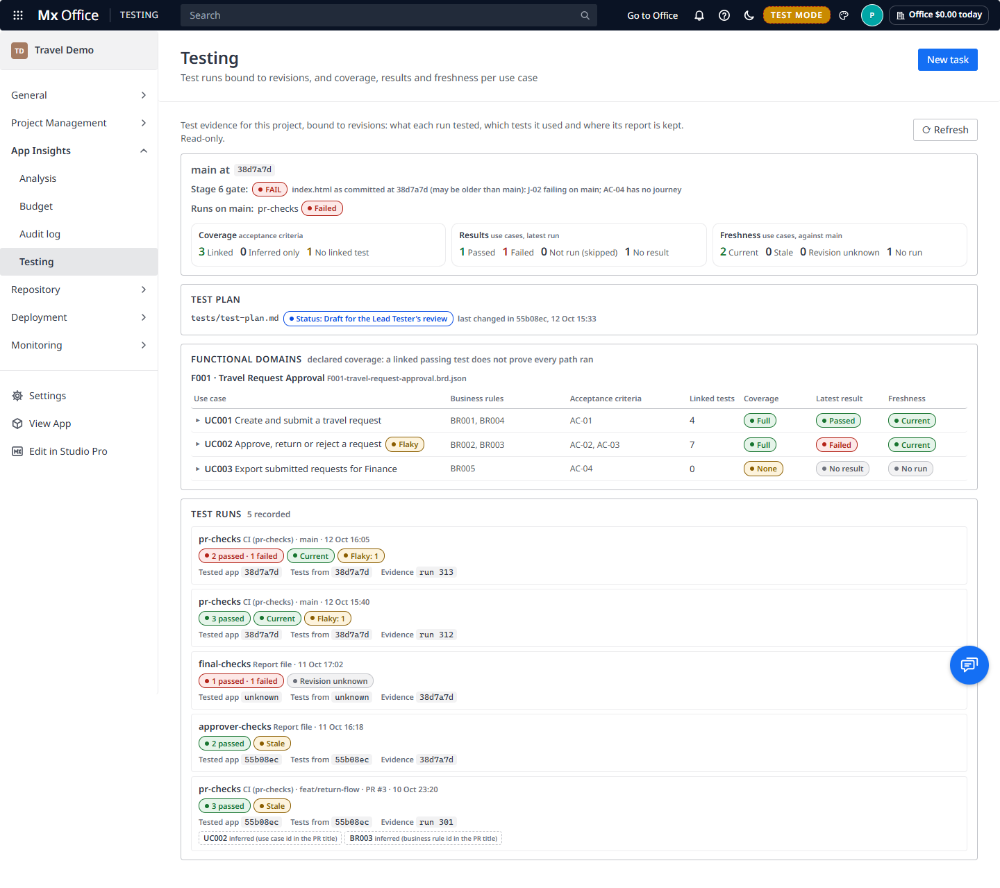

The **Testing** page (**App Insights › Testing** in the Portal navigation, `/lite?tab=testing`) shows the project's test evidence and what it really proves. It never changes the repository or GitHub. Admins can set the verification policy and give waivers (see [Verification policy and waivers](#verification-policy-and-waivers)), and start the office's own mxcli runs (see [Quality](#quality) and [Microflow tests](#microflow-tests)); everything else is read-only.

## Three revisions per run

Every test run the office records keeps three revisions apart:

| Revision | What it is |
|---|---|
| **Tested app** | The commit the app under test was built from. |
| **Tests from** | The commit the tests themselves were taken from. |
| **Evidence** | Where the report is kept: a repository commit, a CI run, or the office's own store. |

A report file committed at commit B proves nothing about B. Unless the file says what it tested, its tested revision is shown as **unknown**, and it counts as evidence for no commit.

Where the records come from (nothing new is asked of GitHub):

- **pr-checks runs.** The Board's check results on a pull request's head commit, and the pr-checks run the Board fetches when you hover a PR card. The run's head commit is both the tested and the tests-from revision. The evidence is the CI run.
- **Report files** on main: the JSON reports under `reports/testing/` and the toolkit's `docs/report.json`. The evidence revision is the commit that last added or changed the file. The tested revision comes only from the file itself (`appRevision`, `testedRevision`, or `project.gitCommit` in `docs/report.json`), the tests-from revision from `testRevision`. Otherwise both are unknown.
- **The office's own gate-check** of main, which the setup panel runs when main moves. The commit gate-check read is both revisions. The evidence is the office's store.
- **The office's own microflow test runs** (see [Microflow tests](#microflow-tests)): the work folder's commit is both revisions, the evidence the JUnit file in the office's store.

Reading the same run or report again never records it twice. The records are kept in `<data>/testing/<project>.jsonl`, append-only and hash-chained. Unlike the [audit log](audit-log.md) and the acceptance records, the office never checks this chain: nothing reads it back to verify it, so an edited or truncated file isn't flagged. Treat the chain as a way to check by hand, not as a guarantee the office enforces.

## The header

- **main at** the commit main is on. **Stale** shows when no run has tested that commit yet.
- **Stage 6 gate**: gate-check's verdict for Test, from the office's own run on main, or else the committed `index.html` (which may be older than main).
- **Runs on main**: each suite that ran on exactly main's commit, and its result (**Harness error** when the run couldn't reach a verdict).
- Three counts, kept apart: **Coverage** (per acceptance criterion), **Results** (per use case, latest run) and **Freshness** (per use case, against main).

## Coverage, result and freshness

These are three separate questions, and each column answers only its own:

- **Coverage**: is there a linked test definition? *Linked*, *Inferred only* or *No linked test* for a criterion; *Full*, *Partial*, *Inferred only* or *None* for a use case.
- **Latest result**: what did the newest linked run say? *Passed*, *Failed*, *Not run (skipped)* or *No result*. A criterion with no linked test always shows *No result*, never *Failed*.
- **Freshness**: did that run test the commit main is on? *Current*, *Stale* (an older commit), *Revision unknown*, or *No run*. Freshness follows the tested app revision, not the tests-from revision.

This is **declared** coverage: a linked passing test doesn't prove that every path in the use case ran, and a failing one doesn't say which step broke.

## Links: recorded or inferred

Every link says how the office knows it:

- **recorded**: a file says so. The acceptance-criteria table (`architecture/acceptance-criteria.md`, AC → journey), a test or journey file naming UC, BR or AC ids or pointing into a BRD (`F001#/useCases/0`), or a report's own `requirement`, `covers` or `journey` field.
- **inferred**: the office worked it out from an id in a test's name, a pull request's title or a report's file name. The rule that matched is shown with it, for example *business rule id in the PR title*.

## The panels

- **Test plan**: the toolkit's `tests/test-plan*.md` (or `docs/test-plan*.md`) on main, with its own *Status:* line and the commit that last changed it. Open it to read it, rendered like the Documents page does. Without a plan the panel says so.
- **Functional domains**: one row per use case in the BRDs (`analysis/knowledge-base/brd/*.brd.json`), grouped by feature, with its business rules, acceptance criteria, linked tests, coverage, latest result and freshness. Click a row to see its criteria (each with its own three states), the linked tests and the runs with all three revisions. Criteria that belong to no use case are listed after the features.
- **Test runs**: the newest runs first, each with its source, branch or PR, its counts, freshness and all three revisions. **Flaky** marks a test that passed and failed on the same tested revision.

The page loads when you first open it and again when you come back to it (at most every 20 seconds), when you switch projects, or on **⟳ Refresh**. A new run on an unchanged commit shows at once.

## Safety switches

Two office-wide switches in [⚙️ Settings › ✅ Verification](/lite?tab=settings&section=verification) decide whether the office does any of the background Testing work below. Both are **off by default**, so an office that updates stays quiet on the projects it already has. Only an admin changes them, and each change is recorded in the audit log as `settings.change` (`testing.judge`, `testing.autoScore`).

| Switch | Default | Off | On |
|---|---|---|---|
| **Judge merged tasks against checks** | Off | No `gh` calls for the default branch's checks, no *Merged, not verified* or *Passed on PR head…* judging, no Needs you items from it (nor the [test-first](#test-first) prompt). Merged tasks stay *integrated*. The Verification panel shows the policy and *Judging is off (Settings › Verification)*. | Everything in [Verification](#verification), but only for pull requests merged **after** the switch was turned on (the office keeps that moment), so older merges never raise an item. |
| **Score main automatically with mxcli** | Off | No automatic quality run, from the Testing page or from the Board's poll. The Quality card says *Automatic scoring is off*; an admin's **Score main now** still works. | A quality run for each new main commit, as in [Quality](#quality), but never while any agent on the project is working: it waits for the next look at a moment the project is idle (or the next commit). |

## Verification

The **Verification** panel, under the header, answers a different question from the rest of the page: did a merged task's required checks pass on the commit that actually landed on the default branch? A check that passed on the pull request's head proves nothing about the merge commit, so the two are kept apart.

- **Policy in force**: the checks this project requires, and whether that's the default or who set it.
- **Newest integrated revision**: the merge commit of the newest merged pull request, and each required check's state on it.
- **Merged tasks not verified**: the team's merged tasks that are *Merged, not verified* or *Passed on PR head, integrated revision not checked*, each with its pull request, merge commit, PR head and what's missing or failed.

A merged task is in one of three states:

| State | When |
|---|---|
| **Done (verified)** | Every required check passed, or was waived, on the merge commit. Only this counts as delivered. |
| **Merged, not verified** | A required check failed, is missing or was skipped on the merge commit. The office asks you once in [Needs you](command-center.md#needs-you), with what failed or is missing and the options. |
| **Passed on PR head, integrated revision not checked** | The pull request's head passed, and the merge commit has no results yet. Never counted as verified; no Needs you item. |

Everything in this section happens only while **Judge merged tasks against checks** is on (see [Safety switches](#safety-switches)), and only for pull requests merged after it was turned on.

Where merge-commit results come from: on each look at the pull requests (the Board's poll, never more often), the office also reads the default branch's newest pr-checks runs and the check runs on its newest commit, with two `gh` calls started off the main thread. A merged pull request's merge commit comes from the same pull-request list. Nothing is ever written to GitHub. A test office never starts its own `gh` for this.

If your pr-checks workflow only runs on pull requests, merge commits never get results, and merged tasks stay *Passed on PR head, integrated revision not checked*. Run the workflow on pushes to the default branch too, or waive.

> [!NOTE]
> **Known limitation: GitHub conclusions the office doesn't read as a result.** On the default branch, a pr-checks run whose conclusion is `cancelled`, `timed_out`, `action_required` or `startup_failure` isn't recorded at all, so that check is **missing** on the commit; a single check run with one of those conclusions (or none) is recorded as **skipped**. Either way it never counts as passed, but it also never shows as *failed*: the task reads *Merged, not verified* with the check missing or skipped. Open the run on GitHub to see what happened.

## Verification policy and waivers

The **verification policy** is the list of checks a merged task needs on its merge commit. Admins set it per project in [⚙️ Settings › ✅ Verification](/lite?tab=settings&section=verification), a short list of checkboxes:

- **pr-checks run**, its overall conclusion;
- the pr-checks scorecard rows: **Studio Pro mx check**, **Lint**, **Unit tests**, **E2E tests**;
- **E2E journeys for the task's linked acceptance criteria**: applies only when the task's pull request says `Covers: AC-…`. Each criterion needs a test result on the merge commit that names it or one of its journeys.

With nothing set, the default applies: **the pr-checks conclusion on the merge commit is required**, plus the linked-criteria rule for tasks that have linked criteria. A single task can have its own policy (`POST /api/testing/verification` with `action: "task-policy"`), which beats the project's. Every change is recorded in the audit log as `testing.policy`.

Each required check on a revision is **passed**, **failed**, **missing** (it never ran on that revision), **skipped**, or **waived**. Missing and skipped never count as passed.

A **waiver** accepts a check that didn't pass on one revision. It needs a named person and a reason, is recorded in the audit log as `testing.waive`, and is shown everywhere with who and why. Admins give one in the Verification panel: pick the check, write why, **Waive**. It counts for that check on that commit only.

When a task is *Merged, not verified*, its Needs you item offers:

- **Re-run checks**: re-run the pr-checks workflow on GitHub yourself (or ask the agent to). The office never re-runs anything; it picks up the new run on its next look.
- **Waive (with a reason)**: in the Verification panel, as above.
- **Send back for rework**: your answer goes to the agent as its next prompt.

The office raises it once per task and merge commit, and never nudges the agent about it.

## Quality

The **Quality** card, under the header, shows how the app scores on mxcli's own checks, per commit:

- The six scores of `mxcli report` (**Security**, **Quality**, **Architecture**, **Performance**, **Naming**, **Design**) and the **Overall** score, all from one commit and one mxcli version, which the card names together with the catalog schema and the Mendix version. A score the report didn't give shows as **–**, never as 0.
- A small trend beside each score: one bar per recorded commit, the last 10, newest on the right. Hover a bar for its commit and score.
- **Lint**: `mxcli lint`'s findings by severity (errors, warnings, info, hints) and the rules with the most findings.
- **Rules that could not run**: lint rules or catalog reads that failed, so their findings are missing rather than zero (from the JSON's `ruleFailures` where mxcli writes it, and from what lint says on stderr, such as *lint could not read the catalog for …*). When none failed the card says so.
- **Stale** when main has moved since the scored commit, **Current** when it hasn't.

How the scores are made:

- When **Score main automatically with mxcli** is on (it's off by default, see [Safety switches](#safety-switches)), the office works them out **once for each new main commit** (when the Testing page or the Board's poll sees main move), and again only for a different mxcli version: scoring the same commit with the same mxcli twice keeps one record. At most one quality run per project at a time. It never runs while any of the project's agents is working: it waits for a look at a moment they're all idle.
- An admin can also click **Score main now**.
- Each run happens in the **office's own work folder** (`<data>/testing/work/<project>/quality`), a fresh copy of that commit made from the project's git objects, wiped before and after. It never runs in the project's checkout or an agent's worktree, because mxcli's catalog refresh rewrites `.ai-context/skills/widgets/` and creates `.claude/skills/widgets/` in the folder it runs in.
- On a small sample app a run takes about 19 s: about 3 s for the copy, 14 s for `report` (it builds the catalog from scratch in the fresh folder), 1.2 s for `lint` and 0.6 s to read the catalog's schema.
- The records are kept in `<data>/testing/quality/<project>.jsonl` (append-only, hash-chained), and the raw report and lint JSON in `<data>/testing/evidence/<project>/`.

## Microflow tests

An admin can click **Run microflow tests on main** on the Quality card (its tooltip says it needs a local Mendix runtime). The office then:

1. makes a fresh copy of main's commit in its own work folder (`<data>/testing/work/<project>/tests`), never the project's checkout;
2. runs `mxcli test <the .test.mdl and .test.md files> -p <app>.mpr --local --require-assertions --junit <file>` there, with a 15-minute timeout and one run at a time per project;
3. keeps the JUnit file in `<data>/testing/evidence/<project>/` and records the run, then wipes the work folder.

The run record says:

- **Tested app** and **Tests from**: both the work folder's commit.
- **Evidence**: the JUnit file in the office's store.
- What ran it: the mxcli version, the runtime (`local`) and the Mendix version the model reports, plus when it started and finished.
- Each test by its file and `@test` name (`tests/core.test.mdl#Request number: …`), never mxcli's positional `test_1`, with its assertion count.

How results are read:

- JUnit `<failure>` is **Failed**. `<skipped>` is **Skipped**.
- JUnit `<error>` is a **harness error**: the test never reached a verdict (it threw outside its assertions, or asserted nothing, which `--require-assertions` makes an error). A harness error never counts as passed, never as a failed business rule, and never meets a required check.
- mxcli's exit code 1 means both "a test failed" and "the run broke", so the office never reads it on its own: the JUnit content decides. When mxcli writes no JUnit at all (no Mendix runtime, a timeout, a start failure), the whole run is shown as **Harness error, not failed tests**.
- A JUnit file found in the repository is never imported by itself: only the file from a run the office started counts as evidence.

`mxcli test --local` needs a Mendix runtime on the office's machine, so the run can fail to start; that's recorded as a harness error. In test mode only a fake mxcli runs.

## Test first

Two light prompts, nothing blocks:

- When the build plan (Stage 4) has passed and Stage 5 isn't confirmed yet, Needs you shows **N acceptance criteria have no linked test**. It's raised once and its count is kept up to date. Only while **Judge merged tasks against checks** is on (see [Safety switches](#safety-switches)).
- The Playbooks ask the Tester Lead to write or extend a task's test first and name the criteria it covers, and developers to run the task's tests before opening a pull request and to put `Covers: AC-xx, BRyyy` in its description. The office reads that line as a **recorded** link.
- New microflow tests are run with `mxcli test --require-assertions`, and whoever writes the model checks what uses an entity or microflow first (`mxcli refs`, `impact` or `context`, which only read the catalog) and keeps the widget docs that `lint`, `report` and `refresh catalog` rewrite out of commits.

## Acceptance

When the Project Manager accepts a delivery, the office tries to add the Testing summary at the accepted commit to the acceptance record: the coverage, result and freshness counts, and the verification policy's evaluation there. It's optional: when the summary can't be read, the record is written without it. The acceptance dialog and the record's view don't show it; it's kept in the record (`<data>/acceptance/<project>.jsonl`) for reading later. Records from before this change are left as they were.

Acceptance doesn't require passing tests. Its evidence list shows gate-check verdicts, CI on pull requests and the test documents on main, not this page's run records, and failing gates and CI become suggested exceptions in the acceptance dialog. See [Progress and acceptance](progress-and-acceptance.md#acceptance).

See also [State and sources of truth](../architecture/state-and-truth.md): test evidence, task outcomes and acceptance as separate sources, and what each guarantees.

## Not in this release

Per-task usage, task and attempt ids, and changes to the Board come in later releases. `mxcli playwright verify` isn't imported: the projects' own end-to-end JSON reports stay the source for UI tests.
